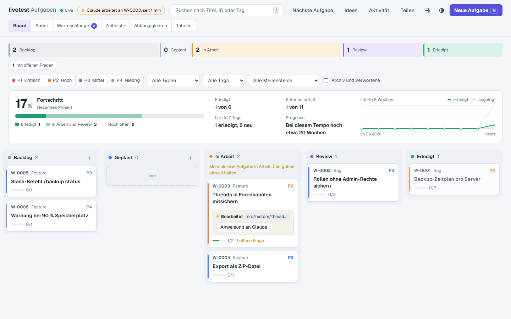
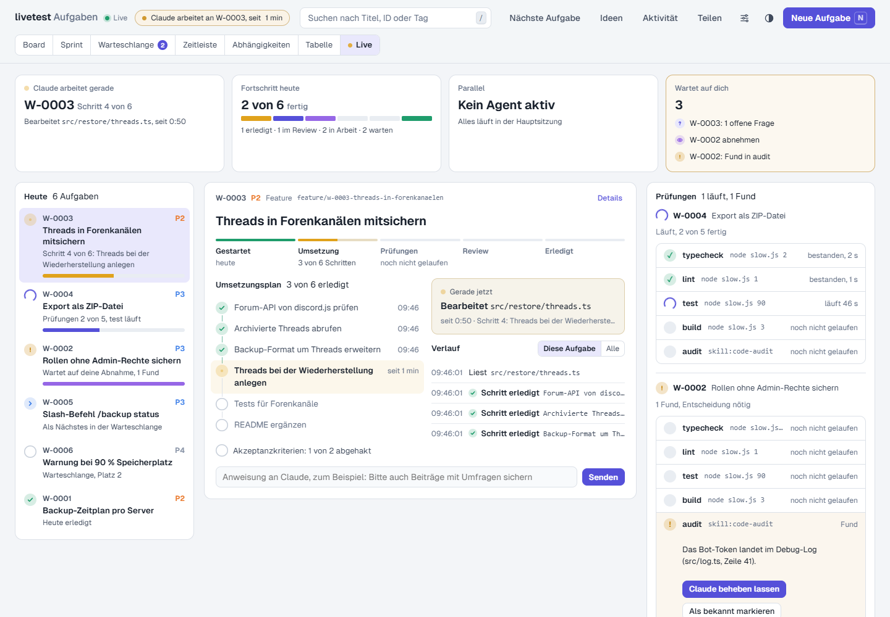

# Live-Ansicht im works-Board

## Ziel
<!-- Was ist nach Abschluss anders? Ein bis drei Sätze, aus Sicht des Ergebnisses formuliert. -->

## Beschreibung
Im works-Board soll man live verfolgen können, wie weit Claude mit den Aufgaben ist: an welcher Aufgabe und welchem Schritt Claude arbeitet, was gerade läuft, was parallele Agenten tun und wie die Prüfungen (typecheck, lint, test, build, code-audit) stehen. Gewählt ist Variante A: ein eigener siebter Reiter Live (Taste 7) mit Kacheln oben (Claude arbeitet gerade, Fortschritt heute, Parallel, Wartet auf dich), Tagesliste links, Fokus-Aufgabe mit Phasenleiste, Umsetzungsplan, Gerade jetzt und Verlauf in der Mitte, Prüfungen aller Aufgaben rechts. Entscheidungen des Nutzers: neuer PreToolUse-Hook für eine genaue Anzeige 'Gerade jetzt' (ca. 0,2 s pro Werkzeugaufruf akzeptiert); Agenten in Worktrees lassen Prüfungen über works checks run laufen, die dann im Worktree laufen. Design: docs/superpowers/specs/2026-11-20-live-tracking-design.md. Plan: docs/superpowers/plans/2026-11-20-live-tracking.md. Ausführung: native, alles in der Sitzung selbst, am Ende ein frischer Reviewer über den Branch.

## Kontext und Problem
<!-- Warum ist das nötig? Aktueller Zustand, Auslöser, Einschränkungen. -->

## Nutzerperspektive
<!-- Wer profitiert und wie? Optional: Als <Rolle> möchte ich <Fähigkeit>, damit <Nutzen>. -->

## Akzeptanzkriterien
- [x] Board hat den Reiter Live (Taste 7) mit Kacheln, Tagesliste, Fokus-Aufgabe und Prüfungsspalte wie im gewählten Entwurf A
- [x] Gerade jetzt zeigt einen laufenden Werkzeugaufruf ab dem Start (PreToolUse-Hook), nach dem Ende Claude denkt nach und Zuletzt
- [x] Abgehakte Schritte des Umsetzungsplans zeigen ihre Uhrzeit
- [x] Laufende Prüfungen zeigen ihre Laufzeit, fertige ihr Ergebnis mit Uhrzeit, Funde lassen sich aus der Ansicht beheben lassen oder als bekannt markieren
- [x] Prüfungen paralleler Aufgaben laufen im Worktree und erscheinen live in der Ansicht
- [x] Kein seitliches Scrollen bei 375 px, Status nie nur über Farbe, reduzierte Bewegung wird beachtet
- [x] works selftest ist grün, inklusive der neuen Live-Schritte

## Umsetzungsplan
- [x] Task 1: PreToolUse-Hook und genaue Jetzt-Anzeige
- [x] Task 2: Uhrzeit abgehakter Schritte (steps.json)
- [x] Task 3: Prüfungen mit Zwischenstand, für Agenten im Worktree
- [x] Task 4: Live-Daten in boardData
- [x] Task 5: Ansicht Live im Board
- [x] Task 6: Dokumentation

## Betroffene Dateien
<!-- Pfade mit kurzer Notiz, was dort passiert. -->

## Designentscheidungen
Details und verworfene Alternativen: [decisions.md](decisions.md)

## Assets

Beschreibung: Board vor der Änderung (Testprojekt, 1440 px): nur Pille 'Claude arbeitet an W-0003' im Kopf und ein kleiner Kasten 'Bearbeitet src/restore/thread…' auf der Karte in Arbeit, keine Prüfungen, keine Schritte, kein Reiter Live.
Art: vorher · Hinzugefügt: 2026-11-21

Beschreibung: Ansicht Live nach der Änderung (Testprojekt, 1440 px, hell): Kacheln (Claude arbeitet gerade W-0003 Schritt 4 von 6, Fortschritt 2 von 6, Kein Agent aktiv, Wartet auf dich 3), Tagesliste mit 6 Aufgaben, Fokus W-0003 mit Phasenleiste, Umsetzungsplan mit Uhrzeiten, Gerade jetzt 'Bearbeitet src/restore/threads.ts seit 0:50', Verlauf, Anweisungsfeld; rechts Prüfungen: W-0004 läuft (typecheck und lint bestanden, test läuft 46 s), W-0002 mit Fund in audit und den Knöpfen Claude beheben lassen / Als bekannt markieren.
Art: nachher · Hinzugefügt: 2026-11-21

## Offene Fragen
- [x] Plan freigeben und auf eigenem Branch loslegen? (Frage vom 2026-11-20 noch offen) Antwort: Freigegeben am 2026-11-21: umsetzen wie besprochen, eigener Branch, ein Commit pro Task, nichts pushen.

## Übergabe
Stand: 2026-11-21 09:49

Stand 2026-11-21: Umgesetzt auf feature/w-0001-live-ansicht-im-works-board (43a05f2..HEAD), alle 7 Kriterien erfüllt, selftest --browser 18/18 (Playwright mit installiertem Chrome). Abschluss-Review (frischer Reviewer) eingearbeitet: Senden-Knopf, Frische-Grenzen ohne neue Daten, Fehlerausgabe bleibt offen, Export ohne Live-Daten, Browserprüfung. code-audit: nur eine Nebensache (Leselink zeigt 40 statt 12 Befehle). Vorher/Nachher-Screenshots angehängt. Offen: Abnahme durch den Nutzer, dann works done; Merge in main nur auf Wunsch, nichts gepusht. Kleinere Punkte aus dem Review sind im Abschlussbericht der Sitzung aufgeführt.

## Verlauf
- 2026-11-20: Aufgabe angelegt
- 2026-11-20: decisions.md angelegt
- 2026-11-20: Akzeptanzkriterien: "Gerade jetzt zeigt einen laufenden Werkzeugaufruf ab dem Start (PreToolUse-Hook), nach dem Ende Claude denkt nach und Zuletzt" ergänzt
- 2026-11-20: Akzeptanzkriterien: "Abgehakte Schritte des Umsetzungsplans zeigen ihre Uhrzeit" ergänzt
- 2026-11-20: Akzeptanzkriterien: "Laufende Prüfungen zeigen ihre Laufzeit, fertige ihr Ergebnis mit Uhrzeit, Funde lassen sich aus der Ansicht beheben lassen oder als bekannt markieren" ergänzt
- 2026-11-20: Akzeptanzkriterien: "Prüfungen paralleler Aufgaben laufen im Worktree und erscheinen live in der Ansicht" ergänzt
- 2026-11-20: Akzeptanzkriterien: "Kein seitliches Scrollen bei 375 px, Status nie nur über Farbe, reduzierte Bewegung wird beachtet" ergänzt
- 2026-11-20: Akzeptanzkriterien: "works selftest ist grün, inklusive der neuen Live-Schritte" ergänzt
- 2026-11-20: Umsetzungsplan: "Task 1: PreToolUse-Hook und genaue Jetzt-Anzeige" ergänzt
- 2026-11-20: Umsetzungsplan: "Task 2: Uhrzeit abgehakter Schritte (steps.json)" ergänzt
- 2026-11-20: Umsetzungsplan: "Task 3: Prüfungen mit Zwischenstand, für Agenten im Worktree" ergänzt
- 2026-11-20: Umsetzungsplan: "Task 4: Live-Daten in boardData" ergänzt
- 2026-11-20: Umsetzungsplan: "Task 5: Ansicht Live im Board" ergänzt
- 2026-11-20: Umsetzungsplan: "Task 6: Dokumentation" ergänzt
- 2026-11-20: Brainstorming angehängt
- 2026-11-20: Designrichtung angehängt (ui-ux-pro-max)
- 2026-11-20: Entwurf A „Live-Ansicht“ angehängt
- 2026-11-20: Entwurf A „Live-Ansicht“ gewählt. Grund: Zeigt am meisten auf einmal und passt ins vorhandene Ansichtssystem; Pille im Kopf führt direkt hin
- 2026-11-20: Dokument verlinkt: Umsetzungsplan
- 2026-11-20: Übergabe aktualisiert
- 2026-11-21: Gestartet (Status: geplant → in-arbeit)
- 2026-11-21: Frage 1 geklärt: Freigegeben am 2026-11-21: umsetzen wie besprochen, eigener Branch, ein Commit pro Task, nichts pushen.
- 2026-11-21: Umsetzungsplan: "Task 1: PreToolUse-Hook und genaue Jetzt-Anzeige" abgehakt
- 2026-11-21: Umsetzungsplan: "Task 2: Uhrzeit abgehakter Schritte (steps.json)" abgehakt
- 2026-11-21: Umsetzungsplan: "Task 3: Prüfungen mit Zwischenstand, für Agenten im Worktree" abgehakt
- 2026-11-21: Umsetzungsplan: "Task 4: Live-Daten in boardData" abgehakt
- 2026-11-21: Umsetzungsplan: "Task 5: Ansicht Live im Board" abgehakt
- 2026-11-21: Umsetzungsplan: "Task 6: Dokumentation" abgehakt
- 2026-11-21: Übergabe aktualisiert
- 2026-11-21: Alle sechs Tasks umgesetzt, Selbsttest 18/18, Abschluss-Review läuft
- 2026-11-21: Asset hinzugefügt: assets/2026-11-21-board-vor-der-aenderung-testprojekt-vorher.png (vorher)
- 2026-11-21: Asset hinzugefügt: assets/2026-11-21-ansicht-live-nach-der-aenderung-nachher.png (nachher)
- 2026-11-21: Akzeptanzkriterien: "Board hat den Reiter Live (Taste 7) mit Kacheln, Tagesliste, Fokus-Aufgabe und Prüfungsspalte wie im gewählten Entwurf A" abgehakt
- 2026-11-21: Akzeptanzkriterien: "Gerade jetzt zeigt einen laufenden Werkzeugaufruf ab dem Start (PreToolUse-Hook), nach dem Ende Claude denkt nach und Zuletzt" abgehakt
- 2026-11-21: Akzeptanzkriterien: "Abgehakte Schritte des Umsetzungsplans zeigen ihre Uhrzeit" abgehakt
- 2026-11-21: Akzeptanzkriterien: "Laufende Prüfungen zeigen ihre Laufzeit, fertige ihr Ergebnis mit Uhrzeit, Funde lassen sich aus der Ansicht beheben lassen oder als bekannt markieren" abgehakt
- 2026-11-21: Akzeptanzkriterien: "Prüfungen paralleler Aufgaben laufen im Worktree und erscheinen live in der Ansicht" abgehakt
- 2026-11-21: Akzeptanzkriterien: "Kein seitliches Scrollen bei 375 px, Status nie nur über Farbe, reduzierte Bewegung wird beachtet" abgehakt
- 2026-11-21: Akzeptanzkriterien: "works selftest ist grün, inklusive der neuen Live-Schritte" abgehakt
- 2026-11-21: Abschluss-Review umgesetzt (Senden-Knopf, Frische-Grenzen ohne neue Daten, Fehlerausgabe bleibt offen, Export ohne Live-Daten, Browserprüfung mit Chrome); selftest --browser 18/18; Kriterien im Browser am Testprojekt geprüft
- 2026-11-21: Status: in-arbeit → review (Grund: Umsetzung fertig, Abschluss-Review eingearbeitet, wartet auf Abnahme)
- 2026-11-21: Übergabe aktualisiert
