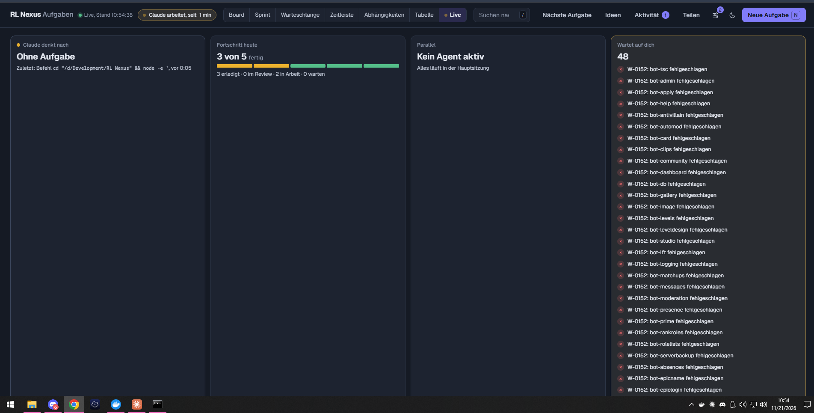
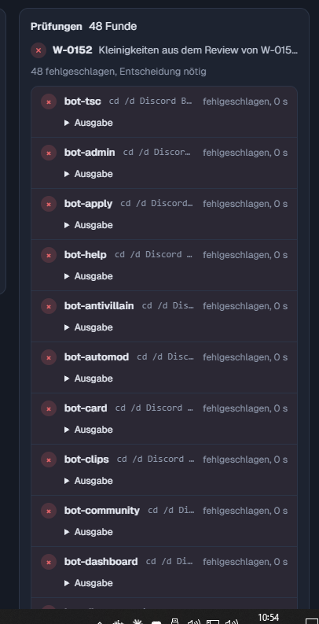
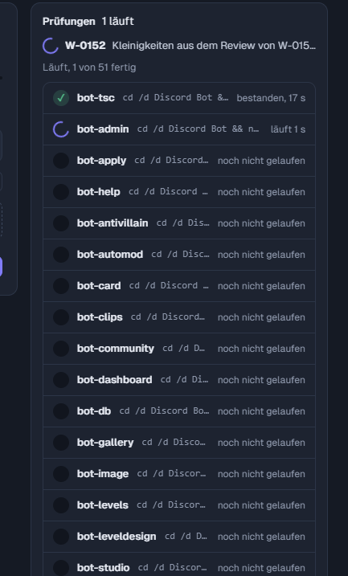

# Live-Ansicht: viele Prüfungen und Funde übersichtlich zeigen

## Ziel
<!-- Welches Gestaltungsproblem wird gelöst? -->

## Beschreibung
Wunsch des Nutzers vom 2026-11-21: Bei vielen Befunden soll die Live-Ansicht besser aussehen. Anlass: RL Nexus hat 51 eingerichtete Prüfungen, ein Lauf ergab 45 Fehlschläge (alle mit derselben Meldung 'The system cannot find the path specified.'). Folgen in der Ansicht: Die Kachel 'Wartet auf dich' listet jeden Fehlschlag einzeln (48 Zeilen) und zieht alle vier Kacheln auf Bildschirmhöhe; die Prüfungsspalte zeigt 51 Zeilen mit je einem Aufklapper 'Ausgabe'; während eines Laufs stehen Dutzende Zeilen 'noch nicht gelaufen'. Gewünscht: eine kompakte, gut lesbare Darstellung, die auch bei vielen Prüfungen und Funden zeigt, was los ist und was zu tun ist.

## Zielgruppe und Kontext
<!-- Wer nutzt die Oberfläche, auf welchen Geräten, in welcher Situation? -->

## Referenzen
<!-- Bestehende Seiten, Vorbilder, Markenvorgaben. Bilder über `works asset --kind referenz`. -->

## Varianten
<!-- Untersuchte Richtungen. Ausführliche Begründungen in decisions.md. -->

## Gewählte Lösung
<!-- Kurzbeschreibung des Ergebnisses. -->

## Akzeptanzkriterien
- [ ] Darstellung ist auf Mobil, Tablet und Desktop korrekt
- [ ] Kontraste erfüllen WCAG AA
- [ ] Bedienung per Tastatur ist möglich
- [ ] Wartet auf dich zeigt Funde je Aufgabe zusammengefasst statt einer Zeile pro Prüfung
- [ ] Die Kacheln oben bleiben auch bei vielen Funden niedrig
- [ ] Die Prüfungsspalte bleibt bei 50 Prüfungen übersichtlich und zeigt zuerst, was fehlgeschlagen ist
- [ ] Bei wenigen Prüfungen (bis etwa 8) bleibt die bisherige Liste

## Umsetzungsplan
- [ ] 

## Betroffene Dateien

## Designentscheidungen
Details und verworfene Alternativen: [decisions.md](decisions.md)

## Assets

Beschreibung: Live-Ansicht in RL Nexus vorher (1903 px): Kachel 'Wartet auf dich' mit 48 Einträgen 'W-0152: bot-… fehlgeschlagen', alle vier Kacheln dadurch so hoch wie der Bildschirm.
Art: vorher · Hinzugefügt: 2026-11-21

Beschreibung: Prüfungsspalte vorher: 'Prüfungen 48 Funde', W-0152 mit 48 fehlgeschlagenen Prüfungen, je Zeile Name, abgeschnittener Befehl 'cd /d Discord B…', 'fehlgeschlagen, 0 s' und ein Aufklapper 'Ausgabe'.
Art: vorher · Hinzugefügt: 2026-11-21

Beschreibung: Prüfungsspalte während eines Laufs: 'Läuft, 1 von 51 fertig', bot-tsc bestanden, bot-admin läuft, darunter viele Zeilen 'noch nicht gelaufen'.
Art: vorher · Hinzugefügt: 2026-11-21

## Offene Fragen

## Übergabe

## Verlauf
- 2026-11-21: Aufgabe angelegt
- 2026-11-21: decisions.md angelegt
- 2026-11-21: Akzeptanzkriterien: "Die Kacheln oben bleiben auch bei vielen Funden niedrig" ergänzt
- 2026-11-21: Akzeptanzkriterien: "Die Prüfungsspalte bleibt bei 50 Prüfungen übersichtlich und zeigt zuerst, was fehlgeschlagen ist" ergänzt
- 2026-11-21: Akzeptanzkriterien: "Bei wenigen Prüfungen (bis etwa 8) bleibt die bisherige Liste" ergänzt
- 2026-11-21: Asset hinzugefügt: assets/2026-11-21-live-ansicht-in-rl-nexus-vorher-1903-px-vorher.png (vorher)
- 2026-11-21: Asset hinzugefügt: assets/2026-11-21-pruefungsspalte-vorher-pruefungen-48-vorher.png (vorher)
- 2026-11-21: Asset hinzugefügt: assets/2026-11-21-pruefungsspalte-waehrend-eines-laufs-vorher.png (vorher)
- 2026-11-21: Gestartet (Status: backlog → in-arbeit) [Board]
- 2026-11-21: Brainstorming angehängt
- 2026-11-21: Designrichtung angehängt (ui-ux-pro-max)
- 2026-11-21: Entwurf A „Fehlergruppen“ angehängt
- 2026-11-21: Entwurf B „Prüfmatrix“ angehängt
- 2026-11-21: Dokument übernommen: Klickbarer Entwurf (beide Varianten, Zustand nach und während des Laufs)
