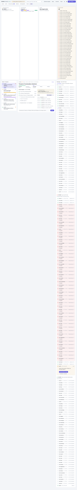
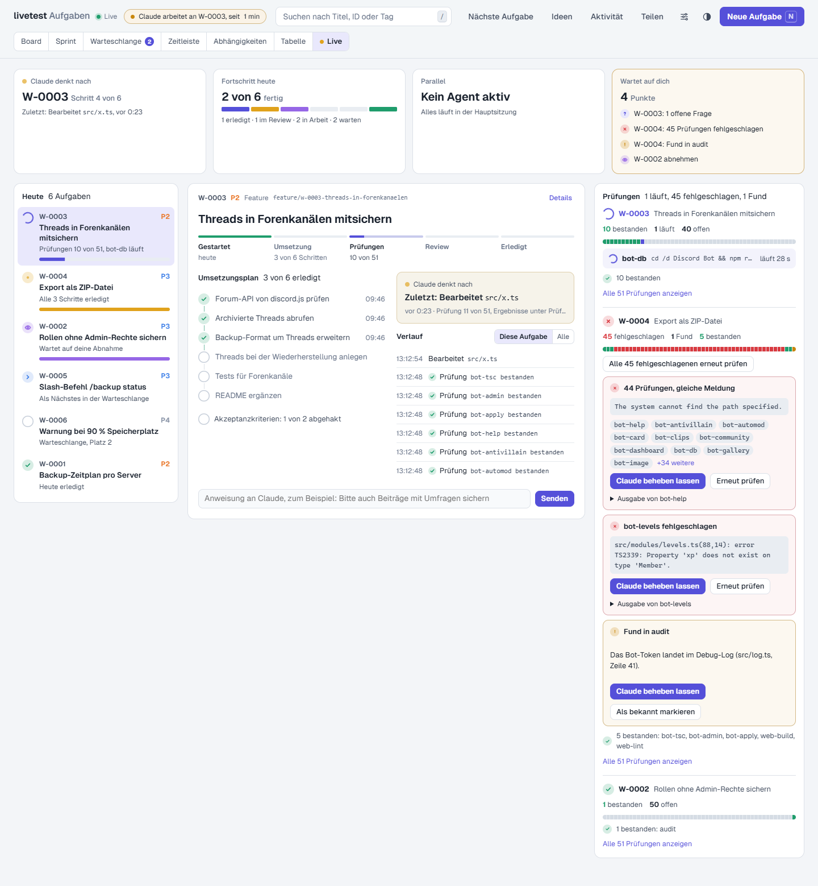

# Fehlgeschlagene Prüfungen aus der Live-Ansicht erneut prüfen

## Ziel
<!-- Was ist nach Abschluss anders? Ein bis drei Sätze, aus Sicht des Ergebnisses formuliert. -->

## Beschreibung
Vorschlag 2 vom 2026-11-21. In der Live-Ansicht an einer Fehlergruppe (und für alle Fehlschläge einer Aufgabe) ein Knopf, der nur diese Prüfungen neu startet (works checks run --only ...), damit nach einem Fix nicht alle 51 Prüfungen laufen müssen. Nur lokal erlaubt wie das bisherige Jetzt prüfen.

## Kontext und Problem
<!-- Warum ist das nötig? Aktueller Zustand, Auslöser, Einschränkungen. -->

## Nutzerperspektive
<!-- Wer profitiert und wie? Optional: Als <Rolle> möchte ich <Fähigkeit>, damit <Nutzen>. -->

## Akzeptanzkriterien
- [x] Ein Klick startet nur die fehlgeschlagenen Prüfungen der Gruppe neu, der Lauf ist live sichtbar
- [x] Knopf an jeder Fehlergruppe, an jeder roten Zeile und ab zwei Fehlschlägen einer für alle
- [x] Bestandene Ergebnisse bleiben stehen
- [x] Während eines Laufs gibt es keinen Knopf, ein zweiter Lauf lässt sich nicht doppelt starten
- [x] Nur im lokalen Board, nicht im Leselink
- [x] Die API lehnt ungültige Namen ab

## Umsetzungsplan
<!-- Konkrete Schritte in sinnvoller Reihenfolge. Unteraufgaben gehören hierher, nicht in eigene Ordner. -->
- [x] Test: checksRun mit only startet nur die genannten Prüfungen, ungültige Namen gibt es 400
- [x] API checksRun mit only
- [x] Board: Knöpfe an Fehlergruppe, roter Zeile und für alle
- [x] Browserprüfung im Selbsttest
- [x] Doku board.md

## Betroffene Dateien
<!-- Pfade mit kurzer Notiz, was dort passiert. -->

## Designentscheidungen
<!-- Kurzfassung der wichtigsten Entscheidungen. Details in decisions.md (works decisions <ID>). -->

## Assets

Beschreibung: Vorher: Live-Ansicht mit 51 Prüfungen, 45 fehlgeschlagen. Fehlergruppen haben nur Claude beheben lassen, kein Weg, nur die roten Prüfungen neu zu starten
Art: vorher · Hinzugefügt: 2026-11-21

Beschreibung: Nachher: Alle 45 fehlgeschlagenen erneut prüfen unter dem Streifen, Erneut prüfen an jeder Fehlergruppe. W-0003 läuft gerade und hat deshalb keine Knöpfe
Art: nachher · Hinzugefügt: 2026-11-21

## Offene Fragen
<!-- Fragen an den Nutzer, die Claude nicht selbst klären kann. Format: - [ ] Frage -->

## Übergabe
Abgeschlossen am 2026-11-21. Keine offene Übergabe.

## Verlauf
- 2026-11-21: Aufgabe angelegt
- 2026-11-21: Brainstorming angehängt
- 2026-11-21: Entwurf A „Live-Ansicht Ergänzungen W-0006 bis W-0009“ angehängt
- 2026-11-21: Entwurf A „Live-Ansicht Ergänzungen W-0006 bis W-0009“ gewählt. Grund: Nutzer: Beide A (Freigabe A Kacheln, Verbrauch A in Kachel und Kopf), Rest wie im Entwurf
- 2026-11-21: Gestartet (Status: backlog → in-arbeit)
- 2026-11-21: Asset hinzugefügt: assets/2026-11-21-vorher-live-ansicht-mit-51-pruefungen-vorher.png (vorher)
- 2026-11-21: Asset hinzugefügt: assets/2026-11-21-nachher-alle-45-fehlgeschlagenen-erneut-nachher.png (nachher)
- 2026-11-21: Umsetzungsplan: "Test: checksRun mit only startet nur die genannten Prüfungen, ungültige Namen gibt es 400" abgehakt
- 2026-11-21: Umsetzungsplan: "API checksRun mit only" abgehakt
- 2026-11-21: Umsetzungsplan: "Board: Knöpfe an Fehlergruppe, roter Zeile und für alle" abgehakt
- 2026-11-21: Umsetzungsplan: "Browserprüfung im Selbsttest" abgehakt
- 2026-11-21: Umsetzungsplan: "Doku board.md" abgehakt
- 2026-11-21: Akzeptanzkriterien: "Ein Klick startet nur die fehlgeschlagenen Prüfungen der Gruppe neu, der Lauf ist live sichtbar" abgehakt
- 2026-11-21: Akzeptanzkriterien: "Knopf an jeder Fehlergruppe, an jeder roten Zeile und ab zwei Fehlschlägen einer für alle" abgehakt
- 2026-11-21: Akzeptanzkriterien: "Bestandene Ergebnisse bleiben stehen" abgehakt
- 2026-11-21: Akzeptanzkriterien: "Während eines Laufs gibt es keinen Knopf, ein zweiter Lauf lässt sich nicht doppelt starten" abgehakt
- 2026-11-21: Akzeptanzkriterien: "Nur im lokalen Board, nicht im Leselink" abgehakt
- 2026-11-21: Akzeptanzkriterien: "Die API lehnt ungültige Namen ab" abgehakt
- 2026-11-21: API checksRun mit only, Knöpfe an Fehlergruppe, roter Zeile und für alle; Selbsttest mit Klick im Browser 22/22.
- 2026-11-21: Abgeschlossen (Status: in-arbeit → erledigt), DoD bestätigt
- 2026-11-21: Nach Review korrigiert, siehe decisions.md (Branch fix/review-w0006-w0009).
