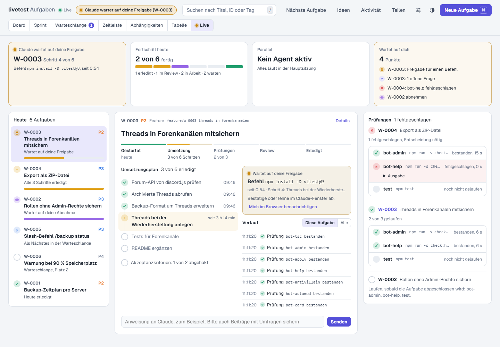
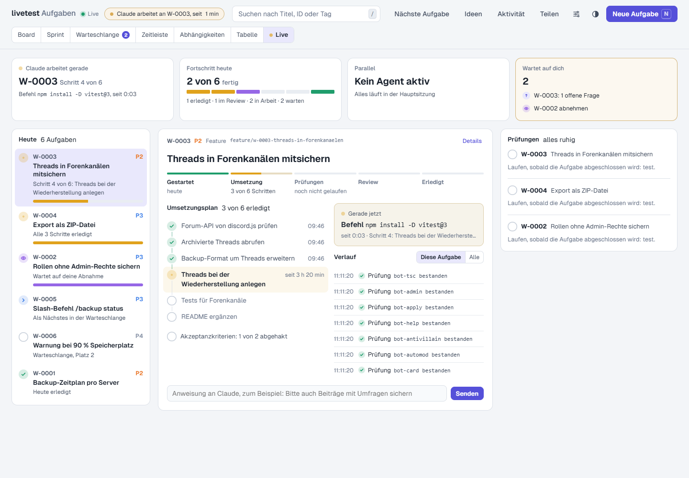

# Live-Ansicht zeigt, wenn Claude auf eine Freigabe wartet

## Ziel
<!-- Was ist nach Abschluss anders? Ein bis drei Sätze, aus Sicht des Ergebnisses formuliert. -->

## Beschreibung
Vorschlag 3 vom 2026-11-21. Fragt Claude nach einer Erlaubnis für ein Werkzeug, zeigt die Live-Ansicht heute 'Gerade jetzt: Befehl ...' mit laufender Zeit, und 'Wartet auf dich' bleibt leer. Gewünscht: ein Hook (Notification bzw. Rechteabfrage) meldet den Zustand, die Live-Ansicht zeigt 'Claude wartet auf deine Freigabe' mit Werkzeug und Wartezeit, 'Wartet auf dich' führt den Punkt, optional Browser-Benachrichtigung. Der Zustand endet, sobald der Aufruf weiterläuft, abgelehnt wird oder die Antwort endet.

## Kontext und Problem
<!-- Warum ist das nötig? Aktueller Zustand, Auslöser, Einschränkungen. -->

## Nutzerperspektive
<!-- Wer profitiert und wie? Optional: Als <Rolle> möchte ich <Fähigkeit>, damit <Nutzen>. -->

## Akzeptanzkriterien
- [x] Während einer Rechteabfrage zeigt die Live-Ansicht 'wartet auf deine Freigabe' statt 'Gerade jetzt'
- [x] Kachel, Jetzt-Box und Tagesliste zeigen den Befehl und die Wartezeit, 'Wartet auf dich' führt die Freigabe als ersten Punkt
- [x] Der Zustand endet mit dem nächsten PreToolUse, PostToolUse, Stop oder UserPromptSubmit, spätestens nach 60 Minuten
- [x] Der Hook gibt nichts aus und greift nicht in die Entscheidung ein
- [x] Browser-Benachrichtigung nur nach Klick des Nutzers, gemerkt im Browser
- [x] Reiter Live und Fenstertitel zeigen die wartende Freigabe auch in anderen Ansichten

## Umsetzungsplan
<!-- Konkrete Schritte in sinnvoller Reihenfolge. Unteraufgaben gehören hierher, nicht in eigene Ordner. -->
- [x] Test im Selbsttest: PermissionRequest setzt den Wartezustand, PreToolUse beendet ihn
- [x] Hook permission.mjs und markWaiting in live.mjs
- [x] Registrierung in hooks.json und install-hooks
- [x] Board: Kachel, Jetzt-Box, Tagesliste, Wartet auf dich, Reiter und Titel
- [x] Browser-Benachrichtigung auf Wunsch
- [x] Doku (hooks.md, board.md), Selbsttest mit Browser, Linux

## Betroffene Dateien
<!-- Pfade mit kurzer Notiz, was dort passiert. -->

## Designentscheidungen
<!-- Kurzfassung der wichtigsten Entscheidungen. Details in decisions.md (works decisions <ID>). -->

## Assets

Beschreibung: Live-Ansicht im Testprojekt, während Claude auf eine Freigabe für npm install wartet: gelbe Kachel, Freigabe als erster Punkt unter Wartet auf dich, Jetzt-Box mit Hinweis und Knopf für die Browser-Benachrichtigung, Pille im Kopf
Art: nachher · Hinzugefügt: 2026-11-21

Beschreibung: Vorher: Live-Ansicht im Testprojekt, während Claude auf eine Freigabe für npm install wartet. Das Board zeigt fälschlich Claude arbeitet gerade, Wartet auf dich enthält die Freigabe nicht
Art: vorher · Hinzugefügt: 2026-11-21

## Offene Fragen
<!-- Fragen an den Nutzer, die Claude nicht selbst klären kann. Format: - [ ] Frage -->

## Übergabe
Abgeschlossen am 2026-11-21. Keine offene Übergabe.

## Verlauf
- 2026-11-21: Aufgabe angelegt
- 2026-11-21: Brainstorming angehängt
- 2026-11-21: Entwurf A „Live-Ansicht Ergänzungen W-0006 bis W-0009“ angehängt
- 2026-11-21: Entwurf A „Live-Ansicht Ergänzungen W-0006 bis W-0009“ gewählt. Grund: Nutzer: Beide A (Freigabe A Kacheln, Verbrauch A in Kachel und Kopf), Rest wie im Entwurf
- 2026-11-21: Gestartet (Status: backlog → in-arbeit)
- 2026-11-21: Asset hinzugefügt: assets/2026-11-21-live-ansicht-im-testprojekt-waehrend-nachher.png (nachher)
- 2026-11-21: Umsetzungsplan: "Test im Selbsttest: PermissionRequest setzt den Wartezustand, PreToolUse beendet ihn" abgehakt
- 2026-11-21: Umsetzungsplan: "Hook permission.mjs und markWaiting in live.mjs" abgehakt
- 2026-11-21: Umsetzungsplan: "Registrierung in hooks.json und install-hooks" abgehakt
- 2026-11-21: Umsetzungsplan: "Board: Kachel, Jetzt-Box, Tagesliste, Wartet auf dich, Reiter und Titel" abgehakt
- 2026-11-21: Umsetzungsplan: "Browser-Benachrichtigung auf Wunsch" abgehakt
- 2026-11-21: Akzeptanzkriterien: "Während einer Rechteabfrage zeigt die Live-Ansicht 'wartet auf deine Freigabe' statt 'Gerade jetzt'" abgehakt
- 2026-11-21: Akzeptanzkriterien: "Kachel, Jetzt-Box und Tagesliste zeigen den Befehl und die Wartezeit, 'Wartet auf dich' führt die Freigabe als ersten Punkt" abgehakt
- 2026-11-21: Akzeptanzkriterien: "Der Zustand endet mit dem nächsten PreToolUse, PostToolUse, Stop oder UserPromptSubmit, spätestens nach 60 Minuten" abgehakt
- 2026-11-21: Akzeptanzkriterien: "Der Hook gibt nichts aus und greift nicht in die Entscheidung ein" abgehakt
- 2026-11-21: Akzeptanzkriterien: "Browser-Benachrichtigung nur nach Klick des Nutzers, gemerkt im Browser" abgehakt
- 2026-11-21: Akzeptanzkriterien: "Reiter Live und Fenstertitel zeigen die wartende Freigabe auch in anderen Ansichten" abgehakt
- 2026-11-21: PermissionRequest-Hook (permission.mjs) markiert den laufenden Aufruf als wartend; Board zeigt Kachel, Jetzt-Box, Tagesliste, Wartet auf dich, Pille, Reiter, Titel und optional Browser-Benachrichtigung. Selbsttest Windows mit Browser 22/22.
- 2026-11-21: Umsetzungsplan: "Doku (hooks.md, board.md), Selbsttest mit Browser, Linux" abgehakt
- 2026-11-21: Asset hinzugefügt: assets/2026-11-21-vorher-live-ansicht-im-testprojekt-vorher.png (vorher)
- 2026-11-21: Abgeschlossen (Status: in-arbeit → erledigt), DoD bestätigt
