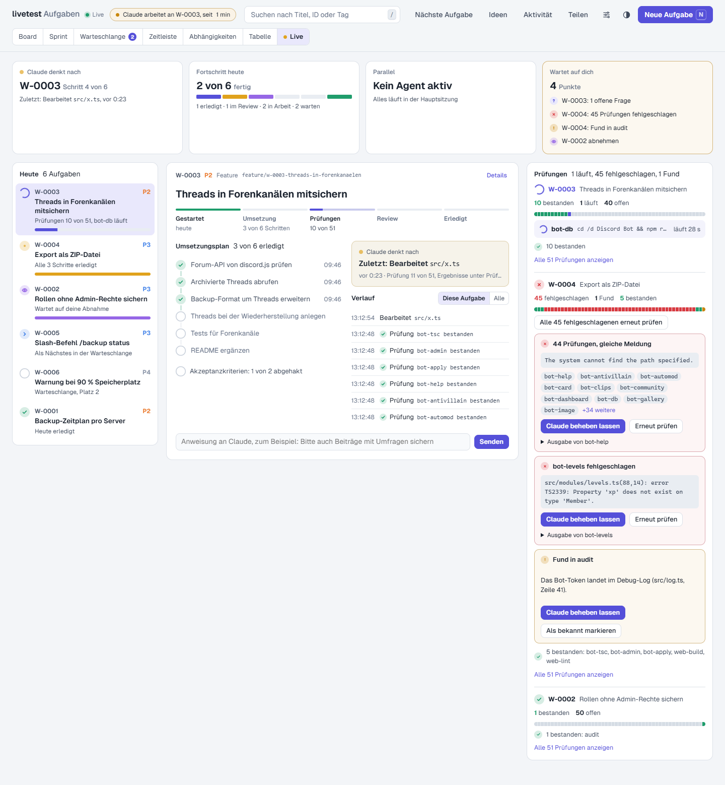
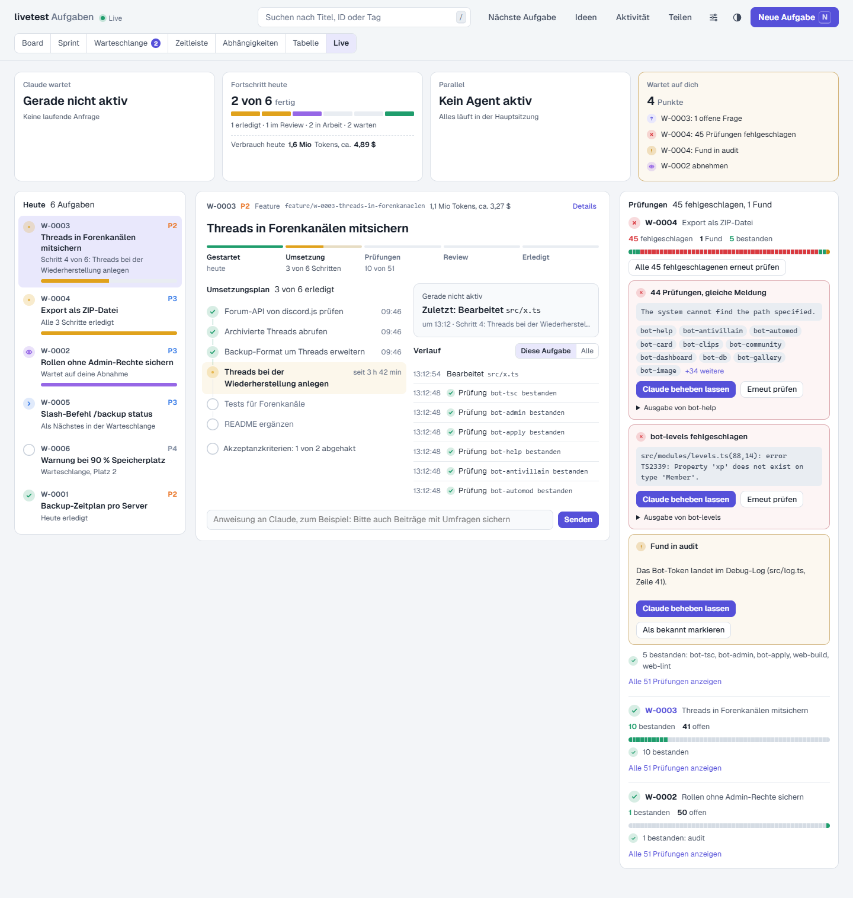

# Verbrauch der Sitzung in der Live-Ansicht

## Ziel
<!-- Was ist nach Abschluss anders? Ein bis drei Sätze, aus Sicht des Ergebnisses formuliert. -->

## Beschreibung
Vorschlag 5 vom 2026-11-21. works erfasst Tokens schon (time.jsonl, Hooks Stop und SubagentStop). Die Live-Ansicht soll den Verbrauch zeigen, etwa 'Heute: 1,2 Mio. Tokens, ca. 3,40 €' und für die gewählte Aufgabe. Kosten sind Schätzungen nach config.prices. Ohne zusätzliches Lesen der ganzen time.jsonl bei jeder Aktualisierung.

## Kontext und Problem
<!-- Warum ist das nötig? Aktueller Zustand, Auslöser, Einschränkungen. -->

## Nutzerperspektive
<!-- Wer profitiert und wie? Optional: Als <Rolle> möchte ich <Fähigkeit>, damit <Nutzen>. -->

## Akzeptanzkriterien
- [x] Die Live-Ansicht zeigt Tokens und geschätzte Kosten für heute und für die gewählte Aufgabe
- [x] Heute in der Kachel Fortschritt, die Aufgabe im Kopf der Mitte (Variante A)
- [x] time.jsonl wird nur neu gelesen, wenn sie sich geändert hat
- [x] Export und Leselink-Schnappschuss enthalten keinen Verbrauch

## Umsetzungsplan
<!-- Konkrete Schritte in sinnvoller Reihenfolge. Unteraufgaben gehören hierher, nicht in eigene Ordner. -->
- [x] Test: liveUsage mit Cache, boardData mit Verbrauch heute und je Aufgabe, Export ohne
- [x] liveUsage in usage.mjs, Daten in board.mjs, Export bereinigen
- [x] Board: Zeile in der Kachel, Kopf der Mitte
- [x] Doku board.md, Selbsttest mit Browser, Linux

## Betroffene Dateien
<!-- Pfade mit kurzer Notiz, was dort passiert. -->

## Designentscheidungen
<!-- Kurzfassung der wichtigsten Entscheidungen. Details in decisions.md (works decisions <ID>). -->

## Assets

Beschreibung: Vorher: Live-Ansicht ohne Verbrauch. Kachel Fortschritt und Kopf der Aufgabe zeigen keine Tokens oder Kosten
Art: vorher · Hinzugefügt: 2026-11-21

Beschreibung: Nachher: Kachel Fortschritt mit Verbrauch heute 1,6 Mio Tokens, ca. 4,89 Dollar; Kopf von W-0003 mit 1,1 Mio Tokens, ca. 3,27 Dollar
Art: nachher · Hinzugefügt: 2026-11-21

## Offene Fragen
<!-- Fragen an den Nutzer, die Claude nicht selbst klären kann. Format: - [ ] Frage -->

## Übergabe
<!-- Wird am Ende jeder Arbeitsphase mit `works handoff` überschrieben. -->

## Verlauf
- 2026-11-21: Aufgabe angelegt
- 2026-11-21: Brainstorming angehängt
- 2026-11-21: Entwurf A „Live-Ansicht Ergänzungen W-0006 bis W-0009“ angehängt
- 2026-11-21: Entwurf A „Live-Ansicht Ergänzungen W-0006 bis W-0009“ gewählt. Grund: Nutzer: Beide A (Freigabe A Kacheln, Verbrauch A in Kachel und Kopf), Rest wie im Entwurf
- 2026-11-21: Gestartet (Status: backlog → in-arbeit)
- 2026-11-21: Asset hinzugefügt: assets/2026-11-21-vorher-live-ansicht-ohne-verbrauch-vorher.png (vorher)
- 2026-11-21: Asset hinzugefügt: assets/2026-11-21-nachher-kachel-fortschritt-mit-nachher.png (nachher)
- 2026-11-21: Umsetzungsplan: "Test: liveUsage mit Cache, boardData mit Verbrauch heute und je Aufgabe, Export ohne" abgehakt
- 2026-11-21: Umsetzungsplan: "liveUsage in usage.mjs, Daten in board.mjs, Export bereinigen" abgehakt
- 2026-11-21: Umsetzungsplan: "Board: Zeile in der Kachel, Kopf der Mitte" abgehakt
- 2026-11-21: Akzeptanzkriterien: "Die Live-Ansicht zeigt Tokens und geschätzte Kosten für heute und für die gewählte Aufgabe" abgehakt
- 2026-11-21: Akzeptanzkriterien: "Heute in der Kachel Fortschritt, die Aufgabe im Kopf der Mitte (Variante A)" abgehakt
- 2026-11-21: Akzeptanzkriterien: "time.jsonl wird nur neu gelesen, wenn sie sich geändert hat" abgehakt
- 2026-11-21: Akzeptanzkriterien: "Export und Leselink-Schnappschuss enthalten keinen Verbrauch" abgehakt
- 2026-11-21: liveUsage mit Cache in usage.mjs, meta.usage und task.usage in board.mjs, Export bereinigt, Anzeige in Kachel und Kopf. Selbsttest Windows mit Browser 22/22.
- 2026-11-21: Umsetzungsplan: "Doku board.md, Selbsttest mit Browser, Linux" abgehakt
