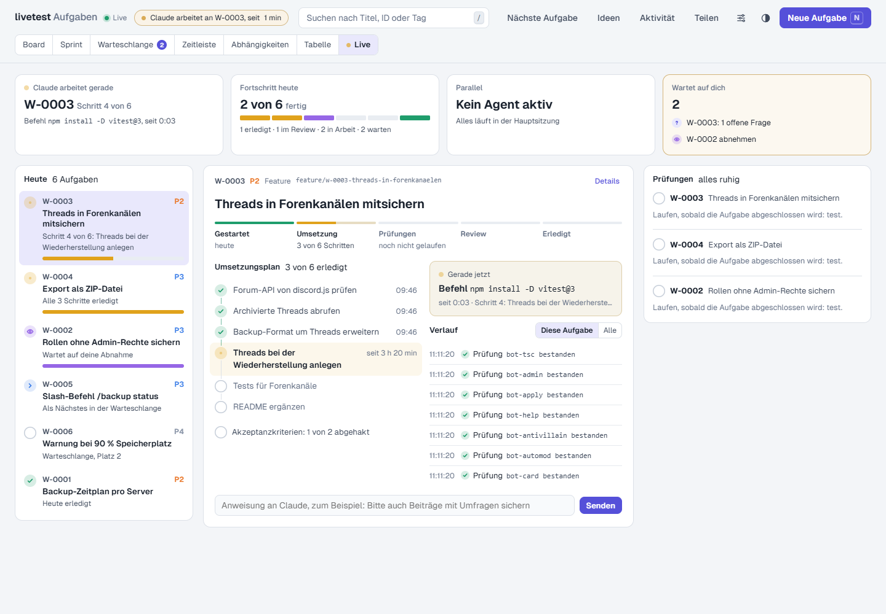
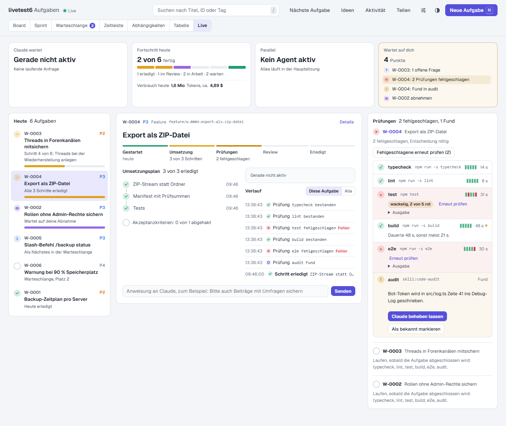
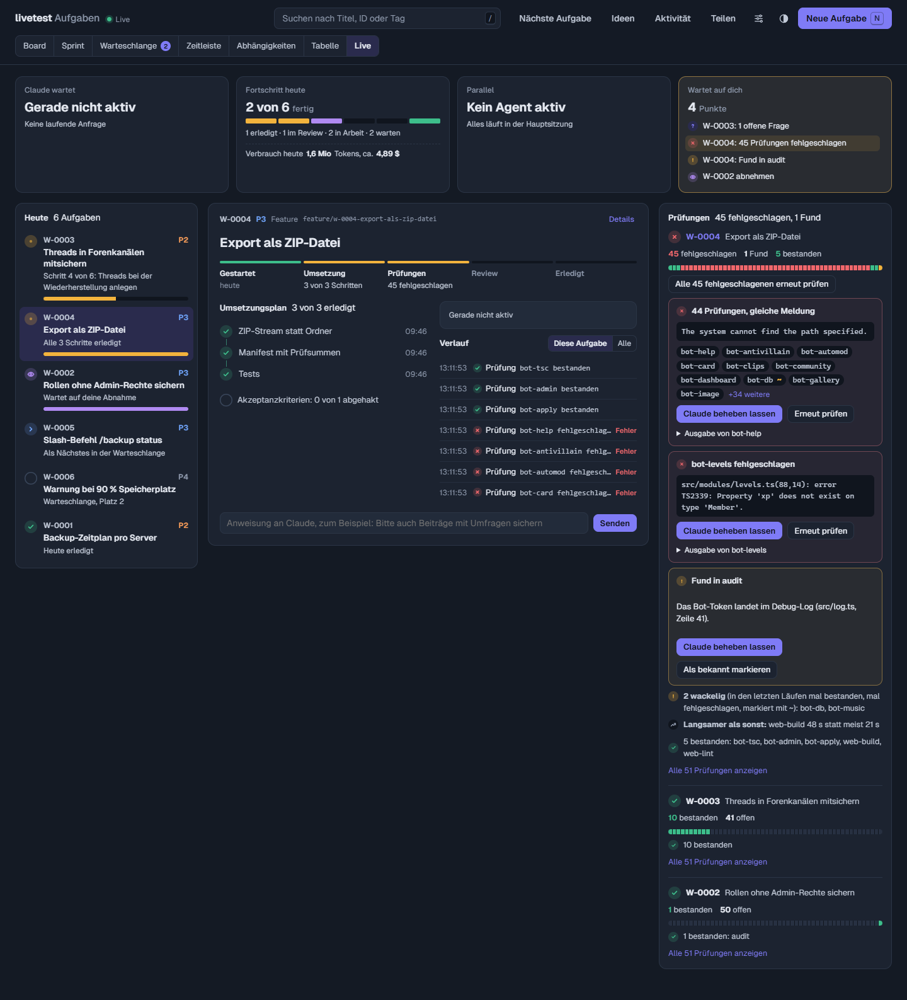

# Wackelige Prüfungen und Laufzeittrend erkennen

## Ziel
<!-- Was ist nach Abschluss anders? Ein bis drei Sätze, aus Sicht des Ergebnisses formuliert. -->

## Beschreibung
Vorschlag 6 vom 2026-11-21. works merkt sich je Prüfung die letzten fünf Ergebnisse mit Laufzeit. Prüfungen, die in diesem Fenster sowohl bestanden als auch fehlgeschlagen sind, werden als wackelig markiert (z. B. 'bot-db: 3 von 5 fehlgeschlagen'). Dazu die Laufzeit im Vergleich zum letzten Lauf, wenn sie deutlich abweicht.

## Kontext und Problem
<!-- Warum ist das nötig? Aktueller Zustand, Auslöser, Einschränkungen. -->

## Nutzerperspektive
<!-- Wer profitiert und wie? Optional: Als <Rolle> möchte ich <Fähigkeit>, damit <Nutzen>. -->

## Akzeptanzkriterien
- [x] Eine Prüfung mit wechselnden Ergebnissen in den letzten fünf Läufen ist in der Live-Ansicht als wackelig markiert
- [x] checks.json merkt sich je Prüfung die letzten fünf Läufe mit Ergebnis und Dauer, ein neuer Befehl beginnt von vorn
- [x] Eine deutlich längere oder kürzere Laufzeit ist an der Dauer markiert, mit dem üblichen Wert als Vergleich
- [x] Zeilen zeigen den Verlauf als kleine Striche, bei vielen Prüfungen gibt es je eine Zeile für wackelig und langsamer

## Umsetzungsplan
<!-- Konkrete Schritte in sinnvoller Reihenfolge. Unteraufgaben gehören hierher, nicht in eigene Ordner. -->
- [x] Test: flakyOf, trendOf, Verlauf in checks.json, fertige Werte im Board
- [x] Verlauf in runChecks, flakyOf und trendOf in checks.mjs, Werte in board.mjs
- [x] Board: Striche, Abzeichen, Pfeil, Hinweiszeilen
- [ ] Doku board.md, Selbsttest mit Browser, Linux

## Betroffene Dateien
<!-- Pfade mit kurzer Notiz, was dort passiert. -->

## Designentscheidungen
<!-- Kurzfassung der wichtigsten Entscheidungen. Details in decisions.md (works decisions <ID>). -->

## Assets

Beschreibung: Vorher: Prüfungszeilen zeigen nur den letzten Lauf mit Text und Dauer, kein Verlauf, kein Hinweis auf wackelige oder langsamere Prüfungen
Art: vorher · Hinzugefügt: 2026-11-21

Beschreibung: Nachher mit 6 Prüfungen: Striche für die letzten fünf Läufe, test als wackelig 2 von 5 rot, build 48 s mit Pfeil und dem Satz Dauerte 48 s, sonst meist 21 s; e2e erst seit dem letzten Lauf rot und deshalb nicht wackelig
Art: nachher · Hinzugefügt: 2026-11-21

Beschreibung: Nachher mit 51 Prüfungen (dunkel): bot-db mit ~ in der Fehlergruppe, Zeilen 2 wackelig und Langsamer als sonst: web-build 48 s statt meist 21 s
Art: nachher · Hinzugefügt: 2026-11-21

## Offene Fragen
<!-- Fragen an den Nutzer, die Claude nicht selbst klären kann. Format: - [ ] Frage -->

## Übergabe
<!-- Wird am Ende jeder Arbeitsphase mit `works handoff` überschrieben. -->

## Verlauf
- 2026-11-21: Aufgabe angelegt
- 2026-11-21: Brainstorming angehängt
- 2026-11-21: Entwurf A „Live-Ansicht Ergänzungen W-0006 bis W-0009“ angehängt
- 2026-11-21: Entwurf A „Live-Ansicht Ergänzungen W-0006 bis W-0009“ gewählt. Grund: Nutzer: Beide A (Freigabe A Kacheln, Verbrauch A in Kachel und Kopf), Rest wie im Entwurf
- 2026-11-21: Gestartet (Status: backlog → in-arbeit)
- 2026-11-21: Asset hinzugefügt: assets/2026-11-21-vorher-pruefungszeilen-zeigen-nur-den-vorher.png (vorher)
- 2026-11-21: Asset hinzugefügt: assets/2026-11-21-nachher-mit-6-pruefungen-striche-fuer-nachher.png (nachher)
- 2026-11-21: Asset hinzugefügt: assets/2026-11-21-nachher-viele-nachher.png (nachher)
- 2026-11-21: Umsetzungsplan: "Test: flakyOf, trendOf, Verlauf in checks.json, fertige Werte im Board" abgehakt
- 2026-11-21: Umsetzungsplan: "Verlauf in runChecks, flakyOf und trendOf in checks.mjs, Werte in board.mjs" abgehakt
- 2026-11-21: Umsetzungsplan: "Board: Striche, Abzeichen, Pfeil, Hinweiszeilen" abgehakt
- 2026-11-21: Akzeptanzkriterien: "Eine Prüfung mit wechselnden Ergebnissen in den letzten fünf Läufen ist in der Live-Ansicht als wackelig markiert" abgehakt
- 2026-11-21: Akzeptanzkriterien: "checks.json merkt sich je Prüfung die letzten fünf Läufe mit Ergebnis und Dauer, ein neuer Befehl beginnt von vorn" abgehakt
- 2026-11-21: Akzeptanzkriterien: "Eine deutlich längere oder kürzere Laufzeit ist an der Dauer markiert, mit dem üblichen Wert als Vergleich" abgehakt
- 2026-11-21: Akzeptanzkriterien: "Zeilen zeigen den Verlauf als kleine Striche, bei vielen Prüfungen gibt es je eine Zeile für wackelig und langsamer" abgehakt
- 2026-11-21: Verlauf hist in checks.json, flakyOf und trendOf in checks.mjs, Werte in board.mjs, Anzeige in Zeilen und Zusammenfassung. Selbsttest Windows mit Browser 23/23.
