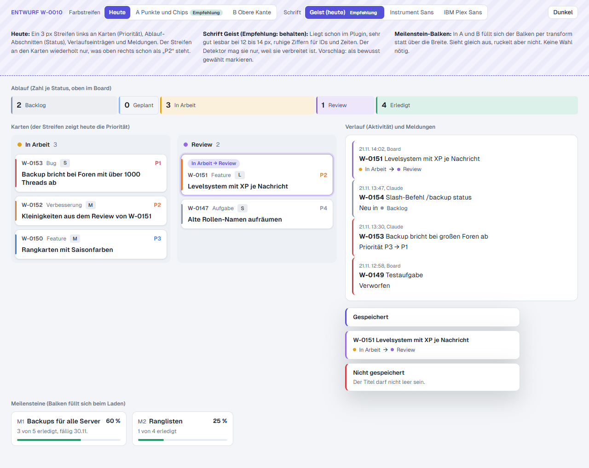
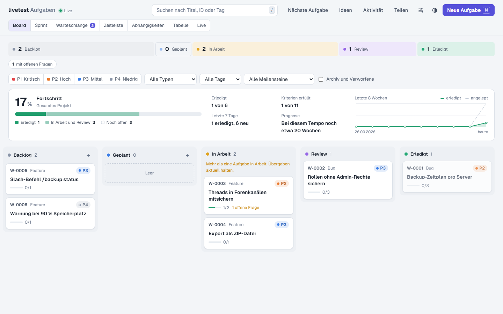
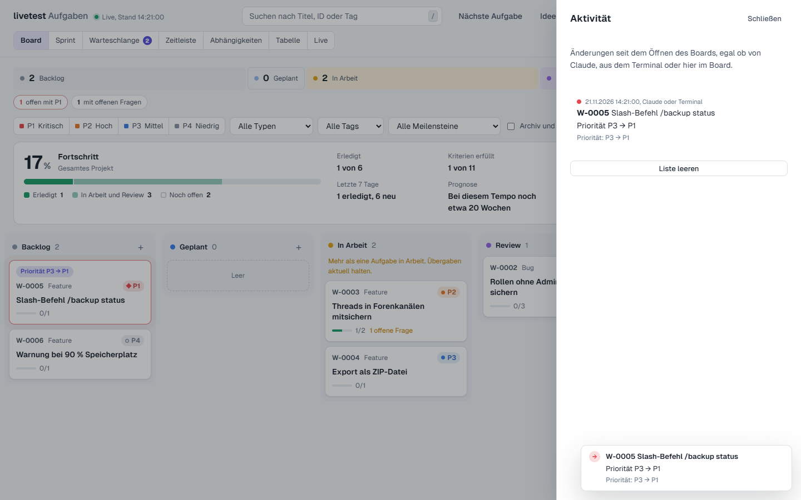
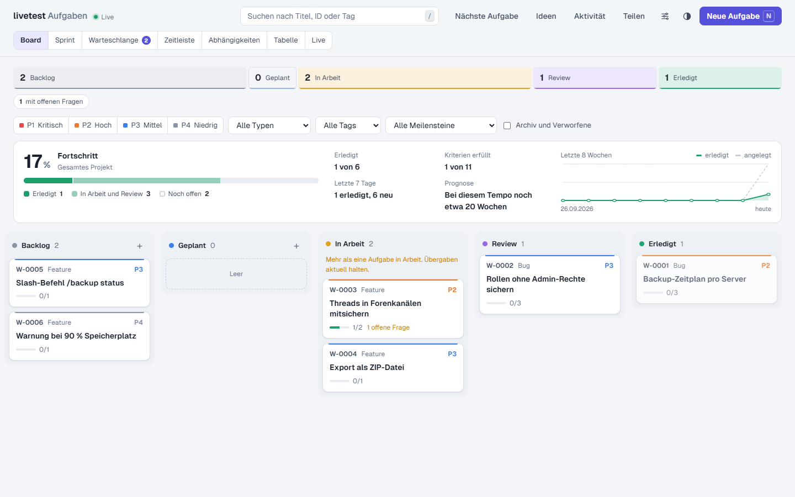
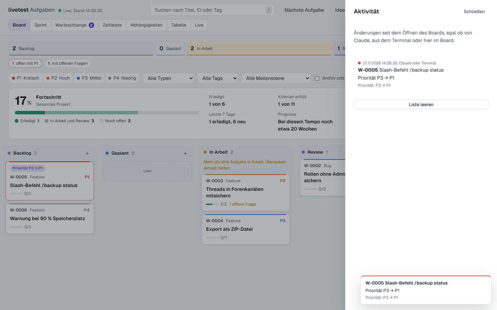

# Design-Funde in board.css überarbeiten

## Ziel
<!-- Welches Gestaltungsproblem wird gelöst? -->

## Beschreibung
Angelegt am 2026-11-21 auf Wunsch des Nutzers. Die Design-Prüfung (impeccable detect) meldet in plugins/works/skills/works/scripts/board/board.css sechs Stellen, die älter sind als W-0004 bis W-0009 und bisher bewusst stehen gelassen wurden. Jede Stelle prüfen: neu gestalten oder als gewollt markieren (impeccable ignores), mit Begründung in decisions.md. Am Verhalten des Boards ändert sich nichts. Die Stellen: (1) Zeile 2, Schrift Geist gilt als überall verwendet. (2) Zeile 153, .flow .seg::before, 3px Streifen links an den Abschnitten im Ablauf. (3) Zeile 195, .ms .track span animiert width (Meilenstein-Balken), besser transform: scaleX wie .lv-bar. (4) Zeile 293, .card::before, 3px Streifen links an jeder Karte im Board (trägt vermutlich Status oder Priorität, Bedeutung erhalten). (5) Zeile 431, .feed li mit border-left 3px (Aktivitätsverlauf). (6) Zeile 474, border-left 3px an den Meldungen (Toast). Wo die Farbe eine Bedeutung trägt (Status, Priorität), muss die Information sichtbar bleiben, nur die Form darf sich ändern. Als Gestaltungsaufgabe erst Entwürfe zeigen und die Wahl des Nutzers abwarten.

## Zielgruppe und Kontext
<!-- Wer nutzt die Oberfläche, auf welchen Geräten, in welcher Situation? -->

## Referenzen
<!-- Bestehende Seiten, Vorbilder, Markenvorgaben. Bilder über `works asset --kind referenz`. -->

## Varianten
<!-- Untersuchte Richtungen. Ausführliche Begründungen in decisions.md. -->

## Gewählte Lösung
<!-- Kurzbeschreibung des Ergebnisses. -->

## Akzeptanzkriterien
- [x] Darstellung ist auf Mobil, Tablet und Desktop korrekt
- [x] Kontraste erfüllen WCAG AA
- [x] Bedienung per Tastatur ist möglich
- [x] Jede der sechs Stellen ist neu gestaltet oder mit Begründung als gewollt markiert
- [x] impeccable detect meldet für board.css nichts mehr, das nicht bewusst markiert ist
- [x] Farben mit Bedeutung (Status, Priorität) bleiben erkennbar

## Umsetzungsplan
- [x] Stellen im Board ansehen, Bedeutung je Streifen klären
- [x] Entwurf mit Alternativen zeigen, Wahl abwarten
- [x] Umsetzen oder markieren, Selbsttest mit Browser

## Betroffene Dateien
- plugins/works/skills/works/scripts/board/board.css: Zeilen 2, 153, 195, 293, 431, 474 (Stand 2026-11-21)

## Designentscheidungen
Details und verworfene Alternativen: [decisions.md](decisions.md)

## Assets

Beschreibung: Vorher im Entwurf: 3 px Streifen links an Karten (Priorität), Ablauf, Verlauf und Meldungen
Art: vorher · Hinzugefügt: 2026-11-21

Beschreibung: Nachher im Board: Prioritäten als Chips mit Form (Raute P1, Punkt P2/P3, Ring P4), Flussleiste mit Punkten statt Streifen, keine Farbstreifen links an Karten
Art: nachher · Hinzugefügt: 2026-11-21

Beschreibung: Nachher: Verlauf unter Aktivität mit farbigem Punkt vor der Zeit, Meldung mit Pfeil-Symbol, P1-Karte mit Raute und getönter Kante
Art: nachher · Hinzugefügt: 2026-11-21

Beschreibung: Nachher Variante B: feine Linie oben an jeder Karte in der Prioritätsfarbe, Priorität als farbiger Text, Flussleiste mit Balken unten
Art: nachher · Hinzugefügt: 2026-11-21

Beschreibung: Nachher Variante B: Meldung mit Linie oben, Verlauf mit Punkt vor der Zeit, P1-Karte mit roter Linie oben
Art: nachher · Hinzugefügt: 2026-11-21

## Offene Fragen

## Übergabe
Abgeschlossen am 2026-11-21. Keine offene Übergabe.

## Verlauf
- 2026-11-21: Aufgabe angelegt
- 2026-11-21: decisions.md angelegt
- 2026-11-21: Gestartet (Status: backlog → in-arbeit)
- 2026-11-21: Brainstorming angehängt
- 2026-11-21: Entwurf A „Feinschliff Board: A Punkte und Chips, B Obere Kante, Schriften“ angehängt
- 2026-11-21: Umsetzungsplan: "Stellen im Board ansehen, Bedeutung je Streifen klären" abgehakt
- 2026-11-21: Asset hinzugefügt: assets/2026-11-21-vorher-im-entwurf-3-px-streifen-links-vorher.png (vorher)
- 2026-11-21: Entwurf A „Feinschliff Board: A Punkte und Chips, B Obere Kante, Schriften“ gewählt. Grund: Nutzer: A und Geist (Streifen durch Punkte und Chips ersetzen, Schrift Geist behalten)
- 2026-11-21: Asset hinzugefügt: assets/2026-11-21-nachher-im-board-prioritaeten-als-chips-nachher.png (nachher)
- 2026-11-21: Asset hinzugefügt: assets/2026-11-21-nachher-verlauf-nachher.png (nachher)
- 2026-11-21: Umsetzungsplan: "Entwurf mit Alternativen zeigen, Wahl abwarten" abgehakt
- 2026-11-21: Umsetzungsplan: "Umsetzen oder markieren, Selbsttest mit Browser" abgehakt
- 2026-11-21: Akzeptanzkriterien: "Darstellung ist auf Mobil, Tablet und Desktop korrekt" abgehakt
- 2026-11-21: Akzeptanzkriterien: "Kontraste erfüllen WCAG AA" abgehakt
- 2026-11-21: Akzeptanzkriterien: "Bedienung per Tastatur ist möglich" abgehakt
- 2026-11-21: Akzeptanzkriterien: "Jede der sechs Stellen ist neu gestaltet oder mit Begründung als gewollt markiert" abgehakt
- 2026-11-21: Akzeptanzkriterien: "impeccable detect meldet für board.css nichts mehr, das nicht bewusst markiert ist" abgehakt
- 2026-11-21: Akzeptanzkriterien: "Farben mit Bedeutung (Status, Priorität) bleiben erkennbar" abgehakt
- 2026-11-21: Variante A umgesetzt, Geist markiert, toter Meilenstein-Block entfernt. impeccable detect meldet nichts mehr. Selbsttest Windows mit Browser 23/23.
- 2026-11-21: Abgeschlossen (Status: in-arbeit → erledigt), DoD bestätigt
- 2026-11-21: Wiedereröffnet (Status: erledigt → backlog). Grund: Nutzer wählt nach dem Umsetzen doch Variante B (obere Kante)
- 2026-11-21: Entwurf B „Feinschliff Board: B Obere Kante (gleicher Entwurf, Variante B)“ angehängt
- 2026-11-21: Entwurf B „Feinschliff Board: B Obere Kante (gleicher Entwurf, Variante B)“ gewählt. Grund: Nutzer: Design mit der oberen Kante gefällt besser, Schrift Geist bleibt
- 2026-11-21: Gestartet (Status: backlog → in-arbeit)
- 2026-11-21: Asset hinzugefügt: assets/2026-11-21-nachher-obere-kante-nachher.png (nachher)
- 2026-11-21: Asset hinzugefügt: assets/2026-11-21-nachher-obere-kante-verlauf-nachher.png (nachher)
- 2026-11-21: Auf Variante B (obere Kante) umgestellt. Detektor meldet nichts. Selbsttest Windows mit Browser 23/23.
- 2026-11-21: Abgeschlossen (Status: in-arbeit → erledigt), DoD bestätigt
