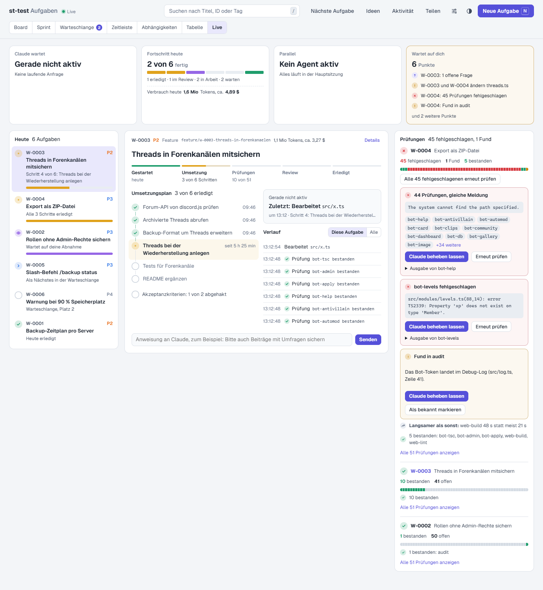
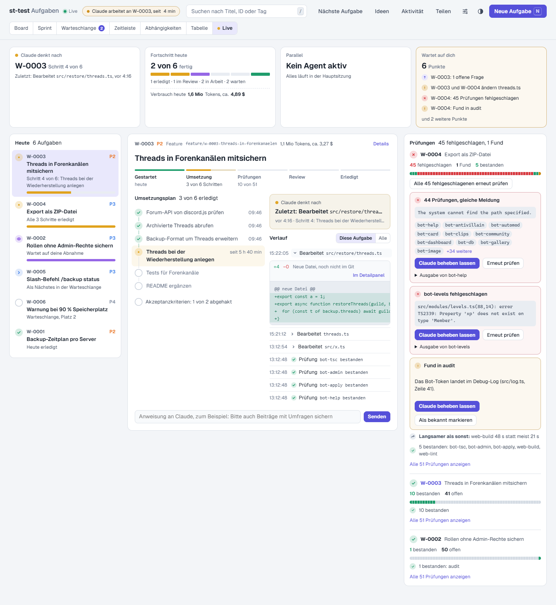

# Live-Ansicht: Diff zu einem Schritt im Verlauf

## Ziel
<!-- Was ist nach Abschluss anders? Ein bis drei Sätze, aus Sicht des Ergebnisses formuliert. -->

## Beschreibung
Vorschlag 1 vom 2026-11-21, vom Nutzer gewünscht. Im Verlauf der Live-Ansicht steht heute nur "Bearbeitet src/levels.ts". Ein Klick auf so einen Eintrag soll die Änderung an dieser Datei zeigen (Diff gegen HEAD bzw. den Stand im Worktree der Aufgabe), damit man nebenbei sieht, was Claude ändert und nicht nur wo. Der Reiter Code und Commits im Detailpanel kann schon Diffs je Datei zeigen, das wiederverwenden. Nur lokal, nicht im Leselink. Erst Entwurf zeigen, Wahl abwarten.

## Kontext und Problem
<!-- Warum ist das nötig? Aktueller Zustand, Auslöser, Einschränkungen. -->

## Nutzerperspektive
<!-- Wer profitiert und wie? Optional: Als <Rolle> möchte ich <Fähigkeit>, damit <Nutzen>. -->

## Akzeptanzkriterien
- [x] Ein Klick auf einen Dateieintrag im Verlauf zeigt den Diff dieser Datei
- [x] Bei Aufgaben im Worktree kommt der Diff aus dem Worktree
- [x] Im Leselink ist der Eintrag nicht klickbar
- [x] Große Diffs werden gekürzt, die Seite bleibt bedienbar

## Umsetzungsplan
- [x] Entwurf zeigen, Wahl abwarten
- [x] API für Diff einer Datei je Aufgabe (vorhandenen Code nutzen)
- [x] Verlauf klickbar machen, Anzeige im Board
- [ ] Selbsttest mit Browser, Linux, Doku

## Betroffene Dateien
<!-- Pfade mit kurzer Notiz, was dort passiert. -->

## Designentscheidungen
Details und verworfene Alternativen: [decisions.md](decisions.md)

## Assets

Beschreibung: Vorher: Verlauf zeigt nur Bearbeitet und den Dateinamen, ohne Weg zur Änderung
Art: vorher · Hinzugefügt: 2026-11-21

Beschreibung: Nachher: Eintrag Bearbeitet src/restore/threads.ts aufgeklappt, Kopf mit +4 −0 und Neue Datei, noch nicht im Git, darunter der Diff, Link Im Detailpanel
Art: nachher · Hinzugefügt: 2026-11-21

## Offene Fragen
<!-- Fragen an den Nutzer, die Claude nicht selbst klären kann. Format: - [ ] Frage -->

## Übergabe
<!-- Wird am Ende jeder Arbeitsphase mit `works handoff` überschrieben. -->

## Verlauf
- 2026-11-21: Aufgabe angelegt
- 2026-11-21: decisions.md angelegt
- 2026-11-21: Brainstorming angehängt
- 2026-11-21: Entwurf A „Board-Erweiterungen W-0011 bis W-0014“ angehängt
- 2026-11-21: Entwurf A „Board-Erweiterungen W-0011 bis W-0014“ gewählt. Grund: Nutzer: A (Diff klappt unter dem Eintrag auf), Rest passt
- 2026-11-21: Gestartet (Status: backlog → in-arbeit)
- 2026-11-21: Asset hinzugefügt: assets/2026-11-21-vorher-verlauf-zeigt-nur-bearbeitet-und-vorher.png (vorher)
- 2026-11-21: Asset hinzugefügt: assets/2026-11-21-nachher-eintrag-bearbeitet-src-restore-nachher.png (nachher)
- 2026-11-21: Umsetzungsplan: "Entwurf zeigen, Wahl abwarten" abgehakt
- 2026-11-21: Umsetzungsplan: "API für Diff einer Datei je Aufgabe (vorhandenen Code nutzen)" abgehakt
- 2026-11-21: Umsetzungsplan: "Verlauf klickbar machen, Anzeige im Board" abgehakt
- 2026-11-21: Akzeptanzkriterien: "Ein Klick auf einen Dateieintrag im Verlauf zeigt den Diff dieser Datei" abgehakt
- 2026-11-21: Akzeptanzkriterien: "Bei Aufgaben im Worktree kommt der Diff aus dem Worktree" abgehakt
- 2026-11-21: Akzeptanzkriterien: "Im Leselink ist der Eintrag nicht klickbar" abgehakt
- 2026-11-21: Akzeptanzkriterien: "Große Diffs werden gekürzt, die Seite bleibt bedienbar" abgehakt
- 2026-11-21: liveFileDiff in git.mjs, /api/diff live=1 mit Pfadprüfung und Leselink-Sperre, aufklappbare Dateieinträge im Verlauf. Selbsttest Windows mit Browser 24/24. Linux folgt gemeinsam.
