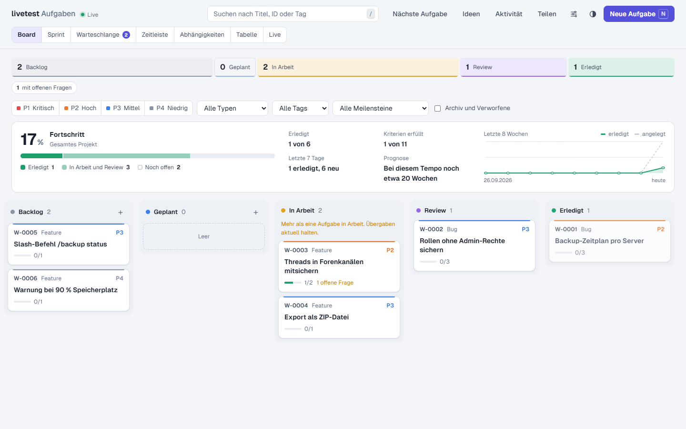
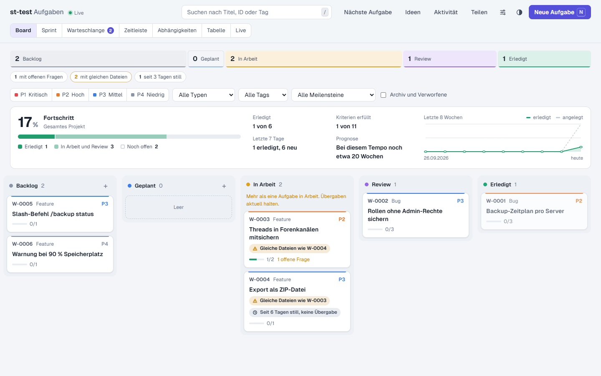
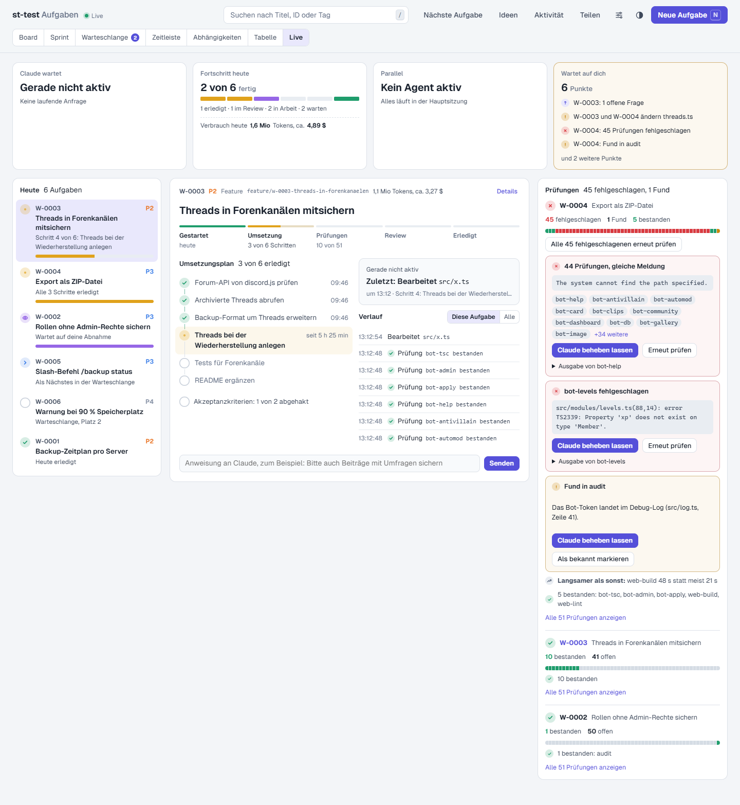

# Board: Konflikt-Radar für Aufgaben mit denselben Dateien

## Ziel
<!-- Was ist nach Abschluss anders? Ein bis drei Sätze, aus Sicht des Ergebnisses formuliert. -->

## Beschreibung
Vorschlag 2 vom 2026-11-21, vom Nutzer gewünscht. works merkt sich in .works/files.jsonl, welche Aufgabe welche Dateien geändert hat. Das Board soll warnen, wenn zwei offene Aufgaben (in Arbeit, Review, Warteschlange) dieselben Dateien ändern, zum Beispiel "W-0012 und W-0015 ändern beide board.js". Hilft vor allem vor paralleler Arbeit (works parallel plan). Anzeige an der Karte und in der Live-Ansicht unter "Wartet auf dich" oder als Hinweis. Erst Entwurf zeigen, Wahl abwarten.

## Kontext und Problem
<!-- Warum ist das nötig? Aktueller Zustand, Auslöser, Einschränkungen. -->

## Nutzerperspektive
<!-- Wer profitiert und wie? Optional: Als <Rolle> möchte ich <Fähigkeit>, damit <Nutzen>. -->

## Akzeptanzkriterien
- [x] Zwei offene Aufgaben mit gemeinsamen Dateien werden im Board als möglicher Konflikt angezeigt
- [x] Der Hinweis nennt die Aufgaben und die gemeinsamen Dateien
- [x] Erledigte und verworfene Aufgaben zählen nicht
- [x] works parallel plan nutzt dieselbe Erkennung

## Umsetzungsplan
- [x] Entwurf zeigen, Wahl abwarten
- [x] Erkennung aus files.jsonl in board.mjs
- [x] Anzeige im Board
- [x] Selbsttest mit Browser, Linux, Doku

## Betroffene Dateien
<!-- Pfade mit kurzer Notiz, was dort passiert. -->

## Designentscheidungen
Details und verworfene Alternativen: [decisions.md](decisions.md)

## Assets

Beschreibung: Vorher: Board ohne Hinweis, wenn offene Aufgaben dieselben Dateien ändern
Art: vorher · Hinzugefügt: 2026-11-21

Beschreibung: Nachher: Hinweis 2 mit gleichen Dateien, Etiketten Gleiche Dateien wie W-0004 und W-0003 an den Karten
Art: nachher · Hinzugefügt: 2026-11-21

Beschreibung: Nachher Live-Ansicht: W-0003 und W-0004 ändern threads.ts unter Wartet auf dich
Art: nachher · Hinzugefügt: 2026-11-21

## Offene Fragen
<!-- Fragen an den Nutzer, die Claude nicht selbst klären kann. Format: - [ ] Frage -->

## Übergabe
Abgeschlossen am 2026-11-21. Keine offene Übergabe.

## Verlauf
- 2026-11-21: Aufgabe angelegt
- 2026-11-21: decisions.md angelegt
- 2026-11-21: Brainstorming angehängt
- 2026-11-21: Entwurf A „Board-Erweiterungen W-0011 bis W-0014“ angehängt
- 2026-11-21: Entwurf A „Board-Erweiterungen W-0011 bis W-0014“ gewählt. Grund: Nutzer: A (Diff klappt unter dem Eintrag auf), Rest passt
- 2026-11-21: Gestartet (Status: backlog → in-arbeit)
- 2026-11-21: Asset hinzugefügt: assets/2026-11-21-vorher-board-ohne-hinweis-wenn-offene-vorher.png (vorher)
- 2026-11-21: Asset hinzugefügt: assets/2026-11-21-nachher-hinweis-2-mit-gleichen-dateien-nachher.png (nachher)
- 2026-11-21: Asset hinzugefügt: assets/2026-11-21-nachher-live-nachher.png (nachher)
- 2026-11-21: Umsetzungsplan: "Entwurf zeigen, Wahl abwarten" abgehakt
- 2026-11-21: Umsetzungsplan: "Erkennung aus files.jsonl in board.mjs" abgehakt
- 2026-11-21: Umsetzungsplan: "Anzeige im Board" abgehakt
- 2026-11-21: Akzeptanzkriterien: "Zwei offene Aufgaben mit gemeinsamen Dateien werden im Board als möglicher Konflikt angezeigt" abgehakt
- 2026-11-21: Akzeptanzkriterien: "Der Hinweis nennt die Aufgaben und die gemeinsamen Dateien" abgehakt
- 2026-11-21: Akzeptanzkriterien: "Erledigte und verworfene Aufgaben zählen nicht" abgehakt
- 2026-11-21: Akzeptanzkriterien: "works parallel plan nutzt dieselbe Erkennung" abgehakt
- 2026-11-21: taskFiles und fileConflicts in files.mjs, parallel plan nutzt taskFiles, conflicts je Aufgabe in board.mjs, Hinweis, Filter, Etikett, Zeile unter Wartet auf dich. Selbsttest Windows 24/24. Browser und Linux folgen gemeinsam.
- 2026-11-21: Umsetzungsplan: "Selbsttest mit Browser, Linux, Doku" abgehakt
- 2026-11-21: Linux 24/24 (Docker) und GitHub-CI grün auf f95a0b1.
- 2026-11-21: Abgeschlossen (Status: in-arbeit → erledigt), DoD bestätigt
