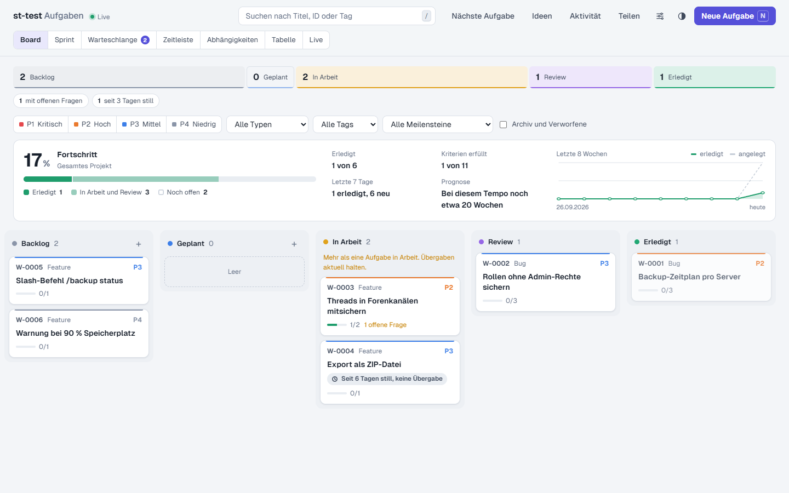
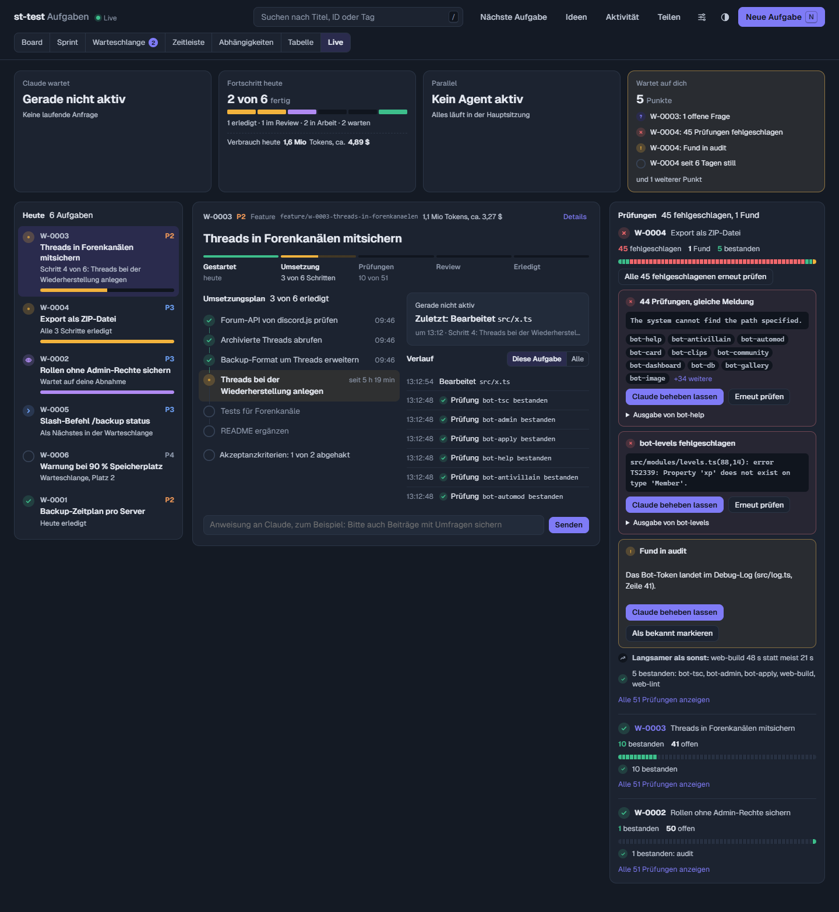

# Live-Ansicht: Hinweis bei Stillstand einer Aufgabe

## Ziel
<!-- Was ist nach Abschluss anders? Ein bis drei Sätze, aus Sicht des Ergebnisses formuliert. -->

## Beschreibung
Vorschlag 4 vom 2026-11-21, vom Nutzer gewünscht. Eine Aufgabe, die seit Tagen "In Arbeit" ist, ohne dass sich etwas tut (keine Werkzeugaufrufe, keine abgehakten Schritte, kein Verlaufseintrag), soll einen Hinweis bekommen, etwa unter "Wartet auf dich": "W-0012 seit 4 Tagen ohne Aktivität, Übergabe fehlt". Die Schwelle (Tage) soll in config.json einstellbar sein. Erst Entwurf zeigen, Wahl abwarten.

## Kontext und Problem
<!-- Warum ist das nötig? Aktueller Zustand, Auslöser, Einschränkungen. -->

## Nutzerperspektive
<!-- Wer profitiert und wie? Optional: Als <Rolle> möchte ich <Fähigkeit>, damit <Nutzen>. -->

## Akzeptanzkriterien
- [x] Eine Aufgabe in Arbeit ohne Aktivität über der Schwelle erscheint mit Hinweis
- [x] Der Hinweis sagt, seit wann nichts passiert ist und ob eine Übergabe fehlt
- [x] Die Schwelle ist in config.json einstellbar, Standard 3 Tage

## Umsetzungsplan
- [x] Entwurf zeigen, Wahl abwarten
- [x] Letzte Aktivität je Aufgabe ermitteln
- [x] Anzeige im Board, Einstellung in config.json
- [ ] Selbsttest mit Browser, Linux, Doku

## Betroffene Dateien
<!-- Pfade mit kurzer Notiz, was dort passiert. -->

## Designentscheidungen
Details und verworfene Alternativen: [decisions.md](decisions.md)

## Assets

Beschreibung: Vorher: Board ohne Hinweis auf Aufgaben, die seit Tagen in Arbeit sind, ohne dass etwas passiert
Art: vorher · Hinzugefügt: 2026-11-21

Beschreibung: Nachher: Hinweis 1 seit 3 Tagen still unter der Flussleiste, Etikett Seit 6 Tagen still, keine Übergabe an W-0004
Art: nachher · Hinzugefügt: 2026-11-21

Beschreibung: Nachher Live-Ansicht: W-0004 seit 6 Tagen still unter Wartet auf dich
Art: nachher · Hinzugefügt: 2026-11-21

## Offene Fragen
<!-- Fragen an den Nutzer, die Claude nicht selbst klären kann. Format: - [ ] Frage -->

## Übergabe
<!-- Wird am Ende jeder Arbeitsphase mit `works handoff` überschrieben. -->

## Verlauf
- 2026-11-21: Aufgabe angelegt
- 2026-11-21: decisions.md angelegt
- 2026-11-21: Brainstorming angehängt
- 2026-11-21: Entwurf A „Board-Erweiterungen W-0011 bis W-0014“ angehängt
- 2026-11-21: Entwurf A „Board-Erweiterungen W-0011 bis W-0014“ gewählt. Grund: Nutzer: A (Diff klappt unter dem Eintrag auf), Rest passt
- 2026-11-21: Gestartet (Status: backlog → in-arbeit)
- 2026-11-21: Asset hinzugefügt: assets/2026-11-21-vorher-board-ohne-hinweis-auf-aufgaben-vorher.png (vorher)
- 2026-11-21: Asset hinzugefügt: assets/2026-11-21-nachher-hinweis-1-seit-3-tagen-still-nachher.png (nachher)
- 2026-11-21: Asset hinzugefügt: assets/2026-11-21-nachher-live-nachher.png (nachher)
- 2026-11-21: Umsetzungsplan: "Entwurf zeigen, Wahl abwarten" abgehakt
- 2026-11-21: Umsetzungsplan: "Letzte Aktivität je Aufgabe ermitteln" abgehakt
- 2026-11-21: Umsetzungsplan: "Anzeige im Board, Einstellung in config.json" abgehakt
- 2026-11-21: Akzeptanzkriterien: "Eine Aufgabe in Arbeit ohne Aktivität über der Schwelle erscheint mit Hinweis" abgehakt
- 2026-11-21: Akzeptanzkriterien: "Der Hinweis sagt, seit wann nichts passiert ist und ob eine Übergabe fehlt" abgehakt
- 2026-11-21: Akzeptanzkriterien: "Die Schwelle ist in config.json einstellbar, Standard 3 Tage" abgehakt
- 2026-11-21: staleTasks in timelog.mjs, stale je Aufgabe in board.mjs, Hinweis, Filter, Etikett und Punkt unter Wartet auf dich. Selbsttest Windows mit Browser 23/23. Linux folgt gemeinsam mit W-0011, W-0012, W-0014.
