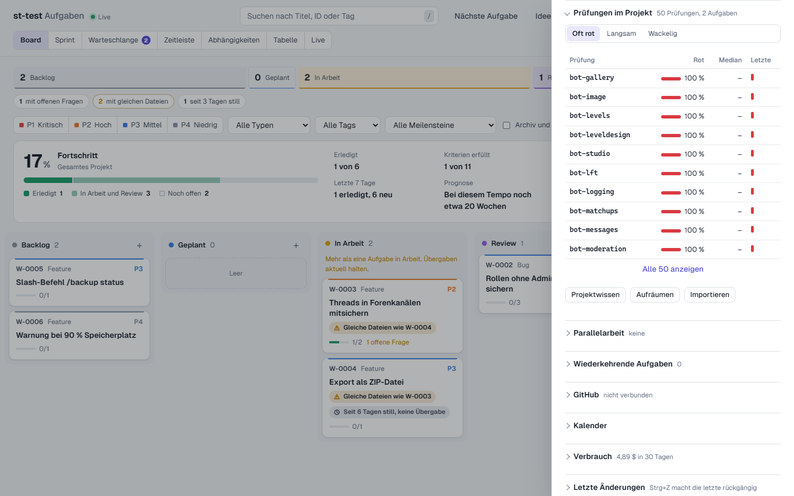
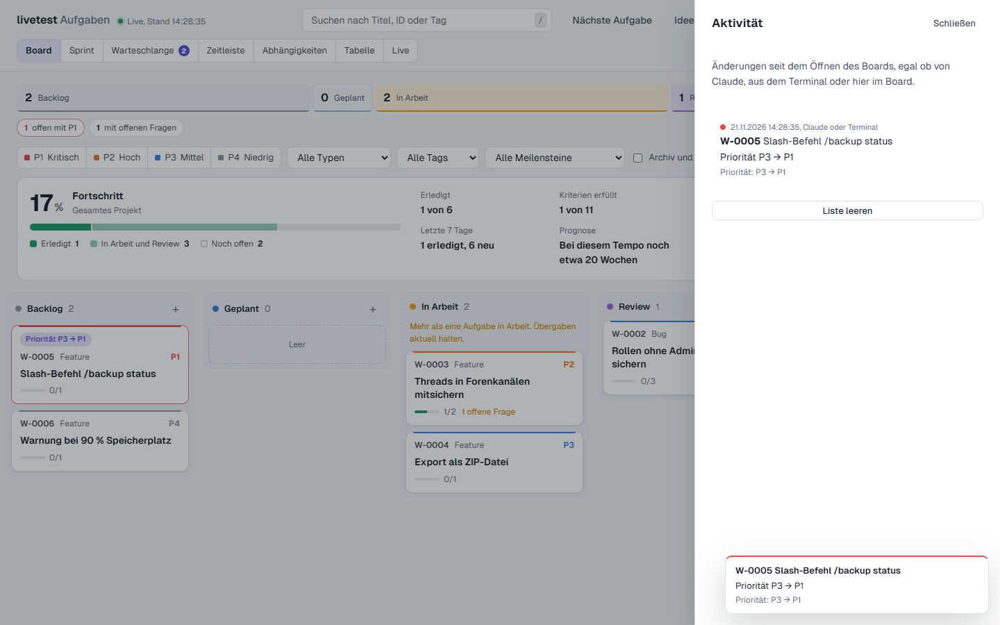

# Werkzeuge: Prüfungs-Gesundheit über alle Aufgaben

## Ziel
<!-- Was ist nach Abschluss anders? Ein bis drei Sätze, aus Sicht des Ergebnisses formuliert. -->

## Beschreibung
Vorschlag 5 vom 2026-11-21, vom Nutzer gewünscht. Eine Übersicht unter Werkzeuge mit den Prüfungen des Projekts über alle Aufgaben: langsamste (Median der Laufzeit), wackeligste (Wechsel bei gleichem Codestand, wie W-0009), am häufigsten rot. Gerade bei RL Nexus mit 51 Prüfungen sieht man so, welche man reparieren oder beschleunigen sollte. Daten aus den checks.json der Aufgaben (hist aus W-0009). Erst Entwurf zeigen, Wahl abwarten.

## Kontext und Problem
<!-- Warum ist das nötig? Aktueller Zustand, Auslöser, Einschränkungen. -->

## Nutzerperspektive
<!-- Wer profitiert und wie? Optional: Als <Rolle> möchte ich <Fähigkeit>, damit <Nutzen>. -->

## Akzeptanzkriterien
- [x] Werkzeuge zeigen je Prüfung Laufzeit, Fehlerquote und wackelig über alle Aufgaben
- [x] Sortierbar nach langsam, rot, wackelig
- [x] Funktioniert auch mit 51 Prüfungen übersichtlich

## Umsetzungsplan
- [x] Entwurf zeigen, Wahl abwarten
- [x] Auswertung über alle checks.json (API)
- [x] Anzeige unter Werkzeuge
- [x] Selbsttest mit Browser, Linux, Doku

## Betroffene Dateien
<!-- Pfade mit kurzer Notiz, was dort passiert. -->

## Designentscheidungen
Details und verworfene Alternativen: [decisions.md](decisions.md)

## Assets

Beschreibung: Nachher: Werkzeuge mit Abschnitt Prüfungen im Projekt, 50 Prüfungen aus 2 Aufgaben, sortiert nach oft rot, Spalten Rot, Median, Letzte
Art: nachher · Hinzugefügt: 2026-11-21

Beschreibung: Vorher: Werkzeuge ohne Übersicht über Prüfungen über alle Aufgaben
Art: vorher · Hinzugefügt: 2026-11-21

## Offene Fragen
<!-- Fragen an den Nutzer, die Claude nicht selbst klären kann. Format: - [ ] Frage -->

## Übergabe
Abgeschlossen am 2026-11-21. Keine offene Übergabe.

## Verlauf
- 2026-11-21: Aufgabe angelegt
- 2026-11-21: decisions.md angelegt
- 2026-11-21: Brainstorming angehängt
- 2026-11-21: Entwurf A „Board-Erweiterungen W-0011 bis W-0014“ angehängt
- 2026-11-21: Entwurf A „Board-Erweiterungen W-0011 bis W-0014“ gewählt. Grund: Nutzer: A (Diff klappt unter dem Eintrag auf), Rest passt
- 2026-11-21: Gestartet (Status: backlog → in-arbeit)
- 2026-11-21: Asset hinzugefügt: assets/2026-11-21-nachher-werkzeuge-mit-abschnitt-nachher.png (nachher)
- 2026-11-21: Asset hinzugefügt: assets/2026-11-21-vorher-werkzeuge-ohne-uebersicht-ueber-vorher.png (vorher)
- 2026-11-21: Umsetzungsplan: "Entwurf zeigen, Wahl abwarten" abgehakt
- 2026-11-21: Umsetzungsplan: "Auswertung über alle checks.json (API)" abgehakt
- 2026-11-21: Umsetzungsplan: "Anzeige unter Werkzeuge" abgehakt
- 2026-11-21: Akzeptanzkriterien: "Werkzeuge zeigen je Prüfung Laufzeit, Fehlerquote und wackelig über alle Aufgaben" abgehakt
- 2026-11-21: Akzeptanzkriterien: "Sortierbar nach langsam, rot, wackelig" abgehakt
- 2026-11-21: Akzeptanzkriterien: "Funktioniert auch mit 51 Prüfungen übersichtlich" abgehakt
- 2026-11-21: checkHealth und /api/check-health, Abschnitt Prüfungen im Projekt unter Werkzeuge mit drei Sortierungen, an die schmale Seitenleiste angepasst. Selbsttest Windows mit Browser 24/24. Linux folgt gemeinsam.
- 2026-11-21: Umsetzungsplan: "Selbsttest mit Browser, Linux, Doku" abgehakt
- 2026-11-21: Linux 24/24 (Docker) und GitHub-CI grün auf f95a0b1.
- 2026-11-21: Abgeschlossen (Status: in-arbeit → erledigt), DoD bestätigt
