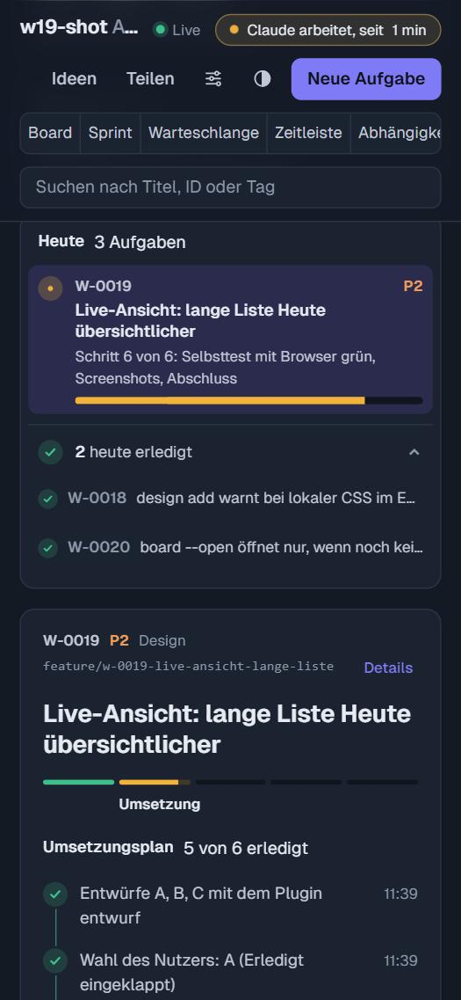
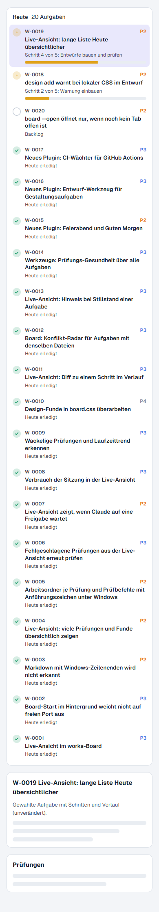

# Live-Ansicht: lange Liste Heute übersichtlicher

## Ziel
<!-- Welches Gestaltungsproblem wird gelöst? -->

## Beschreibung
Wunsch des Nutzers vom 2026-11-21 (Screenshot aus dem Board): In der Live-Ansicht zeigt der Bereich Heute alle Aufgaben des Tages als gleich große Einträge mit drei Zeilen (Symbol, ID und Priorität, Titel, Statuszeile). Bei 18 Aufgaben, davon 17 heute erledigt, wird die Spalte sehr lang, die laufende Aufgabe steht oben, der Rest ist eine lange Wand aus 'Heute erledigt'. Die Liste soll besser angezeigt werden: laufende und wartende Aufgaben im Blick, Erledigtes platzsparend. Nutzer: 'kümmer dich um das Design'. Ablauf: Entwürfe mit dem Plugin entwurf zeigen, Wahl des Nutzers abwarten, dann umsetzen. Code: renderLive() und lvStatus() in plugins/works/skills/works/scripts/board/board.js, Styles .lv-run in board.css.

## Zielgruppe und Kontext
<!-- Wer nutzt die Oberfläche, auf welchen Geräten, in welcher Situation? -->

## Referenzen
<!-- Bestehende Seiten, Vorbilder, Markenvorgaben. Bilder über `works asset --kind referenz`. -->

## Varianten
<!-- Untersuchte Richtungen. Ausführliche Begründungen in decisions.md. -->

## Gewählte Lösung
<!-- Kurzbeschreibung des Ergebnisses. -->

## Akzeptanzkriterien
- [x] Darstellung ist auf Mobil, Tablet und Desktop korrekt
- [x] Kontraste erfüllen WCAG AA
- [x] Bedienung per Tastatur ist möglich
- [x] Bei vielen erledigten Aufgaben bleiben laufende und wartende Aufgaben ohne Scrollen sichtbar
- [x] Erledigte Aufgaben brauchen deutlich weniger Platz als heute
- [x] Hell und dunkel, 1440, 768 und 390 px ohne seitliches Scrollen

## Umsetzungsplan
- [x] Entwürfe A, B, C mit dem Plugin entwurf
- [x] Wahl des Nutzers: A (Erledigt eingeklappt)
- [x] Browser-Test im Selbsttest (RED)
- [x] renderLive: Erledigtes in details.lv-fold, einzeilig in .lv-mini, Zustand gemerkt
- [x] Styles .lv-fold und .lv-mini
- [x] Selbsttest mit Browser grün, Screenshots, Abschluss

## Betroffene Dateien
- `plugins/works/skills/works/scripts/board/board.js`: renderLive, Klick auf die Zeile merkt auf oder zu
- `plugins/works/skills/works/scripts/board/board.css`: .lv-fold, .lv-mini
- `plugins/works/skills/works/scripts/selftest.mjs`: heute erledigte Aufgabe, Browser-Prüfung

## Designentscheidungen
Details und verworfene Alternativen: [decisions.md](decisions.md)

## Assets

Beschreibung: Live-Ansicht auf dem Handy (375 px, dunkel): W-0019 als voller Eintrag, darunter '2 heute erledigt' aufgeklappt mit einzeiligen Einträgen W-0018 und W-0020
Art: nachher · Hinzugefügt: 2026-11-22

Beschreibung: Vorher (Entwurfsseite, Variante Heute, 390 px hell): jede der 17 heute erledigten Aufgaben mit drei Zeilen, die Liste ist sehr lang
Art: vorher · Hinzugefügt: 2026-11-22

## Offene Fragen

## Übergabe
Abgeschlossen am 2026-11-22. Keine offene Übergabe.

## Verlauf
- 2026-11-21: Aufgabe angelegt
- 2026-11-21: decisions.md angelegt
- 2026-11-21: Gestartet (Status: backlog → in-arbeit)
- 2026-11-21: Entwurf A „Erledigt eingeklappt“ angehängt
- 2026-11-21: Entwurf B „Erledigt kompakt“ angehängt
- 2026-11-21: Entwurf C „Gruppen mit Anzahl“ angehängt
- 2026-11-21: Übergabe aktualisiert
- 2026-11-22: Entwurf A „Erledigt eingeklappt“ gewählt. Grund: Nutzer am 2026-11-22 im Superpowers-Begleiter: Erledigtes eingeklappt
- 2026-11-22: Asset hinzugefügt: assets/2026-11-22-live-ansicht-auf-dem-handy-375-px-nachher.jpg (nachher)
- 2026-11-22: Variante A umgesetzt: Erledigtes in einer Zeile 'N heute erledigt' eingeklappt, aufgeklappt einzeilig, Zustand gemerkt. Selbsttest mit Browser 25 von 25. Geprüft im echten Board auf Desktop und Handy.
- 2026-11-22: Asset hinzugefügt: assets/2026-11-22-vorher-entwurfsseite-variante-heute-390-vorher.png (vorher)
- 2026-11-22: Entscheidung E1 dokumentiert: Erledigtes eingeklappt (Variante A)
- 2026-11-22: Abgeschlossen (Status: in-arbeit → erledigt), DoD bestätigt
