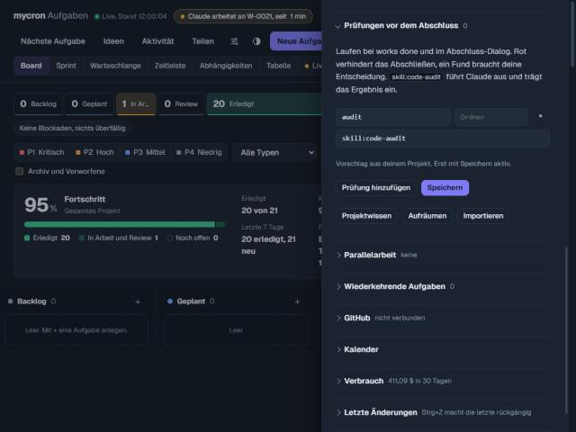
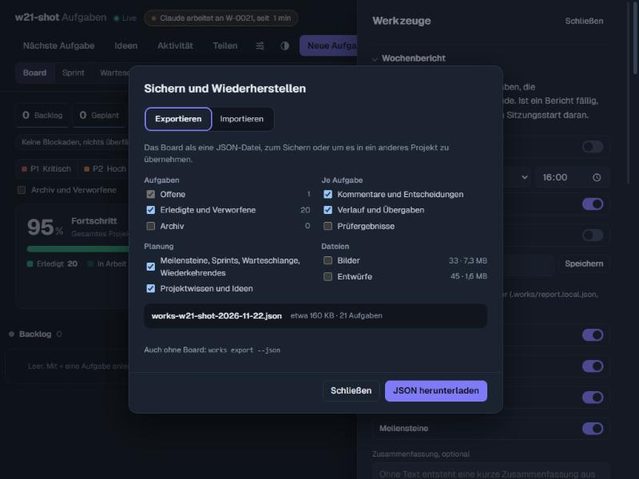

# Board als JSON exportieren und importieren

## Ziel
<!-- Welches Gestaltungsproblem wird gelöst? -->

## Beschreibung
Wunsch des Nutzers vom 2026-11-22: Das aktuelle Board soll sich als JSON exportieren und wieder importieren lassen, mit passendem Design im Board. Heute gibt es nur works export (HTML-Schnappschuss zum Teilen, im Board unter Teilen oder exportieren) und works import (Trello, Notion, Linear, CSV, Excel, Word, Markdown, legt nur neue Aufgaben an, im Board unter Werkzeuge, Importieren). Ein JSON des eigenen Boards mit allen Aufgaben und ihren Feldern fehlt, ebenso das Einlesen eines solchen JSON. Zu klären im Entwurf: Umfang des Exports (Aufgaben mit Beschreibung, Kriterien, Plan, Verlauf, Kommentare, Entscheidungen; dazu Meilensteine, Warteschlange, Sprint, Projektwissen, Wiederkehrendes; Bilder und Entwürfe ja oder nein), Import als Zusammenführen (neue IDs, Duplikate erkennen) oder Wiederherstellen (ersetzt den Stand, mit Sicherung vorher), Vorschau vor dem Import wie beim bestehenden Import, Rückgängig. Auch als CLI-Befehl. Ablauf: Entwürfe mit dem Plugin entwurf, Wahl des Nutzers abwarten, dann umsetzen.

## Zielgruppe und Kontext
<!-- Wer nutzt die Oberfläche, auf welchen Geräten, in welcher Situation? -->

## Referenzen
<!-- Bestehende Seiten, Vorbilder, Markenvorgaben. Bilder über `works asset --kind referenz`. -->

## Varianten
<!-- Untersuchte Richtungen. Ausführliche Begründungen in decisions.md. -->

## Gewählte Lösung
<!-- Kurzbeschreibung des Ergebnisses. -->

## Akzeptanzkriterien
- [x] Darstellung ist auf Mobil, Tablet und Desktop korrekt
- [x] Kontraste erfüllen WCAG AA
- [x] Bedienung per Tastatur ist möglich
- [x] Im Board und per CLI lässt sich das Board als eine JSON-Datei herunterladen
- [x] Ein solches JSON lässt sich im Board und per CLI wieder einlesen, mit Vorschau vor dem Übernehmen
- [x] Export und Import ergeben denselben Stand (Aufgaben, Felder, Kommentare, Entscheidungen)
- [x] Ein Import lässt sich rückgängig machen

## Umsetzungsplan
- [x] Verhalten (E1) mit dem Nutzer klären
- [x] Export: Modul backup.mjs, works export --json, Test
- [x] Import: Abgleich, Zusammenführen, Wiederherstellen mit Sicherung, Rückgängig, works import für works-JSON, Test
- [x] Board: API und Dialog Sichern und Wiederherstellen, Fuß der Dialoge, Browser-Test
- [x] Doku, Selbsttest Windows mit Browser, CI

## Betroffene Dateien
- `plugins/works/skills/works/scripts/backup.mjs`: neu, Export, Prüfung, Abgleich, Zusammenführen, Wiederherstellen
- `plugins/works/skills/works/scripts/undo.mjs`: Rückgängig für Wiederherstellen über die Sicherung
- `plugins/works/skills/works/scripts/works.mjs`: export --json, import für works-Sicherungen, Hilfe
- `plugins/works/skills/works/scripts/api.mjs`, `serve.mjs`: /api/backup, /api/backup-info, /api/backup-preview, Aktion backupApply
- `plugins/works/skills/works/scripts/board/board.js`, `board.css`: Dialog Sichern und Wiederherstellen, Fuß der Dialoge
- `plugins/works/skills/works/scripts/selftest.mjs`: Schritt Sichern als JSON, Browser-Prüfung
- `plugins/works/skills/works/SKILL.md`, `references/board.md`, `cli.md`, `import.md`

## Designentscheidungen
Details und verworfene Alternativen: [decisions.md](decisions.md)

## Assets

Beschreibung: Vorher: Werkzeuge im Board mit Projektwissen, Aufräumen und Importieren, ohne Sichern und Wiederherstellen
Art: vorher · Hinzugefügt: 2026-11-22

Beschreibung: Nachher: Dialog Sichern und Wiederherstellen, Reiter Exportieren mit Umfang (Aufgaben, Je Aufgabe, Planung, Dateien), Dateiname und geschätzter Größe
Art: nachher · Hinzugefügt: 2026-11-22

## Offene Fragen

## Übergabe
Abgeschlossen am 2026-11-22. Keine offene Übergabe.

## Verlauf
- 2026-11-22: Aufgabe angelegt
- 2026-11-22: decisions.md angelegt
- 2026-11-22: Entwurf A „An Teilen und Import andocken“ angehängt
- 2026-11-22: Entwurf B „Eigener Dialog Sichern und Wiederherstellen“ angehängt
- 2026-11-22: Entwurf B „Eigener Dialog Sichern und Wiederherstellen“ gewählt. Grund: Nutzer am 2026-11-22 im Superpowers-Begleiter: eigener Dialog Sichern und Wiederherstellen
- 2026-11-22: Gestartet (Status: backlog → in-arbeit)
- 2026-11-22: CLI-Teil gebaut: backup.mjs (exportBoard, readBackup, compareBackup, mergeBackup, restoreBackup), works export --json, works import für works-Sicherungen mit Vorschau, --apply, --mode=restore, Rückgängig über undo.mjs (snapshotRestore). Selbsttest-Schritt 'Sichern als JSON' war rot (HTML statt JSON), grüner Lauf läuft.
- 2026-11-22: Übergabe aktualisiert
- 2026-11-22: Handtest des CLI-Ablaufs grün (Export, Wiederherstellen, Vorschau, Zusammenführen mit neuer ID, Rückgängig). Nummern für --only ab 1. backupInfo für den Export-Dialog, CSS bk-* und Fuß der Dialoge (flex-wrap, .imp-wrap min-width 0) ergänzt.
- 2026-11-22: CLI-Teil grün (Selbsttest 26 von 26). Browser-Test für den Dialog geschrieben, roter Lauf läuft. Doku: board.md (Sichern und Wiederherstellen), cli.md, import.md, SKILL.md.
- 2026-11-22: Board-Teil gebaut: Routen /api/backup, /api/backup-info, /api/backup-preview, Aktion backupApply (eigenes Rückgängig), Dialog Sichern und Wiederherstellen (Werkzeuge, Befehlspalette) mit Vergleich, CLI-Hilfe. Browser-Selbsttest läuft. Fund im Audit: Export ohne Verlauf und danach Zusammenführen würde den Verlauf geänderter Aufgaben überschreiben; Behebung folgt nach dem Lauf.
- 2026-11-22: Übergabe aktualisiert
- 2026-11-22: Asset hinzugefügt: assets/2026-11-22-vorher-werkzeuge-im-board-mit-vorher.jpg (vorher)
- 2026-11-22: Asset hinzugefügt: assets/2026-11-22-nachher-dialog-sichern-und-nachher.jpg (nachher)
- 2026-11-22: Behebung: Export ohne Verlauf gilt im Abgleich als unverändert, Zusammenführen behält Verlauf und Übergabe des Boards (Test im Selbsttest). Selbsttest mit Browser 26 von 26. Vorher- und Nachher-Screenshot angehängt.
- 2026-11-22: Entscheidung E3 dokumentiert: Export ohne Verlauf überschreibt keinen Verlauf
- 2026-11-22: Abgeschlossen (Status: in-arbeit → erledigt), DoD bestätigt
