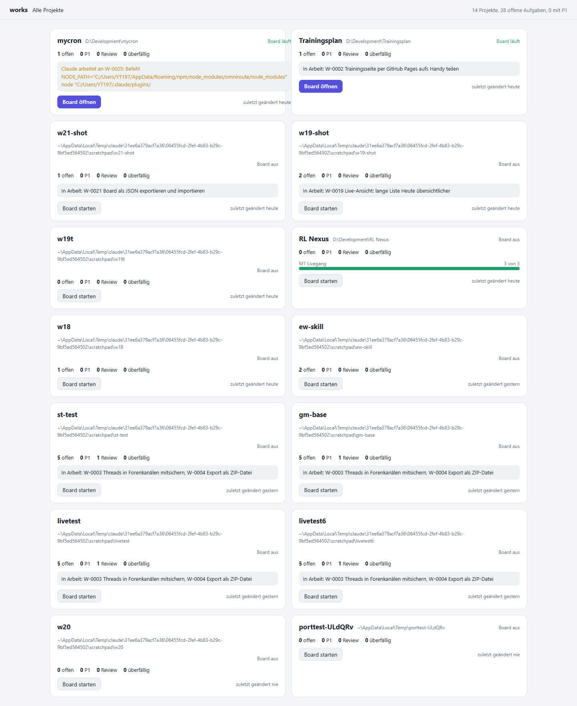
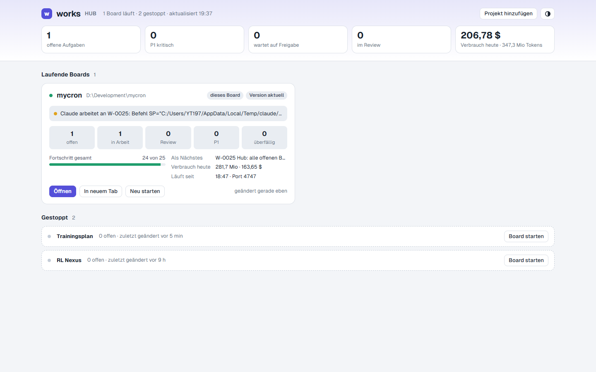
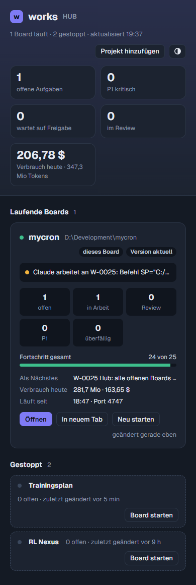
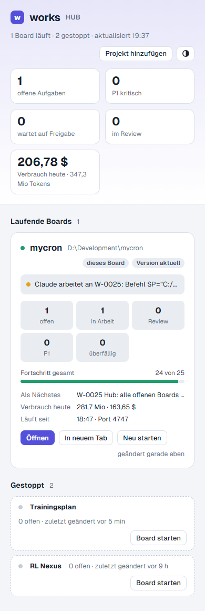
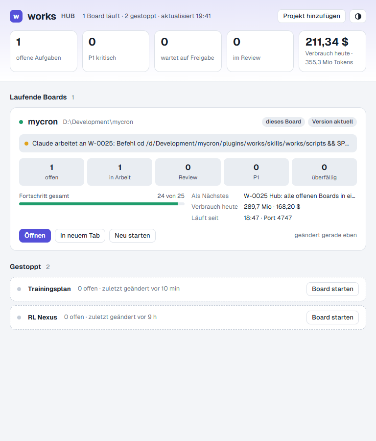

# Hub: alle offenen Boards in einem Tab

## Ziel
<!-- Welches Gestaltungsproblem wird gelöst? -->

## Beschreibung
Vorschlag des Nutzers vom 2026-11-22: Sind mehrere works-Boards offen (mehrere Projekte), sollen sie auf der Hub-Seite erscheinen. Ein Klick auf ein Board öffnet seine große Ansicht im selben Tab. Spart Tabs: heute hat jedes Projekt seinen eigenen Board-Tab. Zusammen mit --open (W-0020): Ist der Hub offen, soll ein weiteres Board dort erscheinen statt in einem neuen Tab. Heute gibt es works hub (Projektübersicht auf Port 4740). Ablauf: Entwürfe mit dem Plugin mockups, im Superpowers-Begleiter zeigen, Wahl abwarten, dann umsetzen.

## Zielgruppe und Kontext
<!-- Wer nutzt die Oberfläche, auf welchen Geräten, in welcher Situation? -->

## Referenzen
<!-- Bestehende Seiten, Vorbilder, Markenvorgaben. Bilder über `works asset --kind referenz`. -->

## Varianten
<!-- Untersuchte Richtungen. Ausführliche Begründungen in decisions.md. -->

## Gewählte Lösung
Variante D „Kennzahlen-Kopf und große Karten“. Jedes Board liefert den Hub unter `/hub`, `works hub` (Port 4740) zeigt dieselbe Seite. Kopf mit Summen über alle Projekte, laufende Boards als große Karten, gestoppte kompakt darunter. Die Board-Seite fragt alle 5 s `/boards`; wird aus einem Board zwei, wechselt der Tab zu `/hub`. Aus dem Hub geöffnete Boards (`?from=hub`) bleiben offen und zeigen „← Hub (N Boards)“. `--open` zählt die Tabs aller Boards. Neu starten, Stoppen und Starten nur lokal mit Token.

## Akzeptanzkriterien
- [x] Darstellung ist auf Mobil, Tablet und Desktop korrekt
- [x] Kontraste erfüllen WCAG AA
- [x] Bedienung per Tastatur ist möglich
- [x] Alle laufenden Boards erscheinen im Hub, ein Klick öffnet das Board groß im selben Tab

## Umsetzungsplan
- [x] Selbsttest: zwei Boards, /boards, /hub, Aktionen mit und ohne Token, --open über alle Boards, works hub, Browser-Wechsel und Öffnen
- [x] hub.mjs: runningBoards, projectInfo erweitert (Fortschritt, Verbrauch, Freigabe, CI, Version), Seite D mit Board-CSS, hubAction
- [x] serve.mjs: /boards, /hub, POST /api/hub (nur lokal)
- [x] board.js und template.html: Link „← Hub (N Boards)“, Wechsel bei 1 → 2 Boards
- [x] works.mjs: openBoardOnce zählt die Tabs aller Boards
- [x] Doku: board.md, cli.md, SKILL.md
- [x] Selbsttest grün (28 von 28 mit Browser), Screenshots vorher und nachher (1440, 768, 390, hell und dunkel)
- [ ] Abschluss: Merge, Push, CI, Plugin-Update

## Betroffene Dateien
- plugins/works/skills/works/scripts/hub.mjs
- plugins/works/skills/works/scripts/serve.mjs
- plugins/works/skills/works/scripts/works.mjs
- plugins/works/skills/works/scripts/board.mjs
- plugins/works/skills/works/scripts/usage.mjs (Verbrauchs-Cache je Projekt)
- plugins/works/skills/works/scripts/board/board.js, template.html, board.css
- plugins/works/skills/works/scripts/selftest.mjs
- plugins/works/skills/works/references/board.md, cli.md, SKILL.md

## Designentscheidungen
Details und verworfene Alternativen: [decisions.md](decisions.md)

## Assets

Beschreibung: Alter works hub (Port 4740): Karten aller Projekte ohne Kopf mit Summen, Board öffnen in neuem Tab, Testprojekte aus dem Scratchpad noch in der Liste
Art: vorher · Hinzugefügt: 2026-11-22

Beschreibung: Neuer Hub, Variante D, hell, 1440 px: Kopf mit fünf Kennzahlen, mycron als große Karte (dieses Board, Live-Zeile, Zahlen, Fortschritt 24 von 25, Verbrauch, Port), Trainingsplan und RL Nexus unter Gestoppt
Art: nachher · Hinzugefügt: 2026-11-22

Beschreibung: Neuer Hub dunkel auf dem Handy (390 px): Kennzahlen zweispaltig, Karte einspaltig, kein seitliches Scrollen
Art: nachher · Hinzugefügt: 2026-11-22

Beschreibung: Neuer Hub hell auf dem Handy (390 px)
Art: nachher · Hinzugefügt: 2026-11-22

Beschreibung: Neuer Hub hell auf dem Tablet (768 px): Kennzahlen in einer Reihe, Karte über die volle Breite, Zahlen fünfspaltig
Art: nachher · Hinzugefügt: 2026-11-22

## Offene Fragen

## Übergabe
Stand: 2026-11-22 19:39

Fertig bis auf Abschluss. Kriterien Kontrast, Tastatur, Öffnen im selben Tab abgehakt; Darstellung Mobil/Desktop geprüft, Tablet-Bild folgt nach dem laufenden Selbsttest. Danach: Commit auf feature/w-0025-hub, code-audit eintragen, works done, Merge --no-ff, Push, CI, Plugin-Update, Board neu starten.

## Verlauf
- 2026-11-22: Aufgabe angelegt
- 2026-11-22: decisions.md angelegt
- 2026-11-22: Entwurf A „Startseite und Umschalter“ angehängt
- 2026-11-22: Entwurf B „Seitenleiste“ angehängt
- 2026-11-22: Entwurf C „Projekt-Reiter“ angehängt
- 2026-11-22: Entscheidung E1 dokumentiert: Erste Entwürfe verworfen
- 2026-11-22: Entwurf D „Kennzahlen-Kopf und große Karten“ angehängt
- 2026-11-22: Entwurf E „Aktivitäts-Kopf und Liste“ angehängt
- 2026-11-22: Entwurf F „Vorschau-Kacheln“ angehängt
- 2026-11-22: Entwurf D „Kennzahlen-Kopf und große Karten“ gewählt. Grund: Nutzer am 2026-11-22 im Superpowers-Begleiter: Kennzahlen-Kopf und große Karten
- 2026-11-22: Gestartet (Status: backlog → in-arbeit)
- 2026-11-22: Hub-Seite D, /boards, /hub, /api/hub, Wechsel im Board-Tab und --open über alle Boards umgesetzt; Selbsttest: beide Hub-Schritte grün
- 2026-11-22: Übergabe aktualisiert
- 2026-11-22: Währung und Kennzahlen im Hub maskiert, h1 im Kopf, Test für Projekt hinzufügen; alte Scratchpad-Testprojekte entfernt, Hub zeigt nur echte Projekte
- 2026-11-22: Übergabe aktualisiert
- 2026-11-22: Selbsttest: Test-Boards nutzen feste freie Ports ab 48200, weil ein verwaister Board-Tab auf 4748 (Trainingsplan-Board beendet) sich mit dem Test-Board verband und als offener Tab zählte
- 2026-11-22: Übergabe aktualisiert
- 2026-11-22: Asset hinzugefügt: assets/2026-11-22-hub-vorher-light-1440-vorher.png (vorher)
- 2026-11-22: Asset hinzugefügt: assets/2026-11-22-hub-nachher-light-1440-nachher.png (nachher)
- 2026-11-22: Asset hinzugefügt: assets/2026-11-22-hub-nachher-dark-390-nachher.png (nachher)
- 2026-11-22: Asset hinzugefügt: assets/2026-11-22-hub-nachher-light-390-nachher.png (nachher)
- 2026-11-22: Kontraste auf WCAG AA angehoben (Chips, rote Zahlen, Beschriftungen, Kopf), Fokus bleibt bei der Aktualisierung erhalten, Vorher- und Nachher-Bilder angehängt, E2 in decisions.md
- 2026-11-22: Übergabe aktualisiert
- 2026-11-22: Asset hinzugefügt: assets/2026-11-22-hub-nachher-light-768-nachher.png (nachher)
