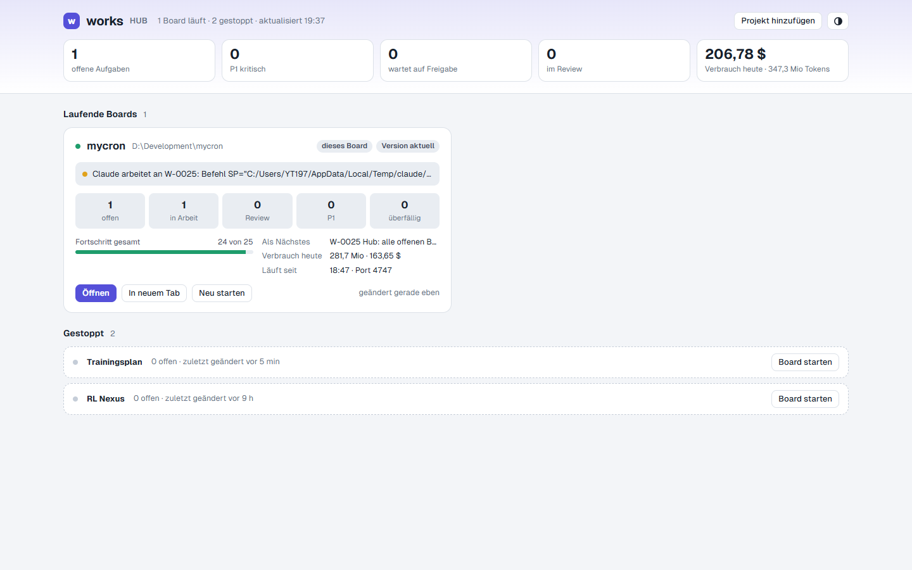
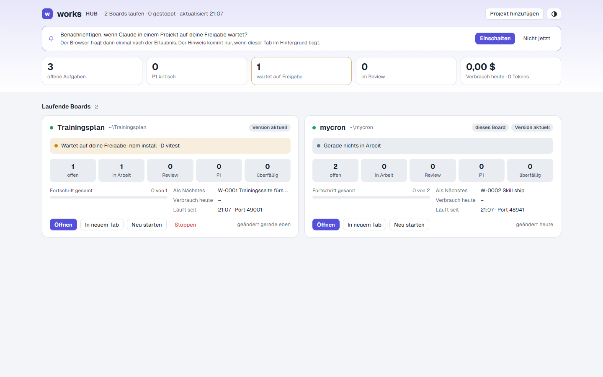
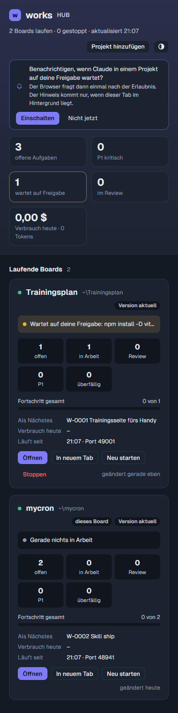
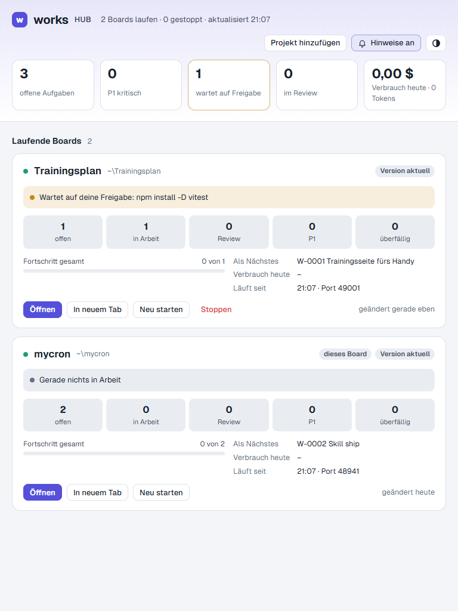

# Hub: Browser-Hinweis, wenn Claude auf eine Freigabe wartet

## Ziel
<!-- Was ist nach Abschluss anders? Ein bis drei Sätze, aus Sicht des Ergebnisses formuliert. -->

## Beschreibung
Vorschlag vom 2026-11-22, vom Nutzer gewünscht (alles einbauen, P3). Der Hub (W-0025) kennt über alle Projekte hinweg, wo Claude auf eine Freigabe wartet (activity.json, perm). Liegt der Tab im Hintergrund, soll eine Browser-Benachrichtigung erscheinen: Projekt, was freigegeben werden soll, Klick öffnet das Board. Nur einmal je Freigabe, nicht bei jeder Aktualisierung. Die Erlaubnis für Benachrichtigungen fragt der Browser erst nach einem Klick des Nutzers (Schalter im Hub-Kopf). Gestaltung über Entwürfe mit mockups, Wahl abwarten.

## Kontext und Problem
<!-- Warum ist das nötig? Aktueller Zustand, Auslöser, Einschränkungen. -->

## Nutzerperspektive
<!-- Wer profitiert und wie? Optional: Als <Rolle> möchte ich <Fähigkeit>, damit <Nutzen>. -->

## Akzeptanzkriterien
- [x] Wartet Claude in einem Projekt auf eine Freigabe und liegt der Hub-Tab im Hintergrund, erscheint eine Browser-Benachrichtigung mit Projekt und Freigabe
- [x] Je Freigabe genau eine Benachrichtigung, nicht bei jeder Aktualisierung
- [x] Die Erlaubnis wird erst nach einem Klick im Hub abgefragt; ohne Erlaubnis bleibt alles wie heute
- [x] Klick auf die Benachrichtigung öffnet das Board des Projekts im Hub-Tab
- [x] Darstellung des Schalters auf Mobil, Tablet und Desktop korrekt, Kontraste WCAG AA, per Tastatur bedienbar

## Umsetzungsplan
- [x] Hub-CSS nach board/hub.css, damit Entwürfe es einbinden können
- [x] Selbsttest: Kennung der Freigabe in der Karte; im Browser Einladung, Einschalten, Hinweis im Hintergrund genau einmal, Wahl bleibt nach Neuladen
- [x] hub.mjs: data-perm an Karten mit wartender Freigabe, Glocke und Einladung im Kopf, Seitenskript mit Notification
- [x] Live-Zeile bei frischer Freigabe richtig formuliert (vorher „Wartet gerade eben auf …“)
- [x] Doku board.md, Screenshots vorher und nachher

## Betroffene Dateien
- plugins/works/skills/works/scripts/hub.mjs: Kennung, Glocke, Einladung, Hinweise
- plugins/works/skills/works/scripts/board/hub.css: Hub-Stile (neu als Datei), Einladung und Glocke
- plugins/works/skills/works/scripts/selftest.mjs: Prüfungen
- plugins/works/skills/works/references/board.md: Doku

## Designentscheidungen
<!-- Kurzfassung der wichtigsten Entscheidungen. Details in decisions.md (works decisions <ID>). -->

## Assets

Beschreibung: Vorher: Hub aus W-0025 ohne Hinweis-Einstellung; eine wartende Freigabe sieht man nur, wenn der Tab vorn liegt
Art: vorher · Hinzugefügt: 2026-11-22

Beschreibung: Nachher, hell 1440 px: Einladung unter dem Kopf mit Einschalten und Nicht jetzt, Trainingsplan wartet auf eine Freigabe
Art: nachher · Hinzugefügt: 2026-11-22

Beschreibung: Nachher, dunkel auf dem Handy: Einladung umgebrochen
Art: nachher · Hinzugefügt: 2026-11-22

Beschreibung: Nachher, Tablet: nach dem Einschalten nur die Glocke Hinweise an im Kopf
Art: nachher · Hinzugefügt: 2026-11-22

## Offene Fragen
<!-- Fragen an den Nutzer, die Claude nicht selbst klären kann. Format: - [ ] Frage -->

## Übergabe
<!-- Wird am Ende jeder Arbeitsphase mit `works handoff` überschrieben. -->

## Verlauf
- 2026-11-22: Aufgabe angelegt
- 2026-11-22: Entwurf A „Glocke im Kopf“ angehängt
- 2026-11-22: Entwurf B „Einladung unter dem Kopf“ angehängt
- 2026-11-22: Entwurf C „Schalter in der Kennzahl“ angehängt
- 2026-11-22: Entwurf B „Einladung unter dem Kopf“ gewählt. Grund: Nutzer am 2026-11-22: Empfehlung genommen. Einladung erklärt einmal, wozu die Erlaubnis gebraucht wird, danach nur die Glocke
- 2026-11-22: Gestartet (Status: backlog → in-arbeit)
- 2026-11-22: Asset hinzugefügt: assets/2026-11-22-hub-vorher-light-1440-vorher.png (vorher)
- 2026-11-22: Asset hinzugefügt: assets/2026-11-22-hub-einladung-light-1440-nachher.png (nachher)
- 2026-11-22: Asset hinzugefügt: assets/2026-11-22-hub-einladung-dark-390-nachher.png (nachher)
- 2026-11-22: Asset hinzugefügt: assets/2026-11-22-hub-glocke-light-768-nachher.png (nachher)
- 2026-11-22: Entscheidung E1 dokumentiert: Hinweis bei wartender Freigabe
- 2026-11-22: Umgesetzt nach Entwurf B, Selbsttest 32/32 mit Browser
