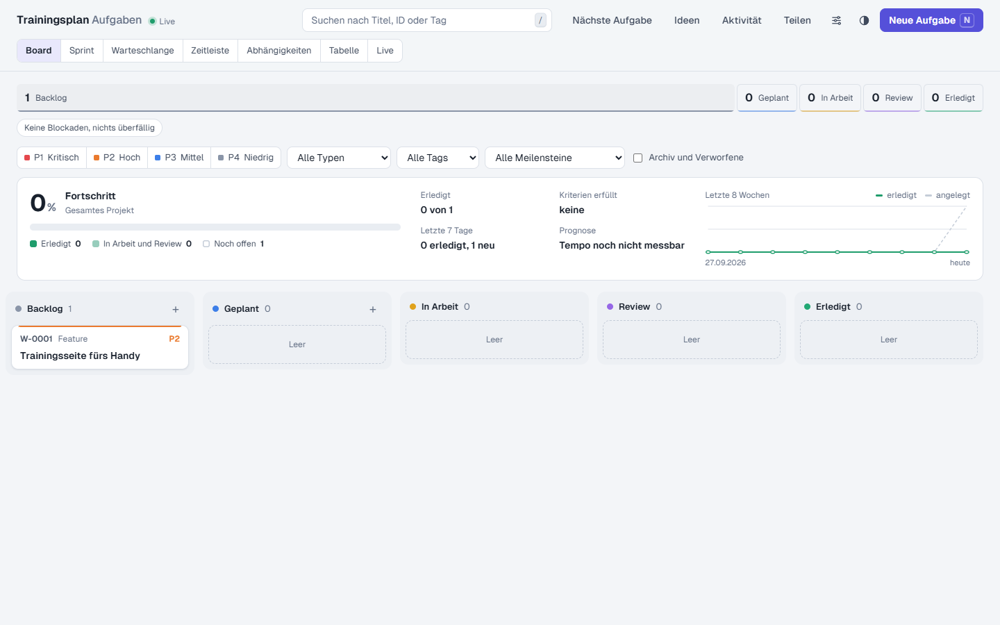
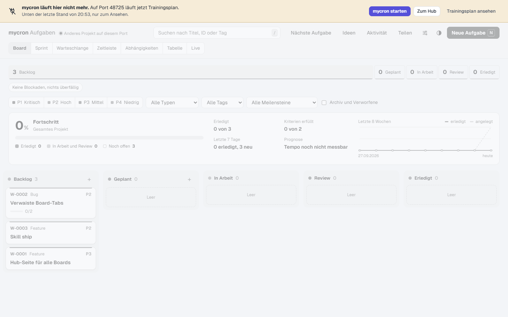
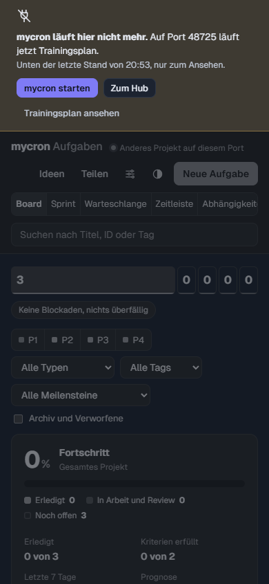
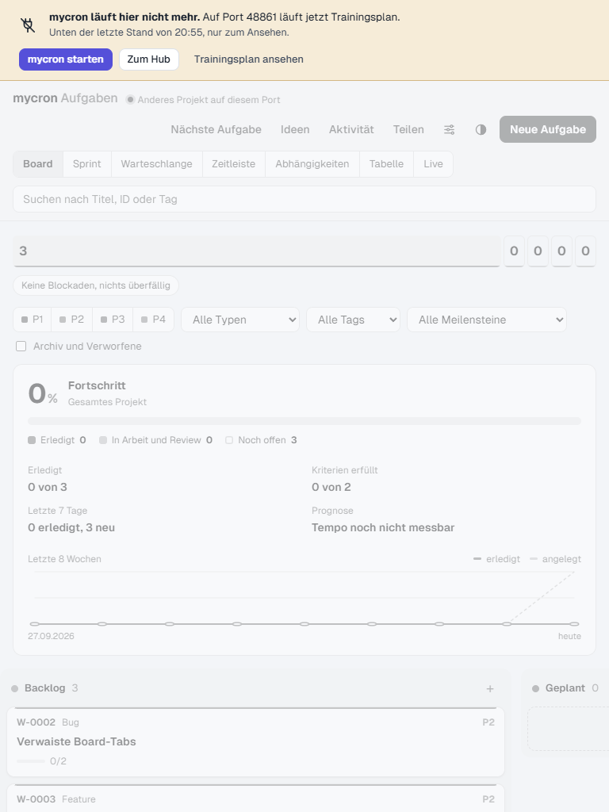

# Verwaiste Board-Tabs zeigen still ein fremdes Projekt

## Zusammenfassung
Ein offener Board-Tab zeigt nach dem Ende seines Boards still das Projekt, das danach auf demselben Port startet, und zählt dort als offener Tab.

## Beschreibung
Gefunden am 2026-11-22 bei W-0025, vom Nutzer gewünscht (P2). Endet ein Board (etwa Trainingsplan auf 4748), versucht sein offener Tab alle 2 s neu zu verbinden. Startet danach ein anderes Projekt auf demselben Port, verbindet sich der alte Tab damit, lädt neu und zeigt still das fremde Board. Außerdem zählt er dort als offener Tab für --open. Gewünscht: Der Tab merkt, dass auf seinem Port jetzt ein anderes Projekt läuft, und zeigt einen Hinweis statt umzuschalten, etwa: Hier läuft jetzt mycron statt Trainingsplan, mit Knöpfen Trainingsplan starten (lokal, über den Hub-Mechanismus) und Zum Hub. Ein solcher Tab zählt nicht als Tab des fremden Boards. Gestaltung über Entwürfe mit mockups, Wahl abwarten.

## Reproduktion
1. Board von Projekt A starten (etwa Port 4748) und im Browser öffnen.
2. Board von A stoppen, den Tab offen lassen.
3. Board von Projekt B auf demselben Port starten.
4. Der Tab von A verbindet sich innerhalb von 2 s mit B, lädt neu und zeigt B. Immer.

## Erwartetes Verhalten
Der Tab bleibt bei A und zeigt einen Hinweis, dass auf dem Port jetzt B läuft, mit A starten und Zum Hub. Er zählt nicht als Tab von B.

## Tatsächliches Verhalten
Der Tab zeigt still B. works board --open in B meldet einen offenen Tab, obwohl der Nutzer B nie geöffnet hat.

## Umgebung
<!-- Version, Branch, Betriebssystem, Browser, Node-Version, Konfiguration. -->

## Logs und Fehlermeldungen
<!-- Stacktraces und Logs als Codeblock. Bei langen Logs nur den relevanten Ausschnitt. -->

## Ursache
Der Event-Stream verbindet sich alle 2 s neu, egal welcher Server auf dem Port antwortet. Beim ersten update vergleicht die Seite nur Version und Server-Kennung (`outdated`) und lädt bei Abweichung neu. Welches Projekt antwortet, prüft sie nicht. Der Server zählt jede lokale Verbindung zu /events als Tab.

## Lösung
meta.rootId (Hash des echten Projektpfads, lib.mjs rootIdOf) in data.json. board.js prüft bei jedem Neuladen zuerst, ob rootId passt; sonst becomeOrphan: Leiste nach Entwurf B, Inhalt ausgegraut und inert, EventSource geschlossen (zählt nicht mehr als Tab), alle 3 s /boards, bei laufendem eigenen Board Wechsel dorthin. /boards liefert dafür projects (Kennung, Name, Pfad) und das Token für POST /api/hub start, nur lokal. a.btn bekommt im ganzen Board die Textfarbe.

## Akzeptanzkriterien
- [x] Der Fehler lässt sich mit den Reproduktionsschritten nicht mehr auslösen
- [x] Regressionstest deckt den Fall ab oder der Verzicht ist begründet
- [x] Ein verwaister Tab zählt nicht als offener Tab des fremden Boards (--open öffnet dann einen neuen Tab für B)
- [x] Der Hinweis bietet A starten (nur lokal, mit Token) und Zum Hub
- [x] Darstellung auf Mobil, Tablet und Desktop korrekt, Kontraste WCAG AA, per Tastatur bedienbar

## Betroffene Dateien
- plugins/works/skills/works/scripts/lib.mjs: rootIdOf
- plugins/works/skills/works/scripts/board.mjs: meta.rootId
- plugins/works/skills/works/scripts/hub.mjs: Kennung in runningBoards, projectsBrief
- plugins/works/skills/works/scripts/serve.mjs: /boards mit projects und token
- plugins/works/skills/works/scripts/board/board.js, template.html, board.css: verwaister Zustand, a.btn-Farbe
- plugins/works/skills/works/scripts/selftest.mjs: Prüfungen im Hub-Schritt, Browser-Schritt Verwaister Tab
- plugins/works/skills/works/references/board.md: Doku

## Assets

Beschreibung: Vorher: Der Tab gehörte zu mycron, nach dem Neustart auf demselben Port zeigt er still das Board von Trainingsplan
Art: vorher · Hinzugefügt: 2026-11-22

Beschreibung: Nachher, hell 1440 px: Leiste mycron läuft hier nicht mehr mit mycron starten, Zum Hub, Trainingsplan ansehen; der letzte Stand von mycron bleibt ausgegraut
Art: nachher · Hinzugefügt: 2026-11-22

Beschreibung: Nachher, dunkel auf dem Handy: Leiste umgebrochen, Knöpfe in zwei Zeilen
Art: nachher · Hinzugefügt: 2026-11-22

Beschreibung: Nachher auf dem Tablet (768 px): Leiste mit Knöpfen in der zweiten Zeile
Art: nachher · Hinzugefügt: 2026-11-22

## Offene Fragen

## Übergabe

## Verlauf
- 2026-11-22: Aufgabe angelegt
- 2026-11-22: Entwurf A „Ersatzseite“ angehängt
- 2026-11-22: Entwurf B „Leiste über dem letzten Stand“ angehängt
- 2026-11-22: Entwurf C „Dialog über dem letzten Stand“ angehängt
- 2026-11-22: Entwurf B „Leiste über dem letzten Stand“ gewählt. Grund: Nutzer am 2026-11-22: Empfehlung genommen. Der letzte Stand bleibt ausgegraut sichtbar, Leiste mit den Knöpfen
- 2026-11-22: Gestartet (Status: backlog → in-arbeit)
- 2026-11-22: Asset hinzugefügt: assets/2026-11-22-tab-vorher-light-1440-vorher.png (vorher)
- 2026-11-22: Asset hinzugefügt: assets/2026-11-22-tab-nachher-light-1440-nachher.png (nachher)
- 2026-11-22: Asset hinzugefügt: assets/2026-11-22-tab-nachher-dark-390-nachher.png (nachher)
- 2026-11-22: Asset hinzugefügt: assets/2026-11-22-tab-nachher-light-768-nachher.png (nachher)
- 2026-11-22: Umgesetzt nach Entwurf B, Selbsttest 31/31 mit Browser, Hub-Schritt zusätzlich mit 8.3-Kurzpfad geprüft
- 2026-11-22: Entscheidung E1 dokumentiert: Verwaisten Tab erkennen und anzeigen
