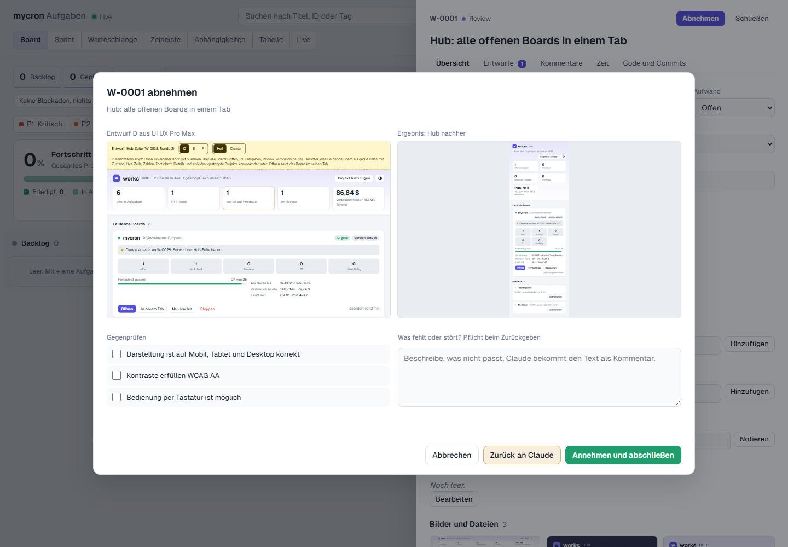
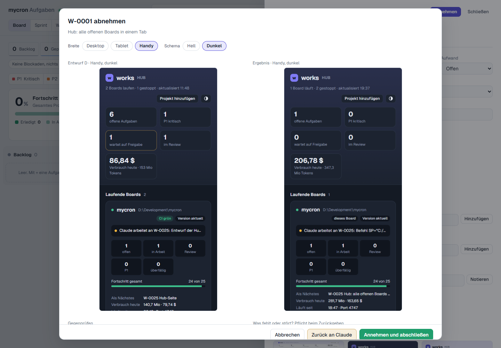
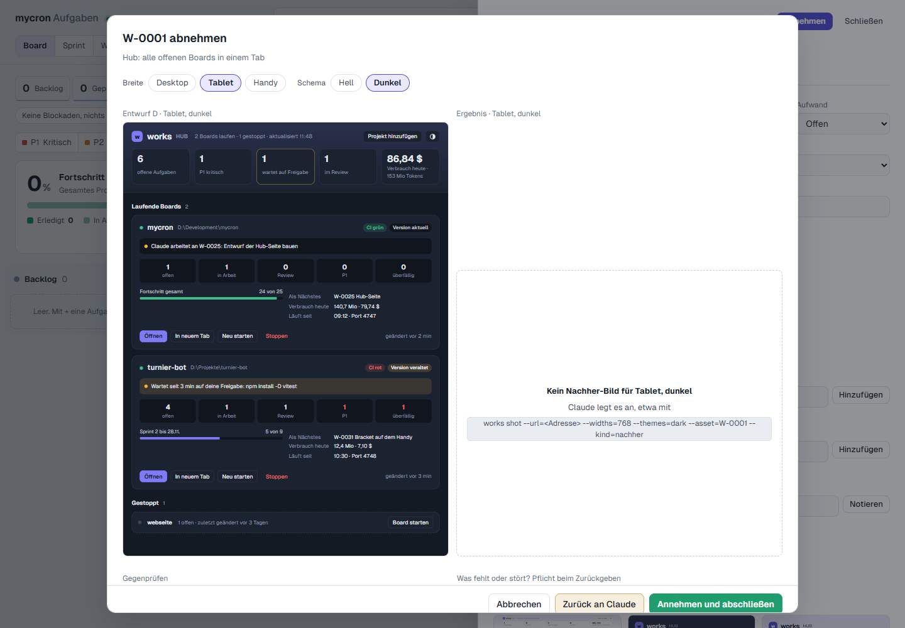
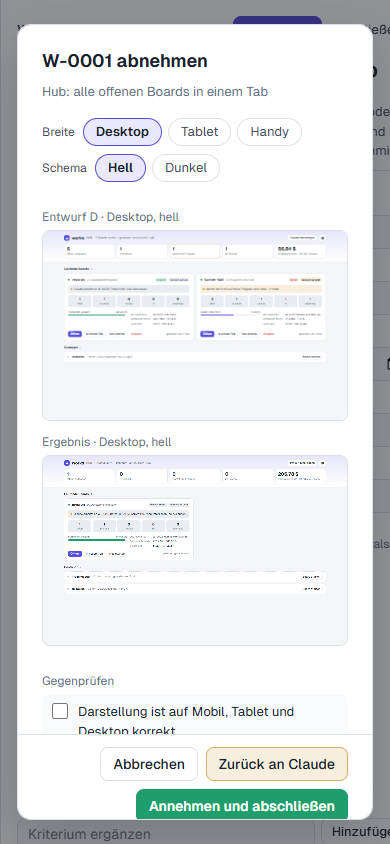

# mockups: Entwurf und Ergebnis nebeneinander im Review

## Ziel
<!-- Was ist nach Abschluss anders? Ein bis drei Sätze, aus Sicht des Ergebnisses formuliert. -->

## Beschreibung
Vorschlag vom 2026-11-22, vom Nutzer gewünscht (alles einbauen, P3). Beim Review einer Gestaltungsaufgabe soll mockups aus dem gewählten Entwurf (design/, works design choose) und dem Nachher-Screenshot (works shot --asset --kind nachher) ein Vergleichsbild bauen: links Entwurf, rechts Umsetzung, gleiche Breite und gleiches Farbschema. Damit sieht man sofort, wo die Umsetzung abweicht (bei W-0025 etwa die angehobenen Kontraste). Das Bild hängt an der Aufgabe und erscheint im Board bei der Abnahme. Gestaltung des Vergleichs über Entwürfe, Wahl abwarten.

## Kontext und Problem
<!-- Warum ist das nötig? Aktueller Zustand, Auslöser, Einschränkungen. -->

## Nutzerperspektive
<!-- Wer profitiert und wie? Optional: Als <Rolle> möchte ich <Fähigkeit>, damit <Nutzen>. -->

## Akzeptanzkriterien
<!-- Nach Rückfrage am 2026-11-22 verkleinert: Der Abnahmedialog zeigt Entwurf und Ergebnis schon nebeneinander, es fehlt der gleiche Maßstab. -->
- [x] Im Abnahmedialog gibt es beim Vergleich Entwurf gegen Ergebnis Umschalter für die Breite (Desktop, Tablet, Handy) und für hell/dunkel
- [x] Der Entwurf rendert in der gewählten Breite und im gewählten Schema; daneben steht das Nachher-Bild mit derselben Breite und demselben Schema, wenn es eins gibt
- [x] Fehlt ein passendes Nachher-Bild, nennt der Dialog, welches fehlt und wie es entsteht (works shot --asset), statt ein beliebiges zu zeigen
- [x] Ohne Entwurf oder ohne Nachher-Bild bleibt der Dialog wie heute
- [x] Darstellung auf Mobil, Tablet und Desktop korrekt, Kontraste WCAG AA, per Tastatur bedienbar

## Umsetzungsplan
- [x] Selbsttest im Browser: Aufgabe mit HTML-Entwurf und Nachher-Bildern hell 1440 und dunkel 390; Handy dunkel, Tablet fehlt, Desktop hell rendert mit 1440 px
- [x] board.js openReview: Breite und Schema, Entwurf mit ?theme= und frame=0 in der gewählten Breite, passendes Nachher-Bild oder Hinweis mit Befehl
- [x] board.css: Umschalter, Hochformat für Tablet und Handy, Bilder oben bündig, Hinweis bei fehlendem Bild
- [x] Doku board.md, integrations.md, SKILL.md; Screenshots vorher und nachher

## Betroffene Dateien
- plugins/works/skills/works/scripts/board/board.js: openReview, fitFrame mit data-fw
- plugins/works/skills/works/scripts/board/board.css: Stile der Umschalter und Größen
- plugins/works/skills/works/scripts/selftest.mjs: Browser-Schritt Abnahme
- plugins/works/skills/works/references/board.md, integrations.md, SKILL.md: Doku

## Designentscheidungen
<!-- Kurzfassung der wichtigsten Entscheidungen. Details in decisions.md (works decisions <ID>). -->

## Assets

Beschreibung: Vorher: Abnahmedialog vergleicht Entwurf D (1024 px, Standardschema) mit einem beliebigen Nachher-Bild, ohne Wahl von Breite und Schema
Art: vorher · Hinzugefügt: 2026-11-22

Beschreibung: Nachher: Breite Handy, Schema dunkel; Entwurf D rendert mit 390 px dunkel, daneben das Nachher-Bild dunkel 390, beide oben bündig
Art: nachher · Hinzugefügt: 2026-11-22

Beschreibung: Nachher: Tablet dunkel ohne Nachher-Bild, der Dialog nennt den Befehl zum Anlegen
Art: nachher · Hinzugefügt: 2026-11-22

Beschreibung: Nachher auf dem Handy: Umschalter umgebrochen, Entwurf und Ergebnis untereinander
Art: nachher · Hinzugefügt: 2026-11-22

## Offene Fragen
<!-- Fragen an den Nutzer, die Claude nicht selbst klären kann. Format: - [ ] Frage -->

## Übergabe
<!-- Wird am Ende jeder Arbeitsphase mit `works handoff` überschrieben. -->

## Verlauf
- 2026-11-22: Aufgabe angelegt
- 2026-11-22: Nach Rückfrage verkleinert: kein separates Vergleichsbild, stattdessen Breite und hell/dunkel im vorhandenen Vergleich des Abnahmedialogs
- 2026-11-22: Entwurf A „Zwei Umschalter“ angehängt
- 2026-11-22: Entwurf B „Vorhandene Bilder“ angehängt
- 2026-11-22: Entwurf A „Zwei Umschalter“ gewählt. Grund: Nutzer am 2026-11-22: Empfehlung genommen. Feste Umschalter, zeigt fehlende Nachher-Bilder mit Befehl
- 2026-11-22: Gestartet (Status: backlog → in-arbeit)
- 2026-11-22: Asset hinzugefügt: assets/2026-11-22-abnahme-vorher-1440-vorher.png (vorher)
- 2026-11-22: Asset hinzugefügt: assets/2026-11-22-abnahme-handy-dunkel-1440-nachher.png (nachher)
- 2026-11-22: Asset hinzugefügt: assets/2026-11-22-abnahme-tablet-fehlt-1440-nachher.png (nachher)
- 2026-11-22: Asset hinzugefügt: assets/2026-11-22-abnahme-mobil-390-nachher.png (nachher)
- 2026-11-22: Entscheidung E1 dokumentiert: Vergleich im gleichen Maßstab
- 2026-11-22: Umgesetzt nach Entwurf A, Selbsttest 33/33 mit Browser
- 2026-11-22: Beim ersten ship-Versuch ship-Fehler gefunden und behoben (siehe W-0026), Selbsttest 33/33
