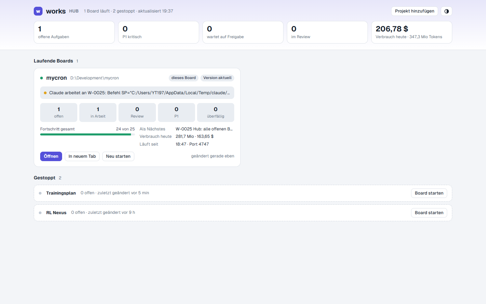
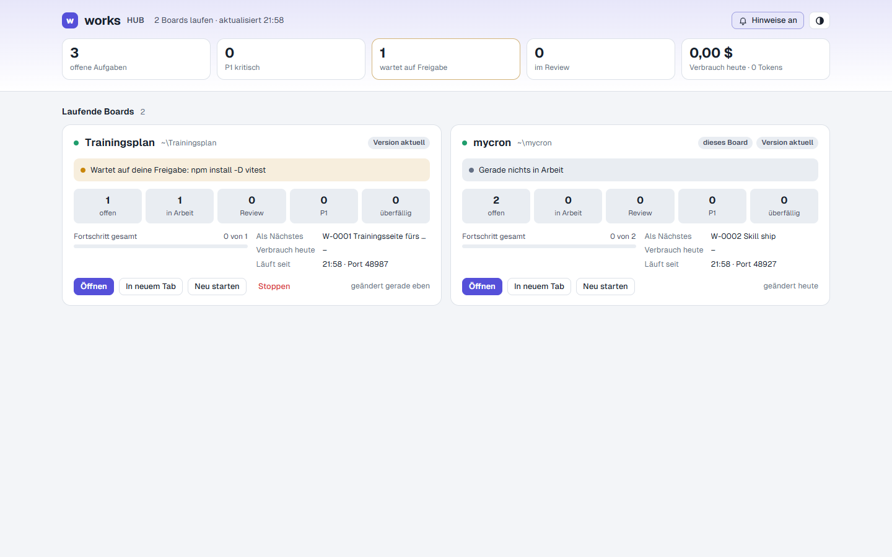
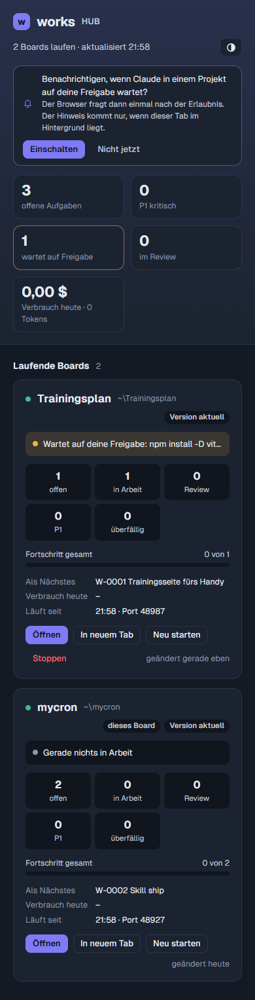
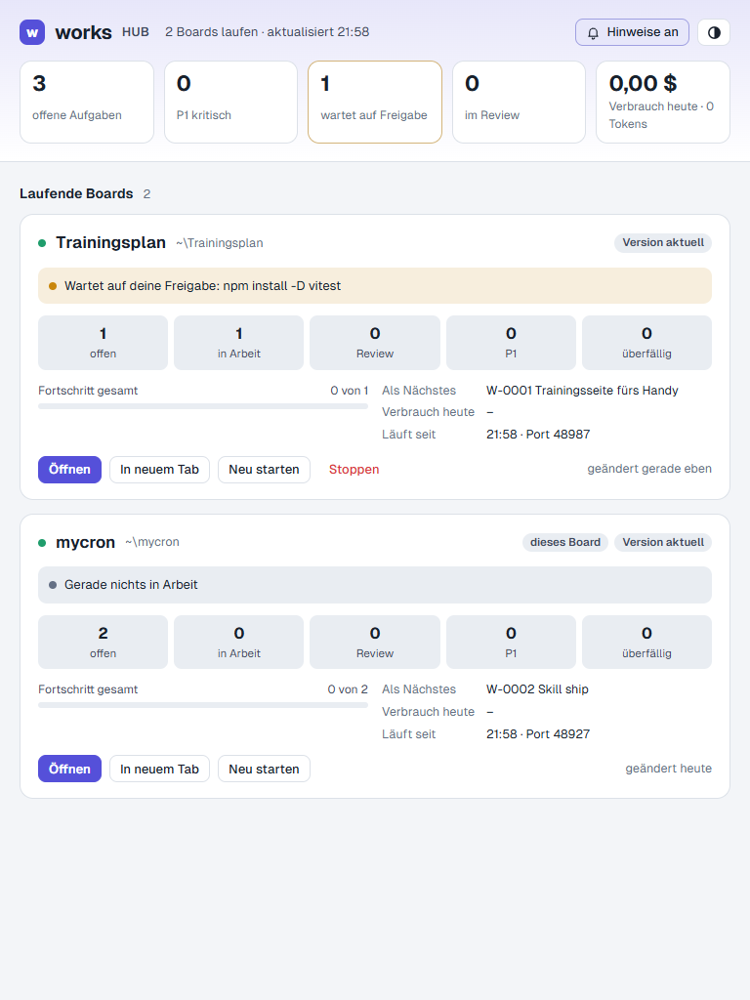

# Hub: Projekte aus der Liste nehmen

## Ziel
<!-- Was ist nach Abschluss anders? Ein bis drei Sätze, aus Sicht des Ergebnisses formuliert. -->

## Beschreibung
Vorschlag vom 2026-11-22, vom Nutzer gewünscht (P2, erst Entwürfe). Im Hub standen Testprojekte aus Temp-Ordnern unter Gestoppt, sie ließen sich nur durch Löschen der Ordner entfernen. Gewünscht: bei gestoppten Projekten ein Knopf Aus der Liste (mit Rückfrage, nur lokal mit Token), der den Eintrag aus ~/.works/projects.json nimmt; der Ordner bleibt unberührt. Projekte in Temp-Ordnern (os.tmpdir) werden gar nicht erst eingetragen. Gestaltung über Entwürfe mit mockups, Wahl abwarten.

Änderung des Nutzers am 2026-11-22 (ersetzt Knopf und Entwürfe): Boards, die nicht mehr laufen, verschwinden automatisch und live aus der Hub-Liste. Läuft nur noch ein Board, schließt sich der Hub und der Tab zeigt dieses Board. Gehen wieder zwei oder mehr Boards auf, zeigt der Tab wieder die Hub-Liste.
## Kontext und Problem
<!-- Warum ist das nötig? Aktueller Zustand, Auslöser, Einschränkungen. -->

## Nutzerperspektive
<!-- Wer profitiert und wie? Optional: Als <Rolle> möchte ich <Fähigkeit>, damit <Nutzen>. -->

## Akzeptanzkriterien
- [x] Der Hub zeigt nur laufende Boards; endet ein Board, verschwindet es bei der nächsten Aktualisierung (höchstens 5 s) ohne Neuladen
- [x] Läuft nur noch ein Board, wechselt der Hub-Tab zu diesem Board
- [x] Endet das Board, das den Hub ausliefert, wechselt der Tab zum verbliebenen Board
- [x] Gehen wieder zwei oder mehr Boards auf, zeigt der Tab wieder den Hub
- [x] Gestoppt-Liste und „Projekt hinzufügen“ sind entfernt
- [x] Darstellung auf Mobil, Tablet und Desktop korrekt

## Umsetzungsplan
- [x] Selbsttest: Hub ohne gestoppte Boards und ohne add; im Browser Wechsel zum verbliebenen Board, zurück zum Hub bei zweien, Wechsel wenn das eigene Board endet
- [x] hub.mjs: nur laufende Boards, Gestoppt-Liste und Projekt hinzufügen entfernt, followSingle und serverGone im Seitenskript
- [x] hub.css: Stile der Gestoppt-Zeilen entfernt
- [x] Doku board.md, Screenshots

## Betroffene Dateien
- plugins/works/skills/works/scripts/hub.mjs, board/hub.css
- plugins/works/skills/works/scripts/selftest.mjs
- plugins/works/skills/works/references/board.md

## Designentscheidungen
Details und verworfene Alternativen: [decisions.md](decisions.md)

## Assets

Beschreibung: Vorher: Hub mit Gestoppt-Liste (Trainingsplan, RL Nexus) und Projekt hinzufügen
Art: vorher · Hinzugefügt: 2026-11-22

Beschreibung: Nachher: nur die zwei laufenden Boards, Kopf ohne gestoppt und ohne Projekt hinzufügen
Art: nachher · Hinzugefügt: 2026-11-22

Beschreibung: Nachher dunkel auf dem Handy
Art: nachher · Hinzugefügt: 2026-11-22

Beschreibung: Nachher auf dem Tablet
Art: nachher · Hinzugefügt: 2026-11-22

## Offene Fragen
<!-- Fragen an den Nutzer, die Claude nicht selbst klären kann. Format: - [ ] Frage -->

## Übergabe
<!-- Wird am Ende jeder Arbeitsphase mit `works handoff` überschrieben. -->

## Verlauf
- 2026-11-22: Aufgabe angelegt
- 2026-11-22: Entwurf A „Knopf je Zeile“ angehängt
- 2026-11-22: Entwurf B „× mit Rückgängig“ angehängt
- 2026-11-22: Entwurf C „Liste bearbeiten“ angehängt
- 2026-11-22: decisions.md angelegt
- 2026-11-22: Entscheidung E1 dokumentiert: Nur laufende Boards statt Knopf
- 2026-11-22: Gestartet (Status: backlog → in-arbeit)
- 2026-11-22: title: Hub: Projekte aus der Liste nehmen → Hub zeigt nur laufende Boards und schließt sich bei einem
- 2026-11-22: Asset hinzugefügt: assets/2026-11-22-hub-mit-gestoppt-1440-vorher.png (vorher)
- 2026-11-22: Asset hinzugefügt: assets/2026-11-22-hub-nur-laufende-1440-nachher.png (nachher)
- 2026-11-22: Asset hinzugefügt: assets/2026-11-22-hub-nur-laufende-dark-390-nachher.png (nachher)
- 2026-11-22: Asset hinzugefügt: assets/2026-11-22-hub-nur-laufende-768-nachher.png (nachher)
- 2026-11-22: Nach der Idee des Nutzers umgesetzt, Selbsttest 35/35 mit Browser
