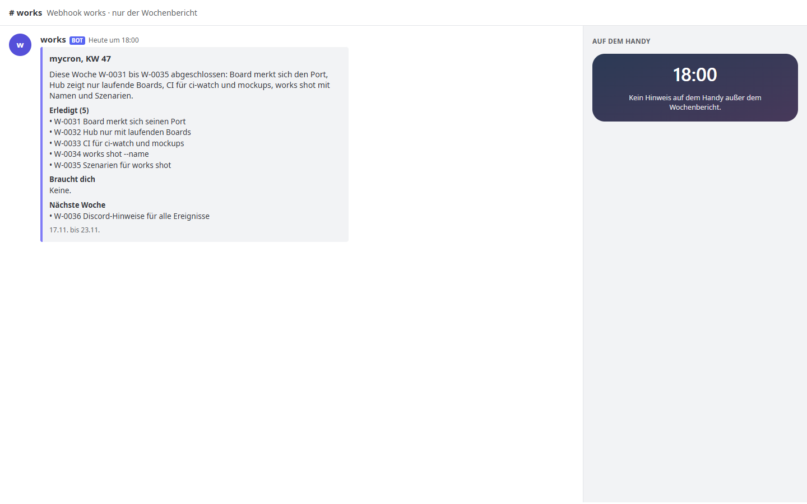
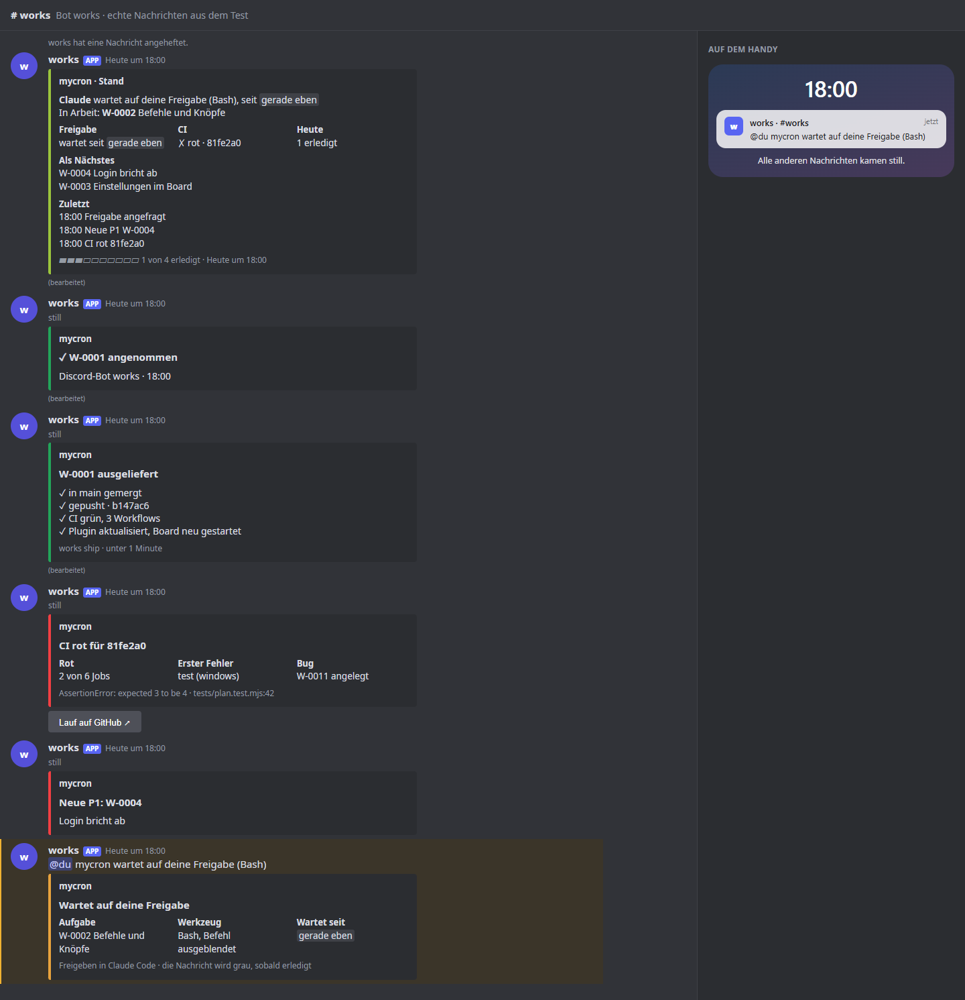
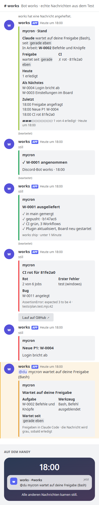

# Discord: Hinweise für alle Ereignisse per Webhook

## Ziel
<!-- Was ist nach Abschluss anders? Ein bis drei Sätze, aus Sicht des Ergebnisses formuliert. -->

## Beschreibung
Wunsch des Nutzers vom 2026-11-22/23 (P2): Discord-Anbindung für alles, nicht nur den Wochenbericht. Entscheidung nach Abwägung (Nutzer: überleg, was Sinn macht): Webhook für alle Ereignisse, kein Bot. Ziel: Hinweise aufs Handy, wenn der Nutzer nicht am Rechner ist (der Browser-Hinweis aus W-0028 kommt nur bei offenem Hub-Tab). Grundlage existiert: works report --webhook, URL lokal in .works/report.local.json, Prüfung der URL, sendDiscord für den Wochenbericht. Ereignisse, alle standardmäßig an und einzeln abschaltbar: Claude braucht dich (Freigabe wartet, Claude fertig und wartet, Frage von Claude; mit @-Erwähnung), Ergebnisse (Aufgabe im Review, erledigt, ship gepusht), CI (rot mit Bug-ID aus W-0027, grün nach ship), Planung und Berichte (neue P1, Blockade aufgelöst, Warteschlange leer, Feierabend- und Wochenbericht). Umsetzung: zentrale Funktion, aufgerufen aus Hooks, CLI, ship und ci-watch, damit es ohne offenes Board klappt; Senden im Hintergrund, Hooks bleiben schnell; Bündeln, Discord-Limit 30 pro Minute je Webhook beachten; Webhook je Projekt oder global für alle Projekte, Projektname in jeder Nachricht; Befehle aus Freigaben standardmäßig nicht mitschicken (können Geheimnisse enthalten); Links auf GitHub statt auf das lokale Board; URL nur lokal, im Board maskiert. Gestaltung über Entwürfe: Aussehen der Nachrichten und Einstellungen im Board, Wahl abwarten.

Änderung des Nutzers am 2026-11-23: Eigener Discord-Bot „works“ statt Webhook („cooler und besser, mehr Freiheiten“). Nachrichten als Mischung aus Entwurf B (ausführlich mit Feldern) und C (Statuspost je Projekt plus Pings), Einstellungen nach Entwurf D, aber komplett verbessert. Aufgeteilt: diese Aufgabe Bot, Verbindung und Nachrichten; W-0037 Befehle und Knöpfe; W-0038 Einstellungen im Board. Den Bot legt der Nutzer im Discord-Entwicklerportal an (Token, Einladung auf den Server); Freigaben aus Claude Code erteilt auch der Bot nicht.
## Kontext und Problem
<!-- Warum ist das nötig? Aktueller Zustand, Auslöser, Einschränkungen. -->

## Nutzerperspektive
<!-- Wer profitiert und wie? Optional: Als <Rolle> möchte ich <Fähigkeit>, damit <Nutzen>. -->

## Akzeptanzkriterien
- [x] works discord richtet den Bot ein (Token, Server, Kanal) und speichert den Token nur lokal (nicht im Git, Datei nur für den Nutzer lesbar), nie in Logs oder URLs
- [x] Ein Bot-Prozess je Rechner verbindet sich mit Discord (Node 22 oder neuer), startet mit dem Board und läuft für alle Projekte; ohne Einrichtung startet nichts
- [x] Je Projekt gibt es einen angehefteten Statuspost, den der Bot bei Änderungen bearbeitet (gebündelt, Limits von Discord eingehalten)
- [x] Ereignisse der vier Gruppen kommen als eigene Nachrichten mit Feldern; bei „Claude braucht dich“ mit Erwähnung des Nutzers
- [x] Hooks und CLI bleiben schnell; läuft der Bot nicht, geht nichts verloren und es hängt nichts
- [x] Befehle aus Freigaben gehen nur mit eigenem Schalter mit
- [x] Tests ohne echtes Discord (nachgebaute API und Gateway)

## Umsetzungsplan
<!-- Konkrete Schritte in sinnvoller Reihenfolge. Unteraufgaben gehören hierher, nicht in eigene Ordner. -->
- [x] Nachgebautes Discord für Tests: REST (Nutzer, Anwendung, Server, Kanäle, Nachrichten, Anheften, 429) und Gateway über WebSocket (Hello, Identify, Ready, Heartbeat)
- [x] Ablage in ~/.works/discord: secret.json (nur Token, Datei nur für den Nutzer), config.json (Einstellungen), state.json (Nachrichten-IDs, Stand je Projekt), outbox/ (eine Datei je Ereignis), bot.log ohne Token
- [x] works discord: Status mit nächstem Schritt, token (liest von stdin, versteckte Eingabe), Einladungslink, channel, set, test, start, stop, emit
- [x] REST-Client mit Grenzen von Discord (Buckets, 429, Wiederholung), Basis-URL nur für Loopback überschreibbar (Tests)
- [x] Gateway mit Heartbeat, Resume und Neuverbindung; unter Node 22 online, darunter nur REST
- [x] Bot-Prozess: einer je Rechner (Sperrdatei), startet mit dem Board und beim Sitzungsstart, nur mit Einrichtung, neu bei neuer Version
- [x] Ereignisse aus dem Stand der Projekte ableiten (Review, angenommen, zurückgegeben, Frage, neue P1, Warteschlange leer, Freigabe mit Verzögerung, fertig mit Verzögerung); Hooks schreiben nichts zusätzlich
- [x] Ereignisse über outbox: works ship (eine Nachricht mit Schritten), CI aus ci-watch, Wochenbericht
- [x] Nachrichten nach F2: Felder, Erledigtes nachträglich bearbeiten, Erwähnung nur bei @, sonst still, Ruhezeit, Datenschutz-Schalter
- [x] Statuspost je Projekt angeheftet, gebündelt bearbeitet, bei gelöschter Nachricht neu
- [x] Selbsttest-Schritte, Doku (cli.md, integrations.md, SKILL.md)

## Betroffene Dateien
<!-- Pfade mit kurzer Notiz, was dort passiert. -->
- plugins/works/skills/works/scripts/discord.mjs: Ablage, Einstellungen, outbox, Start und Stopp
- plugins/works/skills/works/scripts/discord-api.mjs: REST und Gateway
- plugins/works/skills/works/scripts/discord-bot.mjs: Bot-Prozess, Ereignisse, Nachrichten, Statuspost
- plugins/works/skills/works/scripts/discord-fake.mjs: nachgebautes Discord für den Selbsttest
- works.mjs (Befehl discord, Start mit dem Board), ship.mjs, weekly.mjs, hooks/session-start.mjs, ci-watch ci-status.mjs, selftest.mjs

## Designentscheidungen
Details und verworfene Alternativen: [decisions.md](decisions.md)

## Assets

Beschreibung: Vorher: In Discord kam nur der Wochenbericht per Webhook, keine Hinweise zu Freigaben, Reviews oder CI, kein Statuspost
Art: vorher · Hinzugefügt: 2026-11-23

Beschreibung: Nachher: echte Nachrichten des Bots gegen das nachgebaute Discord, Statuspost angeheftet, Review angenommen, ship mit Schritten, CI rot mit Bug, neue P1, Freigabe mit Erwähnung
Art: nachher · Hinzugefügt: 2026-11-23

Beschreibung: Nachher auf dem Handy, hell: dieselben Nachrichten in 390 px Breite
Art: nachher · Hinzugefügt: 2026-11-23

## Offene Fragen
<!-- Fragen an den Nutzer, die Claude nicht selbst klären kann. Format: - [ ] Frage -->

## Übergabe
Abgeschlossen am 2026-11-23. Keine offene Übergabe.

## Verlauf
- 2026-11-23: Aufgabe angelegt
- 2026-11-23: decisions.md angelegt
- 2026-11-23: Entwurf A „Nachrichten kompakt“ angehängt
- 2026-11-23: Entwurf B „Nachrichten ausführlich“ angehängt
- 2026-11-23: Entwurf C „Statuspost und Pings“ angehängt
- 2026-11-23: Entwurf D „Einstellungen: eigener Abschnitt“ angehängt
- 2026-11-23: Entwurf E „Einstellungen: Tabelle Browser und Discord“ angehängt
- 2026-11-23: title: Discord: Hinweise für alle Ereignisse per Webhook → Discord-Bot works: Verbindung, Statuspost und Nachrichten; effort: L → XL
- 2026-11-23: Entscheidung E1 dokumentiert: Eigener Bot statt Webhook
- 2026-11-23: Entwurf F „Statuspost und Nachrichten mit Knöpfen“ angehängt
- 2026-11-23: Entwurf G „Statuspost mit Thread“ angehängt
- 2026-11-23: Entscheidung E2 dokumentiert: Nachrichten nach Entwurf F
- 2026-11-23: Entwurf F2 „F verbessert“ angehängt
- 2026-11-23: Entwurf F2 „F verbessert“ gewählt. Grund: Wahl des Nutzers: F verbessert
- 2026-11-23: Gestartet (Status: backlog → in-arbeit)
- 2026-11-23: Entscheidung E3 dokumentiert: Ereignisse aus dem Stand der Projekte
- 2026-11-23: Entscheidung E4 dokumentiert: Gateway ab Node 22, Nachrichten auch darunter
- 2026-11-23: Entscheidung E5 dokumentiert: Rechte und Verzögerungen
- 2026-11-23: Asset hinzugefügt: assets/2026-11-23-vorher-in-discord-kam-nur-der-vorher.png (vorher)
- 2026-11-23: Asset hinzugefügt: assets/2026-11-23-nachher-echte-nachrichten-des-bots-nachher.png (nachher)
- 2026-11-23: Asset hinzugefügt: assets/2026-11-23-nachher-auf-dem-handy-hell-dieselben-nachher.png (nachher)
- 2026-11-23: Bot works umgesetzt: Einrichtung über works discord, REST und Gateway, Statuspost je Projekt, Ereignisse nach F2, ship, ci-watch und Wochenbericht über die outbox. Selbsttest gegen nachgebautes Discord.
- 2026-11-23: code-audit durch frischen Prüfer: 12 Funde (5 wichtig), alle behoben und mit Tests abgesichert. Selbsttest Windows 37/37, ci-watch grün.
- 2026-11-23: Abgeschlossen (Status: in-arbeit → erledigt), DoD bestätigt
