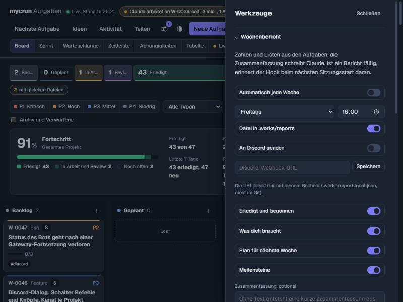
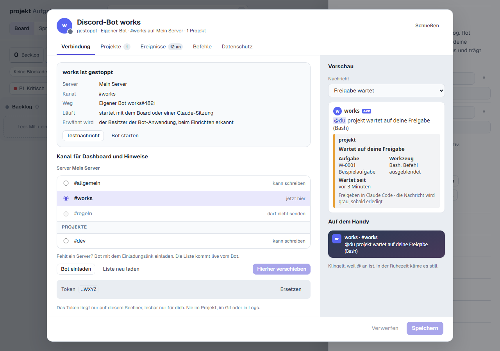
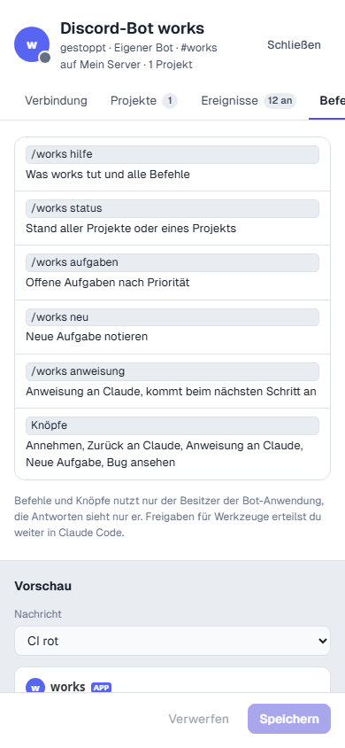

# Board: Einstellungen für den Discord-Bot

## Ziel
<!-- Was ist nach Abschluss anders? Ein bis drei Sätze, aus Sicht des Ergebnisses formuliert. -->

## Beschreibung
Teil der Discord-Anbindung (siehe W-0036), Wunsch des Nutzers vom 2026-11-23 (P2): Einstellungen nach Entwurf D, aber komplett verbessert. Verbindungsstatus, Einrichtung in Schritten (Bot anlegen, Token, Server einladen, Kanal wählen), Erwähnung, Ereignisse, Datenschutz, Befehle. Token nie im Board sichtbar. Gestaltung über Entwürfe, Wahl abwarten.

Gewählt: Entwurf J2 (Dialog mit Reitern und Vorschau), Einrichtung nach R aus W-0040 (gemeinsamer oder eigener Bot). Wunsch des Nutzers am 2026-11-23 (P2): Im Board selbst den Kanal auswählen können, auf dem Discord-Server, auf den der Bot eingeladen ist. Gewählt: Entwurf K (Server und Kanäle live vom Bot, gesperrte ausgegraut, „Hierher verschieben“ legt das Dashboard aus W-0044 im neuen Kanal an und räumt den alten auf).

## Kontext und Problem
<!-- Warum ist das nötig? Aktueller Zustand, Auslöser, Einschränkungen. -->

## Nutzerperspektive
<!-- Wer profitiert und wie? Optional: Als <Rolle> möchte ich <Fähigkeit>, damit <Nutzen>. -->

## Akzeptanzkriterien
<!-- Prüfbare Aussagen. Jede Zeile muss sich mit ja oder nein beantworten lassen. -->
- [x] Dialog Discord-Bot im Board nach J2 mit den Reitern Verbindung, Projekte, Ereignisse, Befehle, Datenschutz und Vorschau
- [x] Einrichtung nach R: gemeinsamer Bot mit Code oder eigener Bot mit Token, Token und Schlüssel nie sichtbar
- [x] Kanalwahl nach K: Server und Textkanäle live vom Bot, Kanäle ohne Schreibrecht ausgegraut, Verschieben des Dashboards
- [x] Änderungen wirken ohne Neustart des Bots
- [x] Selbsttest mit Browser deckt Dialog und Kanalwahl ab

## Umsetzungsplan
<!-- Konkrete Schritte in sinnvoller Reihenfolge. Unteraufgaben gehören hierher, nicht in eigene Ordner. -->
- [x] Entwürfe lesen: design/J2-j-verbessert.html (Dialog, Reiter, Vorschau) und design/K-kanal-im-board-waehlen.html (Kanalwahl); Aussehen und Texte daraus übernehmen, Stil wie die übrigen Dialoge unter Werkzeuge in board.js/board.css
- [x] Test zuerst: Selbsttest-Schritte (API ohne Browser und ein Browser-Schritt für Dialog und Kanalwahl) gegen discord-fake.mjs, vorher rot sehen
- [x] Board-API (serve.mjs/api.mjs, nur Besitzer-Level edit): Stand lesen (Modus, Bot läuft, Server/Kanal, Ereignisse, Ruhezeit, Datenschutz, Verzögerungen, cleanup.hours, Projekte an/aus und eigener Kanal), Einstellungen schreiben über applySetting aus discord.mjs, Projekt an/aus, Token setzen (nur schreiben, nie zurückgeben, Prüfung wie works discord token), Code koppeln (wie works discord link), trennen
- [x] Kanalwahl K: Server und Textkanäle live; eigener Bot über REST mit dem Token aus secret.json (Kanäle nach Kategorie, Schreibrecht des Bots aus Rollen und Overwrites berechnen, ohne Schreibrecht ausgegraut mit Grund); gemeinsamer Bot: neue Dienst-Routen GET /v1/guild/channels (Kanäle des gekoppelten Servers mit Schreibrecht) und POST /v1/link/channel {channel_id} (Kopplung auf einen anderen Kanal desselben Servers umziehen, nur wenn der Bot dort schreiben darf) in services/works-bot/server.mjs mit Test in services/works-bot/test.mjs
- [x] „Hierher verschieben“: channel_id in ~/.works/discord/config.json setzen (gemeinsam: erst Dienst umziehen); der laufende Bot legt das Dashboard im neuen Kanal an und löscht das alte selbst (dashboards() in discord-bot.mjs räumt Kanäle ohne Projekte schon auf), kein Neustart
- [x] Dialog J2 im Board unter Werkzeuge: Reiter Verbindung (Einrichtung nach R: gemeinsamer Bot mit Code oder eigener Bot mit Token, Status, Kanalwahl K), Projekte, Ereignisse (on/at je Ereignis, Ruhezeit, Verzögerungen, Frist cleanup.hours), Befehle (Übersicht der /works-Befehle aus discord-ui.mjs), Datenschutz, Vorschau (renderEvent/renderDashboard als Discord-ähnliche Vorschau)
- [x] Doku: references/board.md und integrations.md (Abschnitt Discord-Bot), cli.md falls neue Befehle
- [x] Selbsttest grün: works selftest --only Discord, die Browser-Schritte für das Board, services/works-bot/test.mjs

Hinweise für die Umsetzung:
- Token, Geräteschlüssel und Codes nie in API-Antworten, Logs, URLs oder im DOM; Eingabefelder für Token als type=password, nach dem Speichern leeren. Nur maskiert (…abcd) anzeigen.
- Texte im Board bleiben in diesem Schritt deutsch; W-0041 (Englisch, Sprache umschaltbar) läuft parallel und übernimmt die neuen Texte nach dem Merge. Keine eigene Übersetzungs-Mechanik bauen.
- Windows: in Heredocs und node -e gehen Backslashes verloren, Regexe und \n mit dem Edit-Werkzeug schreiben. Git Bash wandelt Argumente wie /works in Pfade um (MSYS_NO_PATHCONV=1 oder PowerShell).
- Discord-Änderungen auch ohne globales WebSocket testen: NODE_OPTIONS=--no-experimental-websocket works selftest --only Discord (die CI testet Node 18 und 20).
- Kein Board für das echte Projekt starten, nichts im echten Browser öffnen; Browser-Tests nur über den Selbsttest (headless, WORKS_DRY_OPEN).

## Betroffene Dateien
<!-- Pfade mit kurzer Notiz, was dort passiert. -->
- plugins/works/skills/works/scripts/board/board.js, board.css: Dialog J2 und Kanalwahl K
- plugins/works/skills/works/scripts/serve.mjs, api.mjs: Discord-Routen für das Board
- plugins/works/skills/works/scripts/discord.mjs: gemeinsame Funktionen für Stand, Token, Koppeln (aus works.mjs cmdDiscord herausziehen, statt sie doppelt zu schreiben)
- plugins/works/skills/works/scripts/discord-fake.mjs: Rollen, Mitglieder, Overwrites für die Rechteberechnung
- services/works-bot/server.mjs, test.mjs, README.md: Kanäle des Servers, Kopplung umziehen
- plugins/works/skills/works/scripts/selftest.mjs: Schritte für Dialog und Kanalwahl

## Designentscheidungen
Details und verworfene Alternativen: [decisions.md](decisions.md)

## Assets

Beschreibung: Vorher: Werkzeuge im Board ohne Einstellungen für den Discord-Bot, nur Webhook für den Wochenbericht
Art: vorher · Hinzugefügt: 2026-11-24

Beschreibung: Nachher: Dialog Discord-Bot nach J2, Reiter Verbindung mit Kanalwahl nach K und Vorschau
Art: nachher · Hinzugefügt: 2026-11-24

Beschreibung: Nachher auf dem Handy: Reiter Befehle, Vorschau darunter
Art: nachher · Hinzugefügt: 2026-11-24

## Offene Fragen
- [x] Entwurf J2 zeigt zwei Dinge, für die es noch keine Einstellung gibt: den Schalter „Befehle und Knöpfe erlauben“ und je Projekt eine Kanalwahl (eigener Kanal). Beides fehlt im Dialog; der eigene Kanal wird nur angezeigt, wenn er in config.json steht. Je Projekt einen Kanal ginge nur beim eigenen Bot, der gemeinsame schreibt in genau einen Kanal. Sollen beide als eigene Aufgabe nachgezogen werden, oder reicht es so? Antwort: Nutzer am 2026-11-24: als eigene Aufgabe mit P3 nachziehen (angelegt).

## Übergabe
Stand: 2026-11-24 16:07

Fertig im Branch feature/w-0038-board-einstellungen-fuer-den (4 Commits). Dialog Discord-Bot unter Werkzeuge nach J2 (Reiter Verbindung, Projekte, Ereignisse, Befehle, Datenschutz, Vorschau mit Sperrbildschirm), Einrichtung nach R, Kanalwahl nach K mit Hierher verschieben ohne Neustart. Gemeinsame Logik in discord.mjs für CLI und Board; works discord channel geht jetzt auch mit dem gemeinsamen Bot. Dienst: GET /v1/guild/channels, POST /v1/link/channel. Tests: voller Selbsttest 40/40, --browser --only Discord 11/11 auch mit --no-experimental-websocket, works-bot-Test grün (Playwright lokal über NODE_PATH aus dem npx-Cache). Offen: Frage zu Schalter Befehle erlauben und Kanal je Projekt (fehlen, keine Einstellung dafür). Der neue Dienst muss auf dem VPS aktualisiert werden, bevor die Kanalwahl beim gemeinsamen Bot geht. Texte deutsch, W-0041 übernimmt sie.

## Verlauf
- 2026-11-23: Aufgabe angelegt
- 2026-11-23: Entwurf I „Seitenleiste Discord-Bot“ angehängt
- 2026-11-23: Entwurf J „Dialog mit Vorschau“ angehängt
- 2026-11-23: Entwurf K „Einrichtung in Schritten“ angehängt
- 2026-11-23: decisions.md angelegt
- 2026-11-23: Entscheidung E1 dokumentiert: Einstellungen nach Entwurf J
- 2026-11-23: Entwurf J2 „J verbessert“ angehängt
- 2026-11-23: Entwurf J2 „J verbessert“ gewählt. Grund: Wahl des Nutzers: J verbessert
- 2026-11-23: Beziehung: blocked-by W-0040
- 2026-11-23: Entwurf K „Kanal im Board wählen“ angehängt
- 2026-11-23: Entwurf J2 „J verbessert“ gewählt. Grund: Wahl des Nutzers (J verbessert), dazu K für die Kanalwahl
- 2026-11-23: Beziehung entfernt: blocked-by W-0040
- 2026-11-24: Parallel gestartet im Worktree W-0038-board-einstellungen (Status: backlog → in-arbeit)
- 2026-11-24: Umsetzungsplan: "Entwürfe lesen: design/J2-j-verbessert.html (Dialog, Reiter, Vorschau) und design/K-kanal-im-board-waehlen.html (Kanalwahl); Aussehen und Texte daraus übernehmen, Stil wie die übrigen Dialoge unter Werkzeuge in board.js/board.css" abgehakt
- 2026-11-24: Entwürfe J2, K und R gelesen; Plan: gemeinsame Logik in discord.mjs, Rechte in discord-api.mjs, Routen /api/discord, Dienst-Routen /v1/guild/channels und /v1/link/channel
- 2026-11-24: Umsetzungsplan: "Board-API (serve.mjs/api.mjs, nur Besitzer-Level edit): Stand lesen (Modus, Bot läuft, Server/Kanal, Ereignisse, Ruhezeit, Datenschutz, Verzögerungen, cleanup.hours, Projekte an/aus und eigener Kanal), Einstellungen schreiben über applySetting aus discord.mjs, Projekt an/aus, Token setzen (nur schreiben, nie zurückgeben, Prüfung wie works discord token), Code koppeln (wie works discord link), trennen" abgehakt
- 2026-11-24: Umsetzungsplan: "Kanalwahl K: Server und Textkanäle live; eigener Bot über REST mit dem Token aus secret.json (Kanäle nach Kategorie, Schreibrecht des Bots aus Rollen und Overwrites berechnen, ohne Schreibrecht ausgegraut mit Grund); gemeinsamer Bot: neue Dienst-Routen GET /v1/guild/channels (Kanäle des gekoppelten Servers mit Schreibrecht) und POST /v1/link/channel {channel_id} (Kopplung auf einen anderen Kanal desselben Servers umziehen, nur wenn der Bot dort schreiben darf) in services/works-bot/server.mjs mit Test in services/works-bot/test.mjs" abgehakt
- 2026-11-24: Umsetzungsplan: "„Hierher verschieben“: channel_id in ~/.works/discord/config.json setzen (gemeinsam: erst Dienst umziehen); der laufende Bot legt das Dashboard im neuen Kanal an und löscht das alte selbst (dashboards() in discord-bot.mjs räumt Kanäle ohne Projekte schon auf), kein Neustart" abgehakt
- 2026-11-24: Board-API /api/discord und Dienst-Routen /v1/guild/channels, /v1/link/channel fertig; Selbsttest-Schritt API und works-bot-Test grün; Kanalwechsel ohne Neustart geprüft (eigener und gemeinsamer Bot)
- 2026-11-24: Umsetzungsplan: "Test zuerst: Selbsttest-Schritte (API ohne Browser und ein Browser-Schritt für Dialog und Kanalwahl) gegen discord-fake.mjs, vorher rot sehen" abgehakt
- 2026-11-24: Umsetzungsplan: "Dialog J2 im Board unter Werkzeuge: Reiter Verbindung (Einrichtung nach R: gemeinsamer Bot mit Code oder eigener Bot mit Token, Status, Kanalwahl K), Projekte, Ereignisse (on/at je Ereignis, Ruhezeit, Verzögerungen, Frist cleanup.hours), Befehle (Übersicht der /works-Befehle aus discord-ui.mjs), Datenschutz, Vorschau (renderEvent/renderDashboard als Discord-ähnliche Vorschau)" abgehakt
- 2026-11-24: Dialog J2 mit Kanalwahl K im Board umgesetzt, Browser-Schritt des Selbsttests grün
- 2026-11-24: Umsetzungsplan: "Doku: references/board.md und integrations.md (Abschnitt Discord-Bot), cli.md falls neue Befehle" abgehakt
- 2026-11-24: Entscheidung E2 dokumentiert: Schreibrecht im Kanal lokal berechnet
- 2026-11-24: Entscheidung E3 dokumentiert: Umzug der Kopplung beim gemeinsamen Bot
- 2026-11-24: Entscheidung E4 dokumentiert: Token, Code und Trennen nur am Rechner
- 2026-11-24: Umsetzungsplan: "Selbsttest grün: works selftest --only Discord, die Browser-Schritte für das Board, services/works-bot/test.mjs" abgehakt
- 2026-11-24: Akzeptanzkriterien: "Dialog Discord-Bot im Board nach J2 mit den Reitern Verbindung, Projekte, Ereignisse, Befehle, Datenschutz und Vorschau" abgehakt
- 2026-11-24: Akzeptanzkriterien: "Einrichtung nach R: gemeinsamer Bot mit Code oder eigener Bot mit Token, Token und Schlüssel nie sichtbar" abgehakt
- 2026-11-24: Akzeptanzkriterien: "Kanalwahl nach K: Server und Textkanäle live vom Bot, Kanäle ohne Schreibrecht ausgegraut, Verschieben des Dashboards" abgehakt
- 2026-11-24: Akzeptanzkriterien: "Änderungen wirken ohne Neustart des Bots" abgehakt
- 2026-11-24: Akzeptanzkriterien: "Selbsttest mit Browser deckt Dialog und Kanalwahl ab" abgehakt
- 2026-11-24: Selbsttest voll 40/40, --browser --only Discord 11/11 (auch ohne WebSocket), services/works-bot/test.mjs grün
- 2026-11-24: Übergabe aktualisiert
- 2026-11-24: Status: in-arbeit → review (Grund: Agent fertig)
- 2026-11-24: Übergabe aktualisiert
- 2026-11-24: Frage 1 geklärt: Nutzer am 2026-11-24: als eigene Aufgabe mit P3 nachziehen (angelegt).
- 2026-11-24: Parallele Arbeit beendet
- 2026-11-24: Asset hinzugefügt: assets/2026-11-24-vorher-werkzeuge-im-board-ohne-vorher.jpg (vorher)
- 2026-11-24: Asset hinzugefügt: assets/2026-11-24-nachher-dialog-discord-bot-nach-j2-nachher.png (nachher)
- 2026-11-24: Asset hinzugefügt: assets/2026-11-24-nachher-auf-dem-handy-reiter-befehle-nachher.png (nachher)
- 2026-11-24: Responsive-Check im eingebauten Browser (Ausweichlösung statt Chrome-Erweiterung) auf einem Board aus dem Branch mit Test-Home: Handy 375, Tablet 768, Desktop 1440 ohne waagerechten Überlauf, keine Konsolenfehler. Code-Audit: Board-API und Dienst-Routen in Ordnung; Nebensache: Handy-Vorschau nennt nach dem Verschieben noch den alten Kanal.
