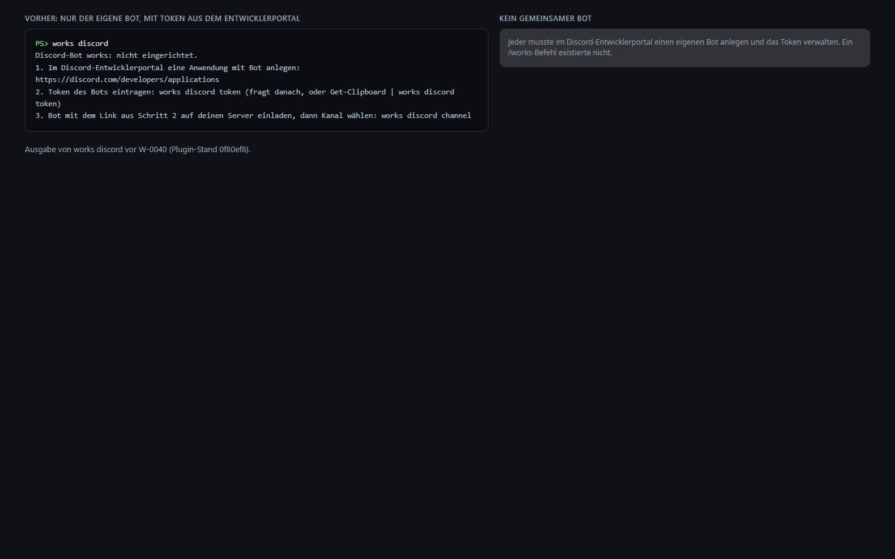
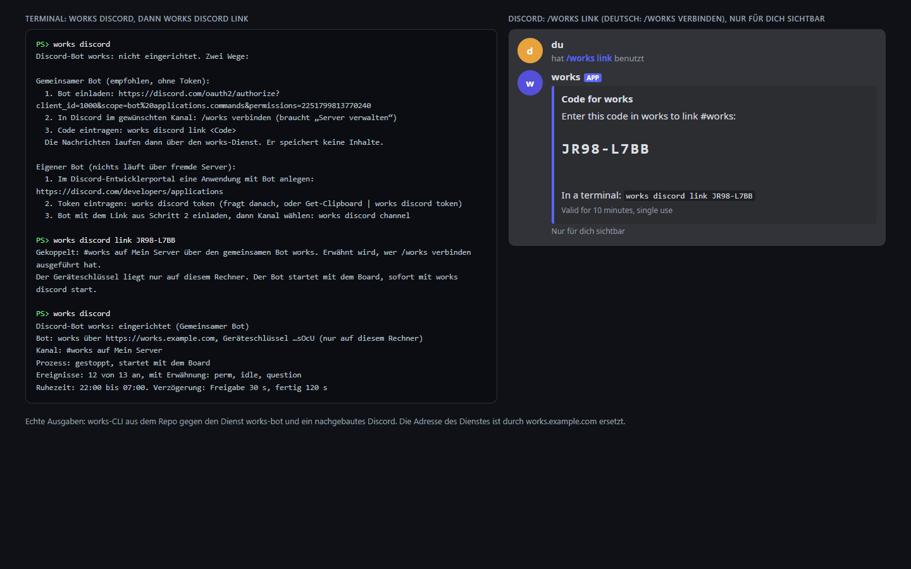
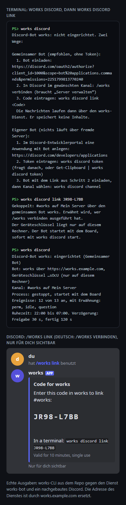

# Gemeinsamer Discord-Bot: zentraler Dienst auf dem VPS

## Ziel
<!-- Was ist nach Abschluss anders? Ein bis drei Sätze, aus Sicht des Ergebnisses formuliert. -->

## Beschreibung
Wunsch des Nutzers am 2026-11-23: Er stellt den Discord-Bot works für alle bereit, damit niemand einen eigenen Bot anlegen muss. Das Token darf nicht ins Plugin (jeder könnte den Bot übernehmen, Discord sperrt öffentlich gewordene Tokens). Deshalb ein zentraler Dienst auf dem VPS des Nutzers, dort läuft schon Docker mit anderen Projekten. Nutzer laden den gemeinsamen Bot auf ihren Server ein und koppeln works per Code (etwa /verbinden in Discord), ohne Token. works schickt Ereignisse per HTTPS an den Dienst, der postet in Discord; Befehle und Knöpfe (W-0037) laufen zurück zu works. Vorgabe des Nutzers: erst ein Konzept als Entwurf mit Ablauf, Sicherheit (Kopplung, Schlüssel je Server, was über den Dienst läuft, Datenschutz) und Kosten, dazu Entwürfe für Kopplung und Einrichtung; Wahl abwarten, dann bauen. Im Konzept klären, ob der Modus mit eigenem Bot aus W-0036 als Option bleibt.

## Kontext und Problem
<!-- Warum ist das nötig? Aktueller Zustand, Auslöser, Einschränkungen. -->

## Nutzerperspektive
<!-- Wer profitiert und wie? Optional: Als <Rolle> möchte ich <Fähigkeit>, damit <Nutzen>. -->

## Akzeptanzkriterien
- [x] Konzept mit Ablauf, Sicherheit und Kosten hängt an der Aufgabe
- [x] Entwürfe für Kopplung und Einrichtung sind gezeigt und gewählt (P und R)
- [x] Dienst ist als Docker-Container mit Anleitung für den VPS bereit (Inbetriebnahme macht der Nutzer)
- [x] works koppelt sich per Code aus `/works verbinden` ohne Token, der eigene Bot bleibt als Option
- [x] Das Bot-Token liegt nur beim Dienst; ein Geräteschlüssel darf nur in seinen Kanal schreiben und nur eigene Nachrichten bearbeiten
- [x] Tests ohne echtes Discord und ohne echten VPS

## Umsetzungsplan
<!-- Konkrete Schritte in sinnvoller Reihenfolge. Unteraufgaben gehören hierher, nicht in eigene Ordner. -->
- [x] discord-fake: Interaktionen über das Gateway schicken (INTERACTION_CREATE), Antworten und Befehle aufnehmen, dazu die Dienst-Routen /v1 nachbilden (für den Selbsttest von works)
- [x] Dienst services/works-bot/server.mjs: Gateway, Slash-Befehl /works (link/verbinden, unlink/trennen, status) nur mit „Server verwalten“, Codes (8 Zeichen, 10 Minuten, einmalig), Geräteschlüssel nur als Hash, Ablage als JSON im Volume
- [x] Dienst-API mit Discord-Routen: GET /v1/info, POST/DELETE /v1/link, GET /v1/users/@me, POST/PATCH Nachrichten, PUT Anheften; Kanal und Besitz geprüft, Erwähnungen nur für den Gekoppelten, Grenzen je Schlüssel, Fehlversuche je IP
- [x] Test des Dienstes gegen das nachgebaute Discord, mit works-CLI und Bot von Kopplung bis Statuspost, dazu die Sicherheitsfälle
- [x] works: Modus gemeinsam oder eigen, works discord link <Code> und unlink, Status nach Entwurf R, Bot über den Dienst (Bearer-Schlüssel, kein eigenes Gateway), Adresse einstellbar
- [x] Dockerfile, compose.yaml, README (englisch) mit Einrichtung auf dem VPS und Reverse-Proxy, CI-Workflow für den Dienst
- [x] Selbsttest, Audit, Doku in integrations.md und cli.md

## Betroffene Dateien
<!-- Pfade mit kurzer Notiz, was dort passiert. -->
- services/works-bot/: Dienst, Test, Dockerfile, compose.yaml, README
- plugins/works/skills/works/scripts/discord.mjs, discord-api.mjs, discord-bot.mjs, discord-fake.mjs, works.mjs, selftest.mjs
- .github/workflows/works-bot.yml

## Designentscheidungen
Details und verworfene Alternativen: [decisions.md](decisions.md)

## Assets

Beschreibung: Vorher: works discord kannte nur den eigenen Bot mit Token aus dem Entwicklerportal
Art: vorher · Hinzugefügt: 2026-11-23

Beschreibung: Nachher: works discord zeigt beide Wege, /works link gibt einen Code nur für dich, works discord link koppelt über den Dienst (echte Ausgaben gegen nachgebautes Discord)
Art: nachher · Hinzugefügt: 2026-11-23

Beschreibung: Nachher auf dem Handy: dieselben Ausgaben in 390 px Breite
Art: nachher · Hinzugefügt: 2026-11-23

## Offene Fragen
<!-- Fragen an den Nutzer, die Claude nicht selbst klären kann. Format: - [ ] Frage -->

## Übergabe
Abgeschlossen am 2026-11-23. Keine offene Übergabe.

## Verlauf
- 2026-11-23: Aufgabe angelegt
- 2026-11-23: Beziehung: W-0037 blocked-by
- 2026-11-23: Beziehung: W-0038 blocked-by
- 2026-11-23: decisions.md angelegt
- 2026-11-23: Dokument verlinkt: konzept.md
- 2026-11-23: Entwurf P „Kopplung: Code aus Discord“ angehängt
- 2026-11-23: Entwurf Q „Kopplung: Code aus works“ angehängt
- 2026-11-23: Entwurf R „Einrichtung: gemeinsam oder eigener Bot“ angehängt
- 2026-11-23: Dokument übernommen: Konzept: gemeinsamer Bot (Ablauf, Sicherheit, Kosten)
- 2026-11-23: Entscheidung E1 dokumentiert: Einrichtung nach Entwurf R
- 2026-11-23: Nutzer hat Entwurf R (Einrichtung: gemeinsam oder eigener Bot) angenommen. Kopplung P oder Q noch offen.
- 2026-11-23: Entwurf P „Kopplung: Code aus Discord“ gewählt. Grund: Wahl des Nutzers: Code aus Discord
- 2026-11-23: Gestartet (Status: backlog → in-arbeit)
- 2026-11-23: Asset hinzugefügt: assets/2026-11-23-vorher-works-discord-kannte-nur-den-vorher.png (vorher)
- 2026-11-23: Asset hinzugefügt: assets/2026-11-23-nachher-works-discord-zeigt-beide-wege-nachher.png (nachher)
- 2026-11-23: Asset hinzugefügt: assets/2026-11-23-nachher-auf-dem-handy-dieselben-nachher.png (nachher)
- 2026-11-23: Entscheidung E2 dokumentiert: Dienst bildet die Discord-Routen nach
- 2026-11-23: Entscheidung E3 dokumentiert: Kaputte Kopplungen und Schutz des gemeinsamen Bots
- 2026-11-23: Umgesetzt: Dienst works-bot (Docker, Anleitung), works discord link/unlink, Bot über den Dienst. Audit mit 8 Funden, alle behoben und getestet. Selbsttest 37/37, Dienst-Test und ci-watch grün.
- 2026-11-23: Abgeschlossen (Status: in-arbeit → erledigt), DoD bestätigt
