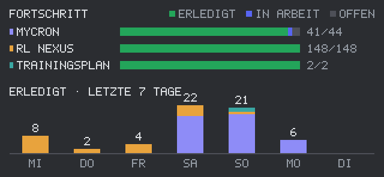

# Discord: ein Dashboard mit Bild statt Statuspost je Projekt, Status des Bots

## Ziel
<!-- Was ist nach Abschluss anders? Ein bis drei Sätze, aus Sicht des Ergebnisses formuliert. -->

## Beschreibung
Wunsch des Nutzers am 2026-11-23 (P2), nach Bild seines echten Kanals mit drei angehefteten Statusposts: Die Nachrichten verbessern, gern mit Bildern, aber nur eine Nachricht, mit Auswahlmenüs und Knöpfen; dazu Statusmeldungen des Bots. Gewählt: Entwurf D3. Eine angeheftete Nachricht für alle Projekte: je Projekt eine Zeile mit Ampel (arbeitet, wartet auf dich, ruhig, CI rot), ein Bild, das works selbst als PNG zeichnet (Fortschritt je Projekt, erledigte Aufgaben der letzten 7 Tage, eingebaute Pixelschrift, kein fremder Dienst, höchstens alle 5 Minuten neu), Auswahlmenü „Projekt wählen“ mit Details nur für den Aufrufer, Knöpfe Warteschlange, Anweisung an Claude, Neue Aufgabe, Hilfe. Status des Bots in der Mitgliederliste (etwa „Trainingsplan wartet auf dich“, „arbeitet an W-0040 (mycron)“, „3 Projekte im Blick“). Ersetzt die Statusposts je Projekt; die alten räumt der Bot auf. Baut auf W-0037 (Befehle und Knöpfe) auf.

Wunsch des Nutzers am 2026-11-23: Der Kanal soll sauber bleiben. Dauerhaft steht dort nur das Dashboard nach D3; alles andere (ship, Commit, CI, erledigt, Berichte und so weiter) bleibt nur eine gewisse Zeit und wird dann vom Bot gelöscht. Gewählt: Frist 24 Stunden, einstellbar. Nachrichten, die auf den Nutzer warten (Freigabe, Claude fertig, Review mit Knöpfen, Frage von Claude), bleiben stehen, solange sie offen sind; ab der Erledigung läuft dieselbe Frist. Gilt beim eigenen und beim gemeinsamen Bot (der Dienst braucht dafür das Löschen eigener Nachrichten).

## Kontext und Problem
<!-- Warum ist das nötig? Aktueller Zustand, Auslöser, Einschränkungen. -->

## Nutzerperspektive
<!-- Wer profitiert und wie? Optional: Als <Rolle> möchte ich <Fähigkeit>, damit <Nutzen>. -->

## Akzeptanzkriterien
- [ ] Eine angeheftete Dashboard-Nachricht statt je Projekt eine; alte Statusposts werden aufgeräumt
- [ ] Bild nach D3 ohne Abhängigkeiten und ohne fremden Dienst, höchstens alle 5 Minuten neu
- [ ] Auswahlmenü zeigt Projektdetails nur dem Aufrufer, die Knöpfe funktionieren
- [ ] Status des Bots zeigt, was gerade wichtig ist
- [ ] Im Kanal bleibt dauerhaft nur das Dashboard; andere Nachrichten löscht der Bot nach der Frist (Standard 24 h, einstellbar), offene erst 24 h nach ihrer Erledigung
- [ ] Löschen geht beim eigenen und beim gemeinsamen Bot, nur eigene Nachrichten, nichts geht beim Neustart verloren
- [ ] Discord-Grenzen eingehalten, Tests ohne echtes Discord

## Umsetzungsplan
<!-- Konkrete Schritte in sinnvoller Reihenfolge. Unteraufgaben gehören hierher, nicht in eigene Ordner. -->
- [x] Bild nach D3 als PNG (discord-image.mjs): Raster, Pixelschrift, PNG über zlib
- [x] Hochladen: Rest mit Dateien (multipart, beim Dienst als base64 in JSON), Löschen eigener Nachrichten; Fake liest multipart, kennt DELETE
- [x] Dashboard je Kanal statt Statuspost je Projekt: Zeilen mit Ampel, Bild, Auswahlmenü, Knöpfe; alte Statusposts löschen
- [x] Knöpfe des Dashboards: Projekt wählen (Details nur für dich), Warteschlange, Anweisung, Neue Aufgabe, Hilfe
- [x] Status des Bots (eigener Bot über das Gateway, gemeinsamer Bot fest „/works help“)
- [x] Aufräumen: Frist 24 h (cleanup.hours), offene erst nach Erledigung, Fragen werden als beantwortet markiert
- [x] Dienst: Bild durchreichen, eigene Nachrichten löschen
- [x] Tests (Selbsttest, Dienst-Test) auf das Dashboard umstellen, Doku

## Betroffene Dateien
<!-- Pfade mit kurzer Notiz, was dort passiert. -->
- plugins/works/skills/works/scripts/discord-image.mjs: neu, Bild
- plugins/works/skills/works/scripts/discord-bot.mjs: Dashboard, Aufräumen, Status
- plugins/works/skills/works/scripts/discord-api.mjs: Dateien, DELETE, Presence
- plugins/works/skills/works/scripts/discord-ui.mjs: Dialog Neue Aufgabe mit Projekt
- plugins/works/skills/works/scripts/discord.mjs: Einstellung cleanup.hours
- plugins/works/skills/works/scripts/discord-fake.mjs, selftest.mjs; services/works-bot/server.mjs, test.mjs, Dockerfile, README.md

## Designentscheidungen
<!-- Kurzfassung der wichtigsten Entscheidungen. Details in decisions.md (works decisions <ID>). -->
- Das Bild wird höchstens alle 5 Minuten neu gezeichnet, aber bei jeder Bearbeitung des Dashboards mit hochgeladen (gut 3 KB). So hängt nichts an Discords Umgang mit alten Anhängen beim Bearbeiten.
- Pixelschrift nur mit Großbuchstaben, Ziffern und wenigen Zeichen: wenig Daten, sicher lesbar; Projektnamen stehen im Bild deshalb in Großbuchstaben.
- Status des Bots nur beim eigenen Bot persönlich; der gemeinsame Bot ist einer für alle und zeigt „/works help“.
- Aufräumen nur über die eigenen gemerkten Nachrichten; ein Durchsuchen des Kanalverlaufs entfällt (alle Nachrichten des Bots sind gemerkt).

## Assets

Beschreibung: Dashboard-Bild nach D3 aus den echten Projekten (mycron, RL Nexus, Trainingsplan): Fortschritt je Projekt, erledigte Aufgaben der letzten 7 Tage gestapelt nach Projektfarbe
Art: nachher · Hinzugefügt: 2026-11-24

## Offene Fragen
<!-- Fragen an den Nutzer, die Claude nicht selbst klären kann. Format: - [ ] Frage -->

## Übergabe
Stand: 2026-11-23 21:00

Erledigt: Plan und Kriterien (inkl. Wunsch sauberer Kanal: Frist 24 h, offene erst nach Erledigung). discord-image.mjs (Bild nach D3, Pixelschrift nur Großbuchstaben, PNG über zlib, GLYPHS exportiert) liegt im Repo, im Scratchpad geprüft. Fake-Discord kann multipart (payload_json + files[n]), Anhänge, DELETE eigener Nachrichten, vorläufige Antworten als echte Nachrichten (fake.ephemerals, klickbar). Selbsttest auf das Dashboard umgestellt (dashOf/isDash statt statusOf) und neuer Schritt W-0044 geschrieben, Rot-Probe noch nicht zu Ende gelaufen.
Offen: (1) discord-api.mjs: Rest mit Dateien (multipart; beim Dienst als base64 in JSON), del(), Gateway-Presence (op 3, beim Identify mitschicken). (2) discord-bot.mjs: Dashboard je Kanal statt statusposts(), Titel 'works · N Projekte', Zeilen wie projectLine, Felder Heute/Wartet auf dich/Als Nächstes, Bild attachment://works.png bei jeder Bearbeitung mit hochladen, neu zeichnen höchstens alle 5 min; Zeile 1 Auswahl w:proj:: (Werte = rid), Zeile 2 Knöpfe w:queue:: w:ins:: w:new:: w:help::; alte Statusposts (pr.status.message_id) löschen; Handler proj (renderStatus + Knöpfe w:tasks:<rid>: und w:ins:<rid>:), tasks, queue, help; ins/new ohne rid: einziges oder gerade aktives Projekt bzw. Projektfeld; Presence nur eigener Bot. Aufräumen: msgs[key].done (offen = 0, sonst Zeit), cleanup.hours (Standard 24, Bruchteile erlaubt), Fragen als beantwortet markieren, prune anpassen. (3) discord-ui.mjs: Dialog Neue Aufgabe ohne rid mit Feld project. (4) discord.mjs: Einstellung cleanup.hours. (5) Dienst: files base64 prüfen (PNG, Größe) und als multipart weiter, DELETE eigener Nachrichten, own() für die IDs der Antworten (Klicks auf Knöpfe in Antworten), Presence '/works help', readBody-Grenze für Nachrichten erhöhen, attachments durchreichen; test.mjs statusPosts auf das Dashboard umstellen. (6) Doku integrations.md und README.
Nächster Schritt: works selftest --only Discord laufen lassen (muss am fehlenden Dashboard scheitern), dann Rest mit Dateien in discord-api.mjs.
Branch feature/w-0044-discord-dashboard, uncommittet: discord-image.mjs (neu), discord-fake.mjs, selftest.mjs. Keine offenen Fragen.

## Verlauf
- 2026-11-23: Aufgabe angelegt
- 2026-11-23: Entwurf D1 „Übersicht, Details nur für dich“ angehängt
- 2026-11-23: Entwurf D2 „Umblättern“ angehängt
- 2026-11-23: Entwurf D3 „Mit Bild“ angehängt
- 2026-11-23: Entwurf D3 „Mit Bild“ gewählt. Grund: Wahl des Nutzers
- 2026-11-23: Beziehung: blocked-by W-0037
- 2026-11-23: Gestartet (Status: backlog → in-arbeit)
- 2026-11-23: Übergabe aktualisiert
- 2026-11-23: Zwischenstand committet (60a2d49): discord-image.mjs, discord-fake.mjs, selftest.mjs; nichts mehr uncommittet, nicht gepusht
- 2026-11-24: Asset hinzugefügt: assets/2026-11-24-dashboard-bild-nach-d3-aus-den-echten-nachher.png (nachher)
- 2026-11-24: Entscheidung E1 dokumentiert: Bild bei jeder Bearbeitung hochladen, höchstens alle 5 Minuten neu zeichnen
- 2026-11-24: Entscheidung E2 dokumentiert: Pixelschrift nur in Großbuchstaben, Farben der Reihe nach
- 2026-11-24: Entscheidung E3 dokumentiert: Aufräumen über gemerkte Nachrichten, Status nur beim eigenen Bot
- 2026-11-24: Umsetzungsplan: "Bild nach D3 als PNG (discord-image.mjs): Raster, Pixelschrift, PNG über zlib" abgehakt
- 2026-11-24: Umsetzungsplan: "Hochladen: Rest mit Dateien (multipart, beim Dienst als base64 in JSON), Löschen eigener Nachrichten; Fake liest multipart, kennt DELETE" abgehakt
- 2026-11-24: Umsetzungsplan: "Dashboard je Kanal statt Statuspost je Projekt: Zeilen mit Ampel, Bild, Auswahlmenü, Knöpfe; alte Statusposts löschen" abgehakt
- 2026-11-24: Umsetzungsplan: "Knöpfe des Dashboards: Projekt wählen (Details nur für dich), Warteschlange, Anweisung, Neue Aufgabe, Hilfe" abgehakt
- 2026-11-24: Umsetzungsplan: "Status des Bots (eigener Bot über das Gateway, gemeinsamer Bot fest „/works help“)" abgehakt
- 2026-11-24: Umsetzungsplan: "Aufräumen: Frist 24 h (cleanup.hours), offene erst nach Erledigung, Fragen werden als beantwortet markiert" abgehakt
- 2026-11-24: Umsetzungsplan: "Dienst: Bild durchreichen, eigene Nachrichten löschen" abgehakt
- 2026-11-24: Umsetzungsplan: "Tests (Selbsttest, Dienst-Test) auf das Dashboard umstellen, Doku" abgehakt
