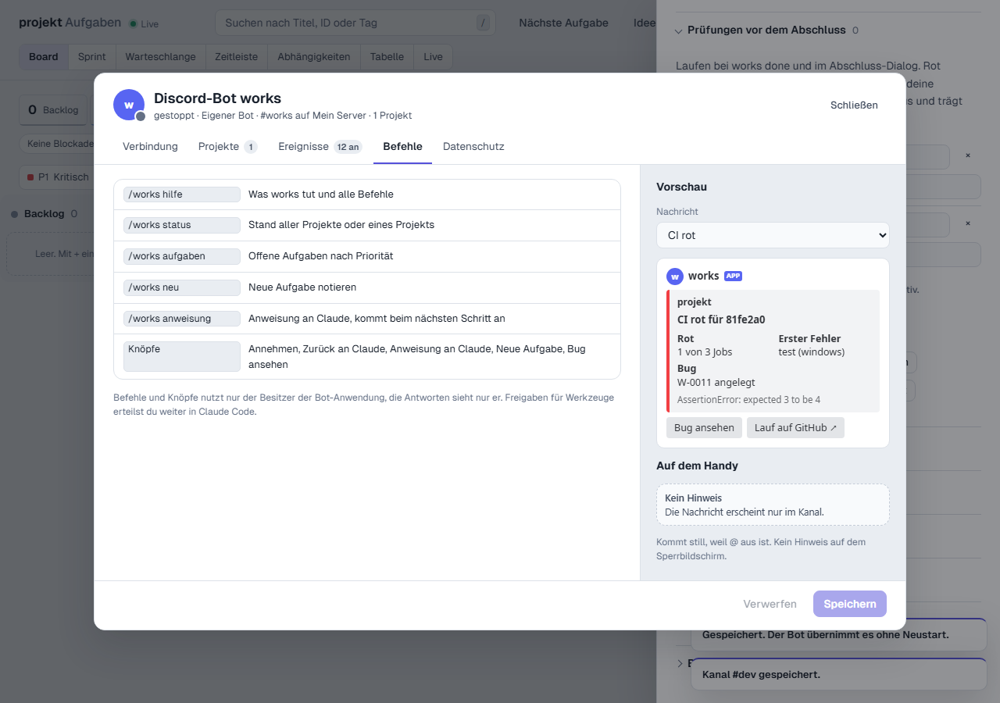
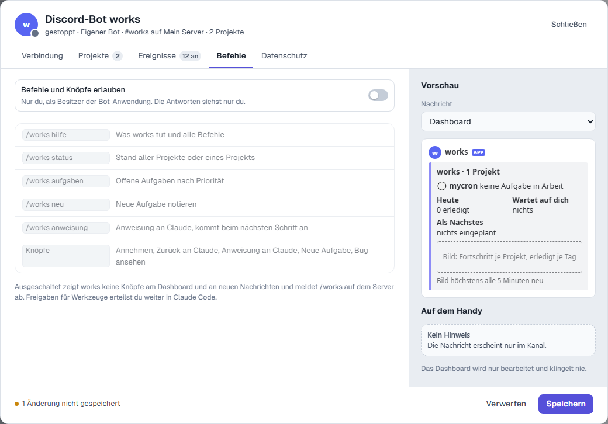
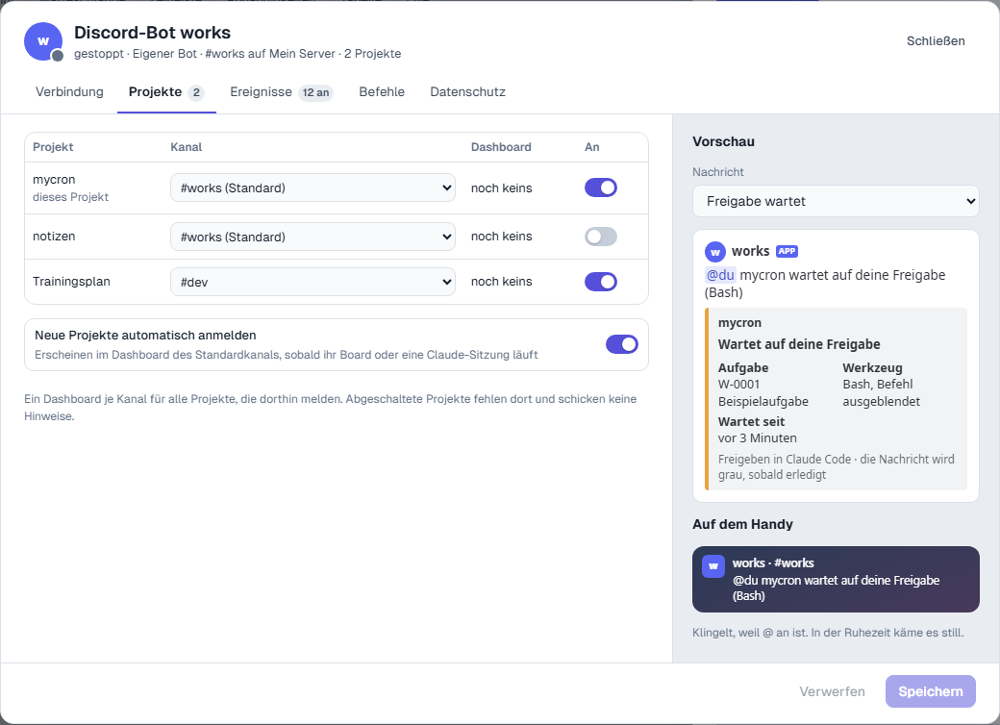

# Discord-Dialog: Schalter Befehle und Knöpfe, Kanal je Projekt

## Ziel
<!-- Was ist nach Abschluss anders? Ein bis drei Sätze, aus Sicht des Ergebnisses formuliert. -->

## Beschreibung
Rest aus Entwurf J2 (W-0038), Entscheidung des Nutzers am 2026-11-24: als eigene Aufgabe mit P3 nachziehen. Der Dialog Discord-Bot im Board zeigt nach J2 einen Schalter (Befehle und Knöpfe erlauben) und je Projekt eine Kanalwahl; für beides gibt es noch keine Einstellung. Kanal je Projekt geht nur beim eigenen Bot (der gemeinsame schreibt in genau einen Kanal). Beides als Einstellung in ~/.works/discord/config.json, im Dialog nach J2 und in works discord set; ohne Befehle und Knöpfe registriert der Bot /works nicht und zeigt keine Knöpfe. Dazu aus dem Code-Audit von W-0038 (Nebensache): Die Handy-Vorschau im Dialog nennt nach dem Verschieben noch den alten Kanal. (Text beim Anlegen an den Anführungszeichen abgeschnitten, hier vollständig.)

## Kontext und Problem
<!-- Warum ist das nötig? Aktueller Zustand, Auslöser, Einschränkungen. -->

## Nutzerperspektive
<!-- Wer profitiert und wie? Optional: Als <Rolle> möchte ich <Fähigkeit>, damit <Nutzen>. -->

## Akzeptanzkriterien
- [x] Schalter Befehle und Knöpfe im Dialog und als Einstellung, wirkt ohne Neustart
- [x] Beim eigenen Bot je Projekt ein Kanal im Dialog wählbar; jedes Projekt erscheint im Dashboard seines Kanals
- [x] Tests ohne echtes Discord, auch ohne globales WebSocket

## Umsetzungsplan
<!-- Konkrete Schritte in sinnvoller Reihenfolge. Unteraufgaben gehören hierher, nicht in eigene Ordner. -->
- [x] Entwurf J2 aus W-0038 lesen (.works/tasks/W-0038-board-einstellungen-fuer-den-discord-bot/design/J2-j-verbessert.html): wo der Schalter „Befehle und Knöpfe erlauben“ und die Kanalwahl je Projekt stehen; Aussehen danach, Stil wie der bestehende Dialog Discord-Bot in board.js
- [x] Test zuerst (Selbsttest gegen discord-fake.mjs, API und Browser-Schritt): Schalter aus → keine Knöpfe und kein Auswahlmenü am Dashboard und an neuen Nachrichten, eigener Bot meldet /works für den Server ab (PUT mit leerer Liste), wieder an → registriert; Kanal je Projekt beim eigenen Bot → das Projekt steht im Dashboard seines Kanals, im alten nicht mehr; gemeinsamer Bot → Kanalwahl je Projekt gesperrt mit Hinweis
- [x] Einstellung `commands` (Standard an) in discord.mjs (DEFAULTS, normalizeConfig, applySetting, `works discord set commands=an|aus`); Kanal je Projekt als `project.<id>.channel=<Kanal-ID>` (projects[rid].channel_id, channelFor nutzt es schon), nur beim eigenen Bot
- [x] Bot: interactive je Durchgang aus der Konfiguration (ohne Neustart); beim Ausschalten Befehle für den Server abmelden; beim gemeinsamen Bot beantwortet das Gerät Befehle bei ausgeschaltetem Schalter mit einem kurzen Hinweis
- [x] Dialog: Schalter im Reiter Befehle, Kanalwahl je Projekt im Reiter Projekte (Liste aus /api/discord/channels)
- [x] Nebensache aus dem Audit von W-0038: Handy-Vorschau nennt nach dem Verschieben den neuen Kanal
- [x] Doku: integrations.md, board.md, cli.md
- [x] Selbsttest grün mit und ohne WebSocket, Browser-Schritte, services/works-bot/test.mjs

## Betroffene Dateien
<!-- Pfade mit kurzer Notiz, was dort passiert. -->

## Designentscheidungen
Details und verworfene Alternativen: [decisions.md](decisions.md)

## Assets

Beschreibung: Vorher: Reiter Befehle ohne Schalter (Stand W-0038)
Art: vorher · Hinzugefügt: 2026-11-24

Beschreibung: Nachher: Reiter Befehle mit Schalter, ausgeschaltet, Vorschau ohne Knöpfe
Art: nachher · Hinzugefügt: 2026-11-24

Beschreibung: Nachher: Reiter Projekte mit Kanal je Projekt
Art: nachher · Hinzugefügt: 2026-11-24

## Offene Fragen
<!-- Fragen an den Nutzer, die Claude nicht selbst klären kann. Format: - [ ] Frage -->

## Übergabe
Stand: 2026-11-24 17:47

Fertig im Branch feature/w-0046-discord-dialog-schalter (5 Commits, nicht gemergt). Umgesetzt: Einstellung commands (Standard an) in config.json, works discord set und Reiter Befehle; der Bot liest sie je Durchgang: aus = keine Knöpfe und kein Auswahlmenü am Dashboard und an neuen Nachrichten, eigener Bot meldet /works ab (PUT mit leerer Liste, auch ohne Gateway), Befehle und alte Knöpfe bekommen einen kurzen Hinweis (beim gemeinsamen Bot antwortet das Gerät). Kanal je Projekt als project.<id>.channel=<Kanal-ID> nur beim eigenen Bot, geprüft auf Kanal und Schreibrecht; im Reiter Projekte als Auswahl aus /api/discord/channels, beim gemeinsamen Bot gesperrt mit Hinweis; channelOf ignoriert eigene Kanäle beim gemeinsamen Bot. Handy-Vorschau nennt den Kanal des Projekts. Die Nebensache aus dem Audit von W-0038 (alter Kanal nach dem Verschieben) ließ sich im Dialog nicht nachstellen; der Browser-Schritt hält jetzt fest, dass nach dem Verschieben der neue Kanal steht. Tests: Selbsttest 49/49 mit und ohne WebSocket (mit Browser), services/works-bot/test.mjs grün. Offen: Merge; ältere Nachrichten behalten ihre Knöpfe nach dem Ausschalten (so gewollt, nur Dashboard und neue Nachrichten); beim Serverwechsel bleibt /works auf dem alten Server registriert (wie vorher).

## Verlauf
- 2026-11-24: Aufgabe angelegt
- 2026-11-24: Parallel gestartet im Worktree W-0046-discord-dialog-schalter (Status: backlog → in-arbeit)
- 2026-11-24: tags: [discord] → [discord, board, ui]
- 2026-11-24: Umsetzungsplan: "Entwurf J2 aus W-0038 lesen (.works/tasks/W-0038-board-einstellungen-fuer-den-discord-bot/design/J2-j-verbessert.html): wo der Schalter „Befehle und Knöpfe erlauben“ und die Kanalwahl je Projekt stehen; Aussehen danach, Stil wie der bestehende Dialog Discord-Bot in board.js" abgehakt
- 2026-11-24: Tests zuerst: Selbsttest-Schritte W-0046 (API und Browser) und Dienst-Test rot gesehen. Handy-Vorschau nach dem Verschieben im Dialog nicht nachstellbar, der Test hält es jetzt fest; mit Kanal je Projekt nennt die Vorschau künftig den Kanal des Projekts.
- 2026-11-24: Umsetzungsplan: "Test zuerst (Selbsttest gegen discord-fake.mjs, API und Browser-Schritt): Schalter aus → keine Knöpfe und kein Auswahlmenü am Dashboard und an neuen Nachrichten, eigener Bot meldet /works für den Server ab (PUT mit leerer Liste), wieder an → registriert; Kanal je Projekt beim eigenen Bot → das Projekt steht im Dashboard seines Kanals, im alten nicht mehr; gemeinsamer Bot → Kanalwahl je Projekt gesperrt mit Hinweis" abgehakt
- 2026-11-24: Umsetzungsplan: "Einstellung `commands` (Standard an) in discord.mjs (DEFAULTS, normalizeConfig, applySetting, `works discord set commands=an|aus`); Kanal je Projekt als `project.<id>.channel=<Kanal-ID>` (projects[rid].channel_id, channelFor nutzt es schon), nur beim eigenen Bot" abgehakt
- 2026-11-24: Umsetzungsplan: "Bot: interactive je Durchgang aus der Konfiguration (ohne Neustart); beim Ausschalten Befehle für den Server abmelden; beim gemeinsamen Bot beantwortet das Gerät Befehle bei ausgeschaltetem Schalter mit einem kurzen Hinweis" abgehakt
- 2026-11-24: Einstellung commands und project.<id>.channel in discord.mjs, Bot liest den Schalter je Durchgang, meldet /works mit leerer Liste ab, Hinweis bei Befehlen; Selbsttest-Schritt API grün mit und ohne WebSocket, Dienst-Test grün (f43cb8f).
- 2026-11-24: Umsetzungsplan: "Dialog: Schalter im Reiter Befehle, Kanalwahl je Projekt im Reiter Projekte (Liste aus /api/discord/channels)" abgehakt
- 2026-11-24: Umsetzungsplan: "Nebensache aus dem Audit von W-0038: Handy-Vorschau nennt nach dem Verschieben den neuen Kanal" abgehakt
- 2026-11-24: Dialog: Schalter im Reiter Befehle, Kanalwahl je Projekt im Reiter Projekte (gesperrt beim gemeinsamen Bot), Handy-Vorschau nennt den Kanal des Projekts; Browser-Schritt grün (9367b8a).
- 2026-11-24: Umsetzungsplan: "Doku: integrations.md, board.md, cli.md" abgehakt
- 2026-11-24: Umsetzungsplan: "Selbsttest grün mit und ohne WebSocket, Browser-Schritte, services/works-bot/test.mjs" abgehakt
- 2026-11-24: Akzeptanzkriterien: "Schalter Befehle und Knöpfe im Dialog und als Einstellung, wirkt ohne Neustart" abgehakt
- 2026-11-24: Akzeptanzkriterien: "Beim eigenen Bot je Projekt ein Kanal im Dialog wählbar; jedes Projekt erscheint im Dashboard seines Kanals" abgehakt
- 2026-11-24: Akzeptanzkriterien: "Tests ohne echtes Discord, auch ohne globales WebSocket" abgehakt
- 2026-11-24: Selbsttest voll grün mit WebSocket (49/49, mit Browser) und ohne WebSocket (49/49, mit Browser), services/works-bot/test.mjs grün. Screenshots w46-*.png im Scratchpad der Hauptsitzung.
- 2026-11-24: Übergabe aktualisiert
- 2026-11-24: Status: in-arbeit → review (Grund: Agent fertig)
- 2026-11-24: Asset hinzugefügt: assets/2026-11-24-vorher-reiter-befehle-ohne-schalter-vorher.png (vorher)
- 2026-11-24: Asset hinzugefügt: assets/2026-11-24-nachher-reiter-befehle-mit-schalter-nachher.png (nachher)
- 2026-11-24: Asset hinzugefügt: assets/2026-11-24-nachher-reiter-projekte-mit-kanal-je-nachher.png (nachher)
- 2026-11-24: Geprüft von der Hauptsitzung: Diff, Dienst-Test, Selbsttest 14/14 mit Browser und 12/12 ohne WebSocket, Responsive-Check im eingebauten Browser (375, 768, 1440 ohne Überlauf). Code-Audit: nichts gefunden.
- 2026-11-24: Parallele Arbeit beendet
- 2026-11-24: decisions.md angelegt
- 2026-11-24: Entscheidung E1 dokumentiert: Schalter Befehle und Knöpfe, Kanal je Projekt
