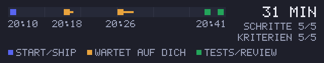
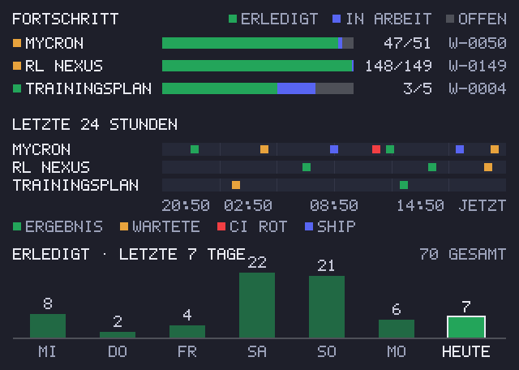

# Discord: Nachrichten nach 10 s löschen, Verlauf im Dashboard

## Ziel
<!-- Was ist nach Abschluss anders? Ein bis drei Sätze, aus Sicht des Ergebnisses formuliert. -->

## Beschreibung
Wunsch des Nutzers am 2026-11-24: Nachrichten sollen nicht erst nach 24 h, sondern nach etwa 10 Sekunden gelöscht werden, deutlich schneller als bisher (W-0044). Dazu ein Verlauf zum Nachschauen. Entscheidungen des Nutzers: Nachrichten, die auf ihn warten (Freigabe, Review mit Knöpfen, Frage von Claude), bleiben stehen, bis sie erledigt sind, und verschwinden 10 s danach; alles andere außer dem Dashboard nach 10 s. Der Verlauf liegt hinter einem Knopf Verlauf im Dashboard und dem Befehl /works verlauf (englisch /works history), nur für ihn sichtbar, nach Projekt filterbar; der Kanal selbst bleibt leer. Standard der Frist wird 10 s, weiter einstellbar (Einheit Sekunden statt nur Stunden). Gestaltung des Verlaufs vorher als Entwurf zeigen. Priorität P2, direkt nach W-0041 (das gerade die Discord-Dateien übersetzt), vor W-0049.

## Kontext und Problem
<!-- Warum ist das nötig? Aktueller Zustand, Auslöser, Einschränkungen. -->

## Nutzerperspektive
<!-- Wer profitiert und wie? Optional: Als <Rolle> möchte ich <Fähigkeit>, damit <Nutzen>. -->

## Akzeptanzkriterien
- [x] Je Aufgabe genau eine Nachricht (Karte nach Entwurf I3), die bei jedem Schritt bearbeitet wird: Start, Frage, Freigabe, fertig und wartet, Review, zurückgegeben, erledigt, Auslieferung (Wunsch des Nutzers vom 2026-11-24, ersetzt „nach 10 s löschen“)
- [x] Braucht die Karte den Nutzer (Freigabe, Frage, Review, fertig und wartet), kommt sie als neue Nachricht nach unten, damit Discord benachrichtigt; die alte Fassung wird gelöscht
- [x] Karten bleiben, solange die Aufgabe offen ist, und verschwinden nach der Frist ab Erledigung; Nachrichten ohne Aufgabe nach der Frist ab Senden
- [x] Knopf Verlauf im Discord-Panel (der angehefteten Dashboard-Nachricht nach D3, neben Warteschlange, Anweisung an Claude, Neue Aufgabe, Hilfe) und /works verlauf zeigen die letzten Nachrichten nur dem Aufrufer, nach Projekt filterbar
- [x] Der Verlauf übersteht einen Neustart des Bots und ist begrenzt (Anzahl oder Alter)
- [x] Frist einstellbar in Sekunden (Dialog im Board, works discord set), Standard 1 Std. (3600 s)
- [x] Geht beim eigenen und beim gemeinsamen Bot, Tests ohne echtes Discord, auch ohne WebSocket
- [x] Panel-Text nach Entwurf P2: Zusammenfassung oben (wartet, arbeitet, heute erledigt, Kosten), Zeile je Projekt mit Ampel, Zustand und Aufgabe, darunter Als Nächstes
- [x] Panel-Bild nach P2: Fortschritt mit Ampel und Aufgabe je Balken, letzte 24 Stunden je Projekt als Spur (ein Punkt je Nachricht in der Farbe ihrer Art), Woche mit heute hervorgehoben
- [x] Verlauf-Ansicht nach P2: Einträge mit Symbol, Projekt, Text und relativer Zeit, Eintrag ansehen mit allen Feldern, Filter Projekt und Zeitraum, Ältere

## Umsetzungsplan
<!-- Konkrete Schritte in sinnvoller Reihenfolge. Unteraufgaben gehören hierher, nicht in eigene Ordner. -->
- [x] Frist in Sekunden: cleanup.seconds (Standard 3600, 0 nie) statt cleanup.hours in discord.mjs (DEFAULTS, normalizeConfig, works discord set, Liste der Schlüssel), Bot cleanup() und prune(), Board-Dialog (Feld in Sekunden), Tests zuerst
- [x] Karte je Aufgabe: Ereignisse mit Aufgaben-ID (neues Ereignis start beim Wechsel auf in Arbeit, perm, idle mit Aufgabe, question, review, returned, done, ship, p1) laufen in upsert() in eine Karte card:<rid>:<id> mit Einträgen je ursprünglichem Schlüssel; Zustand aus dem jüngsten offenen Eintrag; neue wartende Einträge senden die Karte neu (alte löschen, Erwähnung wie bisher je Ereignis); Knöpfe Annehmen und Zurückgeben im Review wie bisher
- [x] Kartenbild nach Entwurf I3 (der Nutzer fand I4 schlechter): Zeitachse der Aufgabe mit Uhrzeiten, rechts Minuten, Schritte, Kriterien, Legende; Bild bei Ereignissen neu, sonst höchstens alle 5 Minuten
- [x] Verlauf speichern: jede gesendete oder bearbeitete Nachricht als Eintrag (Schlüssel, Projekt, Art, Zeit, Ereignis) in state.history, neueste Fassung je Schlüssel, höchstens 7 Tage und 300 Einträge, übersteht Neustart
- [x] Verlauf zeigen: Knopf Verlauf (w:hist) im Dashboard und /works verlauf (history) mit Option project, nur für den Aufrufer; Liste mit Symbol je Art, Projekt, Text, relativer Zeit; Auswahl „Eintrag ansehen“ holt die Nachricht mit allen Feldern; Auswahl Projekt und Zeitraum (24 Std., 3 Tage, 7 Tage), Knopf Ältere; custom_ids passen zu CID_RE (Dienst des gemeinsamen Bots)
- [x] Panel-Text nach P2: Zusammenfassung oben, Zeile je Projekt mit Ampel, Zustand, Werkzeug bei Freigabe und Aufgabe, Feld Als Nächstes; Kosten in der Zusammenfassung nur mit privacy.costs
- [x] Panel-Bild nach P2: Ampel und Aufgabe je Balken, Abschnitt LETZTE 24 STUNDEN mit Spur je Projekt aus state.history (Farbe nach Art), Woche einfarbig mit heute hervorgehoben und Summe
- [x] Doku (integrations.md, cli.md, beide Sprachen), Hilfe im Discord, Katalog de.json; Selbsttest mit und ohne WebSocket, Dienst-Test

## Betroffene Dateien
<!-- Pfade mit kurzer Notiz, was dort passiert. -->

## Designentscheidungen
<!-- Kurzfassung der wichtigsten Entscheidungen. Details in decisions.md (works decisions <ID>). -->

## Assets

Beschreibung: Kartenbild nach I3, gezeichnet mit cardPng aus dem Branch: Zeitachse 20:10 bis 20:41 mit Start, zwei Wartezeiten als Strich, Tests und Review; rechts 31 MIN, Schritte 5/5, Kriterien 5/5; Legende START/SHIP, WARTET AUF DICH, TESTS/REVIEW
Art: nachher · Hinzugefügt: 2026-11-25

Beschreibung: Panel-Bild nach P2, gezeichnet mit dashboardPng aus dem Branch: Fortschritt mit Ampel und Aufgabe je Projekt, letzte 24 Stunden als Spur je Projekt mit Legende, erledigt der letzten 7 Tage mit hervorgehobenem Heute und Summe
Art: nachher · Hinzugefügt: 2026-11-25

## Offene Fragen
<!-- Fragen an den Nutzer, die Claude nicht selbst klären kann. Format: - [ ] Frage -->

## Übergabe
Stand: 2026-11-25 15:53

Fertig zur Abnahme, Status review. Alle 10 Kriterien und 8 Planschritte abgehakt, Branch feature/w-0050-discord-nachrichten-nach-10-s, nichts uncommittet.

Umgesetzt (Commits 392bc5a bis aa605b2): cleanup.seconds statt cleanup.hours, Karte je Aufgabe nach I3 mit Bild und neuem Ereignis start, Verlauf (state.history, Knopf Verlauf, /works verlauf), Panel nach P2 (Text und Bild), Doku und Hilfe.

Funde der Code-Durchsicht behoben (je Fund erst ein roter Test): 01cca0e prune rechnet ab der Erledigung statt ab dem Posten, und ein altes cleanup.hours=0 bleibt nie löschen. d0f8d90 Karten warten nur auf Schritte, deren Schlüssel noch in state.open steht (liveCard); ein neuer Schritt im selben Slot löst den älteren auf; eine im Review gelöschte Aufgabe löst ihr Review auf; ein weggefallenes Projekt räumt offene Schritte und Timer weg. 7d25ab7 ein alter Eintrag ohne Karte in der Warteschlange bleibt Einzelnachricht.

Tests nach den Fixes: Schnelltest 21/21, Selbsttest ohne WebSocket 51/51 (231 s), mit Browser 58/58 (376 s) im zweiten Lauf, services/works-bot/test.mjs alle Prüfungen. Im ersten Browser-Lauf war der Schritt „Dialog Discord-Bot im Browser (W-0038)“ einmal rot mit „Unexpected end of JSON input“: Der Test liest config.json, während das Board sie schreibt; writeJson in lib.mjs schreibt nicht atomar (vorher schon so, nicht Teil von W-0050).

Offen: Board-Vorschau zeigt weiter die Einzelnachricht statt der Karte. /works verlauf beim gemeinsamen Bot erst nach Neustart des Dienstes (Knopf geht sofort). Karten offener Aufgaben bleiben, auch eine P1 im Backlog. Eine Karte, deren Aufgabe gelöscht wurde, zeigt bis zum Löschen als Zustand „In Arbeit“ (Rückfall ohne Status). writeJson nicht atomar (siehe oben).

## Verlauf
- 2026-11-24: Aufgabe angelegt
- 2026-11-24: Beziehung: blocked-by W-0041
- 2026-11-24: Nutzer am 2026-11-24: Knopf Verlauf auch im Discord-Panel (Dashboard-Nachricht in Discord)
- 2026-11-24: Entwurf V1 „Liste, neueste zuerst“ angehängt
- 2026-11-24: Entwurf V2 „Nach Tagen, Eintrag aufklappen“ angehängt
- 2026-11-24: Entwurf V3 „Filter nach Art“ angehängt
- 2026-11-24: Nutzer am 2026-11-24 zu V1 bis V3: bitte besser machen, gern auch mit Bild-Design
- 2026-11-24: Entwurf B1 „Zeitstrahl als Bild“ angehängt
- 2026-11-24: Entwurf B2 „Karten wie im Kanal“ angehängt
- 2026-11-24: Entwurf B3 „Tagesbild und Liste“ angehängt
- 2026-11-24: Nutzer am 2026-11-24 (mit Bild seines Panels): Das Bild im Panel soll bleiben, aber verbessert oder weiterentwickelt werden, ebenso der Text oben im Panel. Entwürfe darauf aufbauen statt das Panel zu ersetzen.
- 2026-11-24: Entwurf P1 „Panel im Feinschliff“ angehängt
- 2026-11-24: Entwurf P2 „Panel weiterentwickelt mit 24-Stunden-Spuren“ angehängt
- 2026-11-24: Entwurf P2 „Panel weiterentwickelt mit 24-Stunden-Spuren“ gewählt. Grund: Nutzer am 2026-11-24: P2 mit Spuren. Panel bleibt, Bild bekommt die letzten 24 Stunden je Projekt als Spur, Text knapper, Verlauf-Ansicht wie gezeigt
- 2026-11-24: Nutzer wählt P2 (Panel mit 24-Stunden-Spuren); Akzeptanzkriterien für Panel-Text, Bild und Verlauf-Ansicht ergänzt
- 2026-11-24: Nutzer am 2026-11-24, neuer Wunsch: Discord-Nachrichten länger als 10 s zeigen, aber kompakter: je Aufgabe nur eine Nachricht, die bei jedem Schritt bearbeitet wird, statt vieler einzelner. Erst Entwürfe zeigen. Panel P2 und Verlauf bleiben gewählt.
- 2026-11-24: Entwurf K1 „Kompakte Karte je Aufgabe“ angehängt
- 2026-11-24: Entwurf K2 „Karte mit Zeitleiste“ angehängt
- 2026-11-24: Entwurf K3 „Eine Zeile je Aufgabe“ angehängt
- 2026-11-24: Nutzer zu K1 bis K3: Nachrichten gern mit Bildern, wenn das besser aussieht; für die Gestaltung gern Fable 5.2 nutzen. Bildvarianten folgen.
- 2026-11-24: Entwurf I1 „Karte mit Vorschaubild“ angehängt
- 2026-11-24: Entwurf I2 „Karte mit Phasenstreifen“ angehängt
- 2026-11-24: Entwurf I3 „Karte mit Zeitachse“ angehängt
- 2026-11-24: Entwurf I3 „Karte mit Zeitachse“ gewählt. Grund: Nutzer am 2026-11-24: „L3 verbessert“, gemeint ist I3 (Karte mit Zeitachse) in verbesserter Fassung: auf dem Handy lesbar, Bild nur bei Ereignissen neu
- 2026-11-24: Parallel gestartet im Worktree W-0050-discord-nachrichten (Status: backlog → in-arbeit)
- 2026-11-24: Entwurf I4 „Zeitachse verbessert“ angehängt
- 2026-11-24: Entwurf I4 „Zeitachse verbessert“ gewählt. Grund: Verbesserte Fassung von I3 nach dem Wunsch des Nutzers „I3 verbessert“ vom 2026-11-24
- 2026-11-24: Entwurf I3 „Karte mit Zeitachse“ gewählt. Grund: Nutzer am 2026-11-24: I4 sieht schlecht aus, die alte Fassung I3 war deutlich besser. I3 wird wie im Entwurf gebaut.
- 2026-11-24: Nutzer zu I4: gefällt nicht, I3 war deutlich besser. Kartenbild wird nach I3 gebaut, Bild bei Ereignissen neu, sonst höchstens alle 5 Minuten.
- 2026-11-24: Übergabe aktualisiert
- 2026-11-24: Kartenbild nach Korrektur des Nutzers nach I3 statt I4; Plan für alle Schritte in der Übergabe, noch kein Code (Feierabend). Ausgangslage Discord-Selbsttests 20 von 20 grün.
- 2026-11-25: Akzeptanzkriterien: "Frist einstellbar in Sekunden (Dialog im Board, works discord set), Standard 1 Std. (3600 s)" abgehakt
- 2026-11-25: Umsetzungsplan: "Frist in Sekunden: cleanup.seconds (Standard 3600, 0 nie) statt cleanup.hours in discord.mjs (DEFAULTS, normalizeConfig, works discord set, Liste der Schlüssel), Bot cleanup() und prune(), Board-Dialog (Feld in Sekunden), Tests zuerst" abgehakt
- 2026-11-25: Akzeptanzkriterien: "Je Aufgabe genau eine Nachricht (Karte nach Entwurf I3), die bei jedem Schritt bearbeitet wird: Start, Frage, Freigabe, fertig und wartet, Review, zurückgegeben, erledigt, Auslieferung (Wunsch des Nutzers vom 2026-11-24, ersetzt „nach 10 s löschen“)" abgehakt
- 2026-11-25: Akzeptanzkriterien: "Braucht die Karte den Nutzer (Freigabe, Frage, Review, fertig und wartet), kommt sie als neue Nachricht nach unten, damit Discord benachrichtigt; die alte Fassung wird gelöscht" abgehakt
- 2026-11-25: Akzeptanzkriterien: "Karten bleiben, solange die Aufgabe offen ist, und verschwinden nach der Frist ab Erledigung; Nachrichten ohne Aufgabe nach der Frist ab Senden" abgehakt
- 2026-11-25: Umsetzungsplan: "Karte je Aufgabe: Ereignisse mit Aufgaben-ID (neues Ereignis start beim Wechsel auf in Arbeit, perm, idle mit Aufgabe, question, review, returned, done, ship, p1) laufen in upsert() in eine Karte card:<rid>:<id> mit Einträgen je ursprünglichem Schlüssel; Zustand aus dem jüngsten offenen Eintrag; neue wartende Einträge senden die Karte neu (alte löschen, Erwähnung wie bisher je Ereignis); Knöpfe Annehmen und Zurückgeben im Review wie bisher" abgehakt
- 2026-11-25: Umsetzungsplan: "Kartenbild nach Entwurf I3 (der Nutzer fand I4 schlechter): Zeitachse der Aufgabe mit Uhrzeiten, rechts Minuten, Schritte, Kriterien, Legende; Bild bei Ereignissen neu, sonst höchstens alle 5 Minuten" abgehakt
- 2026-11-25: Karte je Aufgabe umgesetzt: Zustand aus dem jüngsten offenen Eintrag, eine nach dem Review begonnene Auslieferung zeigt die Karte statt des Reviews; fertig und wartet geht an die Aufgabe, an der Claude zuletzt war (auch im Review). Einzelnachrichten von vor dem Update bleiben einzeln.
- 2026-11-25: Akzeptanzkriterien: "Knopf Verlauf im Discord-Panel (der angehefteten Dashboard-Nachricht nach D3, neben Warteschlange, Anweisung an Claude, Neue Aufgabe, Hilfe) und /works verlauf zeigen die letzten Nachrichten nur dem Aufrufer, nach Projekt filterbar" abgehakt
- 2026-11-25: Akzeptanzkriterien: "Der Verlauf übersteht einen Neustart des Bots und ist begrenzt (Anzahl oder Alter)" abgehakt
- 2026-11-25: Akzeptanzkriterien: "Verlauf-Ansicht nach P2: Einträge mit Symbol, Projekt, Text und relativer Zeit, Eintrag ansehen mit allen Feldern, Filter Projekt und Zeitraum, Ältere" abgehakt
- 2026-11-25: Umsetzungsplan: "Verlauf speichern: jede gesendete oder bearbeitete Nachricht als Eintrag (Schlüssel, Projekt, Art, Zeit, Ereignis) in state.history, neueste Fassung je Schlüssel, höchstens 7 Tage und 300 Einträge, übersteht Neustart" abgehakt
- 2026-11-25: Umsetzungsplan: "Verlauf zeigen: Knopf Verlauf (w:hist) im Dashboard und /works verlauf (history) mit Option project, nur für den Aufrufer; Liste mit Symbol je Art, Projekt, Text, relativer Zeit; Auswahl „Eintrag ansehen“ holt die Nachricht mit allen Feldern; Auswahl Projekt und Zeitraum (24 Std., 3 Tage, 7 Tage), Knopf Ältere; custom_ids passen zu CID_RE (Dienst des gemeinsamen Bots)" abgehakt
- 2026-11-25: Akzeptanzkriterien: "Panel-Text nach Entwurf P2: Zusammenfassung oben (wartet, arbeitet, heute erledigt, Kosten), Zeile je Projekt mit Ampel, Zustand und Aufgabe, darunter Als Nächstes" abgehakt
- 2026-11-25: Akzeptanzkriterien: "Panel-Bild nach P2: Fortschritt mit Ampel und Aufgabe je Balken, letzte 24 Stunden je Projekt als Spur (ein Punkt je Nachricht in der Farbe ihrer Art), Woche mit heute hervorgehoben" abgehakt
- 2026-11-25: Umsetzungsplan: "Panel-Text nach P2: Zusammenfassung oben, Zeile je Projekt mit Ampel, Zustand, Werkzeug bei Freigabe und Aufgabe, Feld Als Nächstes; Kosten in der Zusammenfassung nur mit privacy.costs" abgehakt
- 2026-11-25: Umsetzungsplan: "Panel-Bild nach P2: Ampel und Aufgabe je Balken, Abschnitt LETZTE 24 STUNDEN mit Spur je Projekt aus state.history (Farbe nach Art), Woche einfarbig mit heute hervorgehoben und Summe" abgehakt
- 2026-11-25: Panel nach P2 und Verlauf umgesetzt. Entscheidungen: Spuren im Panel-Bild enden an einer 5-Minuten-Grenze, damit das Bild nicht bei jedem Durchgang neu gezeichnet wird; Kartenbild höchstens alle 5 Minuten auch im Testtakt; Board-Vorschau zeigt weiter die Einzelnachricht (offener Punkt).
- 2026-11-25: Dienst-Test angepasst: /works verlauf in der Befehlsliste, Karte mit Bild und Verlauf mit Auswahl über den Dienst.
- 2026-11-25: Akzeptanzkriterien: "Geht beim eigenen und beim gemeinsamen Bot, Tests ohne echtes Discord, auch ohne WebSocket" abgehakt
- 2026-11-25: Umsetzungsplan: "Doku (integrations.md, cli.md, beide Sprachen), Hilfe im Discord, Katalog de.json; Selbsttest mit und ohne WebSocket, Dienst-Test" abgehakt
- 2026-11-25: Volle Tests grün: Selbsttest mit Browser 58 von 58, ohne WebSocket 51 von 51, Dienst-Test alle Prüfungen. Im ersten Durchgang zwei Testfehler behoben (gleiche Aufgaben-ID in zwei Projekten, Panel-Zeile bei offener Freigabe aus früheren Schritten) und einmal Absturz des Browser-Laufs mit EADDRINUSE auf Port 48444 (fremder Port, Wiederholung grün).
- 2026-11-25: Übergabe aktualisiert
- 2026-11-25: Status: in-arbeit → review (Grund: Agent fertig)
- 2026-11-25: Asset hinzugefügt: assets/2026-11-25-kartenbild-nach-i3-gezeichnet-mit-nachher.png (nachher)
- 2026-11-25: Asset hinzugefügt: assets/2026-11-25-panel-bild-nach-p2-gezeichnet-mit-nachher.png (nachher)
- 2026-11-25: Code-Durchsicht: nichts Kritisches, vier Funde (Karte nach langer Laufzeit nie gelöscht, offene Frage hält Karte fest, cleanup.hours 0 wird 3600, alter ungesendeter Queue-Eintrag); Nutzer: alle beheben.
- 2026-11-25: Vier Funde der Code-Durchsicht behoben (01cca0e, d0f8d90, 7d25ab7), je Fund zuerst ein roter Test. Danach Schnelltest 21/21, ohne WebSocket 51/51, mit Browser 58/58 (zweiter Lauf; im ersten einmal 'Unexpected end of JSON input' im Browser-Dialog-Test, weil config.json nicht atomar geschrieben wird), Dienst-Test grün.
- 2026-11-25: Übergabe aktualisiert
- 2026-11-25: Abschließende Prüfung nach den vier Fixes: Selbsttest mit Browser 58/58, ohne WebSocket 51/51, works-bot grün.
