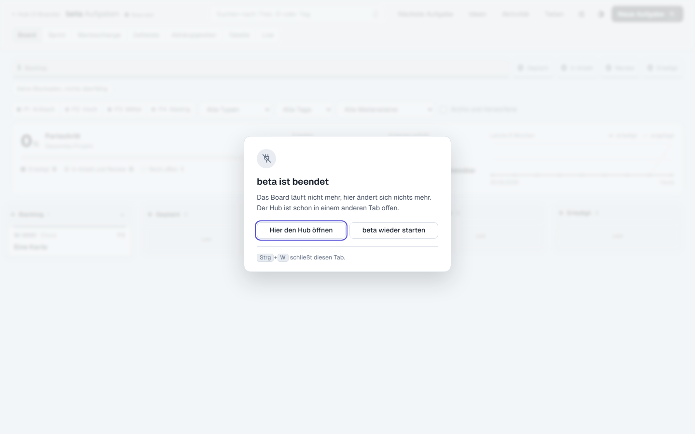
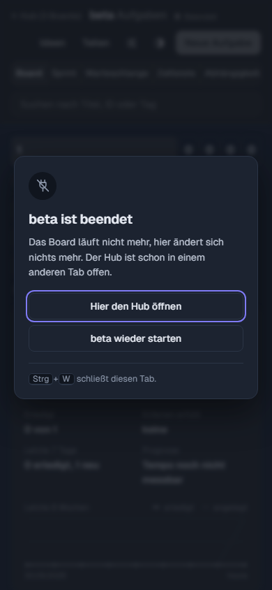

# Tab eines geschlossenen Boards schließt sich, statt zum zweiten Hub zu werden

## Ziel
<!-- Was ist nach Abschluss anders? Ein bis drei Sätze, aus Sicht des Ergebnisses formuliert. -->

## Beschreibung
Wunsch des Nutzers am 2026-11-24 (nach W-0049): Schließt sich ein Board (gestoppt, beendet) und ist es noch als Tab offen, soll sich dieser Tab schließen, damit am Ende nicht zwei Hub-Tabs offen sind. Heute wechselt der Tab eines beendeten Boards zum Hub oder zum verbliebenen Board (W-0032, W-0029), während oft schon ein Hub-Tab offen ist. Hinweis für die Umsetzung: Browser erlauben window.close() nur für Tabs, die per Skript geöffnet wurden; für von Hand geöffnete Tabs eine Lösung finden oder mit dem Nutzer klären (etwa: Tab schließt sich, wenn ein anderer works-Tab den Hub schon zeigt, sonst wird er selbst zum Hub).

## Kontext und Problem
<!-- Warum ist das nötig? Aktueller Zustand, Auslöser, Einschränkungen. -->

## Nutzerperspektive
<!-- Wer profitiert und wie? Optional: Als <Rolle> möchte ich <Fähigkeit>, damit <Nutzen>. -->

## Akzeptanzkriterien
- [x] Wird ein Board beendet, während sein Tab offen ist und schon ein Hub-Tab offen ist, bleibt am Ende nur ein Hub-Tab

## Umsetzungsplan
<!-- Konkrete Schritte in sinnvoller Reihenfolge. Unteraufgaben gehören hierher, nicht in eigene Ordner. -->
- [x] Selbsttests zuerst (rot): works board --stop schickt den offenen Tabs vorher event: ended, --restart nicht; im Browser: Tab an Board B, B wird gestoppt, die Karte „… ist beendet“ erscheint, Titel „Beendet · …“, kein Sprung zum Hub, bei 390 px kein seitliches Scrollen
- [x] Server: works board --stop (auch „Stoppen“ im Hub) kündigt das Ende über POST /api/hub {op:'end'} an, bevor es den Server beendet (unter Windows hart, ohne SIGTERM). Der Server zählt über /tabs der anderen laufenden Boards die offenen Tabs und Hub-Tabs, nennt einen anderen Hub und holt dort ein Einmal-Ticket für den Neustart, dann event: ended an alle Tabs. Ein Neustart (--restart, neue Version, Übergabe) sendet nichts; bricht nur die Verbindung ab, bleibt alles wie bisher (Neuverbinden, verwaister Tab W-0029)
- [x] Board (Entwurf B): bei ended Verbindung zu, Neuladen gesperrt, kein Sprung zum Hub; window.close() versuchen, ist der Tab danach noch offen, die ruhige Karte über dem grauen, unscharfen Board zeigen: „Hier den Hub öffnen“ nur, wenn ein anderes Board läuft, „<Projekt> wieder starten“ über dessen Hub mit dem Ticket, sonst Hinweis auf works board --serve; Satz zum anderen Tab nur, wenn er stimmt; Strg+W bzw. ⌘W, auf Touch ohne Tastenkürzel; Titel „Beendet · <Projekt>“, graues Favicon
- [x] Hub: #start=<Ticket> startet das Board und zeigt es im selben Tab; Hub-Seiten zählen unter /tabs zusätzlich als hubs
- [x] Texte in de.json, Doku board.md in beiden Sprachen

## Betroffene Dateien
<!-- Pfade mit kurzer Notiz, was dort passiert. -->

## Designentscheidungen
<!-- Kurzfassung der wichtigsten Entscheidungen. Details in decisions.md (works decisions <ID>). -->

## Assets

Beschreibung: Nachher, 1440 hell: Tab eines gestoppten Boards zeigt die Karte „beta ist beendet“ nach Entwurf B, Board grau und unscharf dahinter, Knöpfe Hier den Hub öffnen und beta wieder starten, Hinweis Strg+W
Art: nachher · Hinzugefügt: 2026-11-25

Beschreibung: Nachher, 390 dunkel: dieselbe Karte auf dem Handy ohne seitliches Scrollen
Art: nachher · Hinzugefügt: 2026-11-25

## Offene Fragen
<!-- Fragen an den Nutzer, die Claude nicht selbst klären kann. Format: - [ ] Frage -->
- [x] Vorschlag für den Fall, dass der Browser das Schließen verbietet: statt eines zweiten Hubs eine schlichte Seite „Board beendet“ mit Hinweis und Knopf „Hier den Hub öffnen“. Passt das so, oder soll ich vorher Entwürfe für diese Seite zeigen? Antwort: Nutzer am 2026-11-25: erst Entwürfe der Seite zeigen.

## Übergabe
Stand: 2026-11-25 20:40

Stand: umgesetzt und committet (8034cc8, Branch feature/w-0054-tab-eines-geschlossenen), noch nicht gemergt. Selbsttest voll grün: 69/69 mit Browser, 59/59 ohne WebSocket.

Was es tut: works board --stop (auch Stoppen im Hub, Strg+C im Terminal) kündigt das Ende über POST /api/hub {op:'end'} an. Der Server fragt die anderen laufenden Boards (/tabs mit tabs und hubs), holt bei einem davon ein Einmal-Ticket und schickt seinen Tabs event: ended, dann schließt er die Verbindungen. Ein Neustart schickt nichts. Der Tab springt nicht mehr zum Hub: window.close(), sonst Karte nach Entwurf B (Hier den Hub öffnen, <Projekt> wieder starten über /hub#start=<Ticket>, sonst Hinweis auf works board --serve), Titel Beendet · <Projekt>, graues Favicon. Läuft das Board wieder auf demselben Port, wird der Tab wieder live (wie W-0031).

Prüfen: Nachher-Bilder im Scratchpad ende54/nachher (1440 hell, 390 dunkel). Selbsttest-Schritte: Board-Ende: --stop … und Board-Ende im Browser …; WORKS_SELFTEST_SHOTS=<Ordner> legt die Bilder ab.

Offen: Hub-Seite eines gestoppten Boards (Tab auf B/hub) folgt weiter W-0032 und ignoriert ended. Ob ein von works board --open geöffneter Tab sich wirklich schließt, hängt vom Browser ab und ist nur für per Skript geöffnete Tabs geprüft. Touch ohne Tastenkürzel und ⌘W am Mac nicht automatisch geprüft. Tickets liegen im Speicher des ausstellenden Boards; nach dessen Neustart zeigt der Hub eine Meldung, dann hilft Öffnen. Konfliktgefahr mit W-0055 in board.js, board.css, template.html, selftest.mjs (andere Stellen; W-0055 macht die Kopfleiste bei langer Freigabe-Pille zu breit, deshalb nutzt der 390-px-Test eigene Projekte).

## Verlauf
- 2026-11-24: Aufgabe angelegt
- 2026-11-24: Priorität: P3 → P3
- 2026-11-25: Beziehung: W-0057 related
- 2026-11-25: Vorgehen ausgearbeitet (Umsetzungsplan) und Frage zum Fall „Browser verbietet das Schließen“ eingetragen; W-0057 ist ausgeliefert, damit entstehen zwei Hub-Tabs nur noch, wenn ein Board-Tab offen bleibt, dessen Board endet.
- 2026-11-25: Frage 1 geklärt: Nutzer am 2026-11-25: erst Entwürfe der Seite zeigen.
- 2026-11-25: Entwurf A „Leiste wie bei verwaisten Tabs“ angehängt
- 2026-11-25: Entwurf B „Ruhige Karte in der Mitte“ angehängt
- 2026-11-25: Entwurf C „Schlichte Seite statt Board“ angehängt
- 2026-11-25: Entwürfe A bis C (Fable 5.2) angehängt; Tab-Titel „Beendet · mycron“ mit grauem Symbol in allen drei. Wartet auf die Wahl des Nutzers.
- 2026-11-25: Entwurf B „Ruhige Karte in der Mitte“ gewählt. Grund: Nutzer am 2026-11-25: Beide B
- 2026-11-25: Priorität: P3 → P3; incomplete: true → false
- 2026-11-25: Parallel gestartet im Worktree W-0054-tab-eines-geschlossenen (Status: backlog → in-arbeit)
- 2026-11-25: Abschnitt Umsetzungsplan aktualisiert
- 2026-11-25: Umsetzungsplan an Entwurf B angepasst. Geprüft: Ein Tab am beendeten Board kann /boards anderer Boards nicht lesen und deren API nicht aufrufen (anderer Port = andere Herkunft, kein CORS, API prüft Origin und Token). Deshalb holt der stoppende Server die Angaben und ein Einmal-Ticket, der Neustart läuft über den Hub des anderen Boards im selben Tab.
- 2026-11-25: Umsetzungsplan: "Selbsttests zuerst (rot): works board --stop schickt den offenen Tabs vorher event: ended, --restart nicht; im Browser: Tab an Board B, B wird gestoppt, die Karte „… ist beendet“ erscheint, Titel „Beendet · …“, kein Sprung zum Hub, bei 390 px kein seitliches Scrollen" abgehakt
- 2026-11-25: Umsetzungsplan: "Server: works board --stop (auch „Stoppen“ im Hub) kündigt das Ende über POST /api/hub {op:'end'} an, bevor es den Server beendet (unter Windows hart, ohne SIGTERM). Der Server zählt über /tabs der anderen laufenden Boards die offenen Tabs und Hub-Tabs, nennt einen anderen Hub und holt dort ein Einmal-Ticket für den Neustart, dann event: ended an alle Tabs. Ein Neustart (--restart, neue Version, Übergabe) sendet nichts; bricht nur die Verbindung ab, bleibt alles wie bisher (Neuverbinden, verwaister Tab W-0029)" abgehakt
- 2026-11-25: Umsetzungsplan: "Board (Entwurf B): bei ended Verbindung zu, Neuladen gesperrt, kein Sprung zum Hub; window.close() versuchen, ist der Tab danach noch offen, die ruhige Karte über dem grauen, unscharfen Board zeigen: „Hier den Hub öffnen“ nur, wenn ein anderes Board läuft, „<Projekt> wieder starten“ über dessen Hub mit dem Ticket, sonst Hinweis auf works board --serve; Satz zum anderen Tab nur, wenn er stimmt; Strg+W bzw. ⌘W, auf Touch ohne Tastenkürzel; Titel „Beendet · <Projekt>“, graues Favicon" abgehakt
- 2026-11-25: Umsetzungsplan: "Hub: #start=<Ticket> startet das Board und zeigt es im selben Tab; Hub-Seiten zählen unter /tabs zusätzlich als hubs" abgehakt
- 2026-11-25: Umsetzungsplan: "Texte in de.json, Doku board.md in beiden Sprachen" abgehakt
- 2026-11-25: Akzeptanzkriterien: "Wird ein Board beendet, während sein Tab offen ist und schon ein Hub-Tab offen ist, bleibt am Ende nur ein Hub-Tab" abgehakt
- 2026-11-25: Umgesetzt (Commit 8034cc8): works board --stop kündigt das Ende an, Tabs bekommen event: ended, Karte nach Entwurf B, Neustart über Einmal-Ticket im Hub eines anderen Boards. Ergänzt: Der beendete Tab wird wieder live, sobald sein Board auf demselben Port zurück ist (W-0031, sonst öffnete works board --open morgens einen zweiten Tab); Ursache einer roten Prüfung war der Socket, den Node nach dem Ende von der Antwort löst, deshalb schließt der Server ihn selbst. Selbsttest voll: 69/69 mit Browser, 59/59 ohne WebSocket.
- 2026-11-25: Übergabe aktualisiert
- 2026-11-25: Status: in-arbeit → review (Grund: Agent fertig)
- 2026-11-25: Parallele Arbeit beendet
- 2026-11-25: Asset hinzugefügt: assets/2026-11-25-nachher-1440-hell-tab-eines-gestoppten-nachher.png (nachher)
- 2026-11-25: Asset hinzugefügt: assets/2026-11-25-nachher-390-dunkel-dieselbe-karte-auf-nachher.png (nachher)
